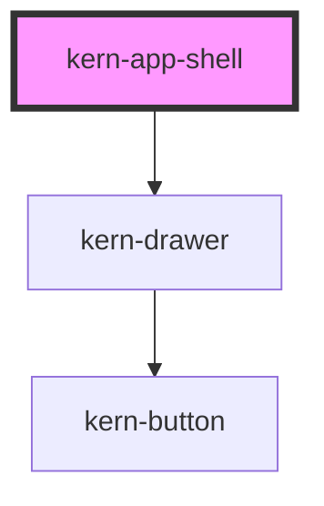

# kern-app-shell


<!-- Auto Generated Below -->


## Overview

Base layout of an app: topbar, optional side navigation, main content with a maximum width and page padding, and
an optional footer. Without the `sidebar` slot it is a plain page frame.

From `breakpoint` (960 px of shell width) the sidebar stands on the left and scrolls on its own; below it, it opens
as a modal drawer from the left. A kern-topbar in the `topbar` slot then gets a menu button (`menu`) that opens it;
with your own header call `toggleSidebar()`. A link click in the drawer closes it and moves focus to the main
content; after routing in `kernNavigate` call `focusMain()` for the same in the wide layout. A skip link («Skip to
content») leads past the navigation, and `<header>`, `<nav>` and `<main>` are landmarks (the navigation also
inside the drawer).

## Usage

### 01-page

# Page frame

Without a `sidebar` the shell is a plain page frame: the topbar stays at the top while scrolling, the content gets a maximum width (`width="normal"`, `wide` or `full`) and page padding that grows with the room. Tab once on the page to see the skip link. In an app the shell fills the window; the examples set a smaller `min-height`.

```html
<kern-app-shell style="min-height:360px">
  <kern-topbar slot="topbar" app-name="Netzwerk" suite="Homelab">
    <a slot="nav" href="#" aria-current="page">Devices</a>
    <a slot="nav" href="#">Leases</a>
    <kern-theme-toggle slot="end" small></kern-theme-toggle>
  </kern-topbar>
  <kern-page-header heading="Devices" description="38 devices in 4 networks"></kern-page-header>
  <kern-grid min="180px" gap="sm">
    <kern-stat label="Online" value="36" unit="/ 38"></kern-stat>
    <kern-stat label="Leases" value="112"></kern-stat>
    <kern-stat label="Blocked (24 h)" value="1’204"></kern-stat>
  </kern-grid>
  <span slot="footer">Netzwerk 2.3 · Homelab</span>
</kern-app-shell>
```


### 02-sidebar

# With a side navigation

Content in the `sidebar` slot stands on the left from `breakpoint` (960 px of shell width; 700 px here, so the example shows both states when you resize the window). Below it the side navigation is a drawer: kern-topbar gets a menu button that opens it, Escape and the backdrop close it, and a click on a link closes it too. In both layouts the slot sits in a `<nav>` landmark.

Build the navigation from `kern-list variant="nav"`, one list per group with a `heading`. Icons go into the `start` slot of kern-list-item, counters into `meta` as `kern-badge mono`, and `current` marks the open page (`aria-current="page"`). A link click emits `kernNavigate`; call `preventDefault()` there to route in your app, move `current` and call `focusMain()`; Fundamentals › Layout › Navigation has the details.

```html
<kern-app-shell breakpoint="700" style="min-height:460px">
  <kern-topbar slot="topbar" app-name="Shelly Manager">
    <kern-language-select slot="end" size="sm" value="en" languages="en,de" display="code"></kern-language-select>
  </kern-topbar>
  <div slot="sidebar">
    <kern-list variant="nav" heading="Home">
      <kern-list-item heading="Overview" href="#overview" current><kern-icon slot="start" name="home"></kern-icon></kern-list-item>
      <kern-list-item heading="Devices" href="#devices">
        <kern-icon slot="start" name="power"></kern-icon>
        <kern-badge slot="meta" mono>38</kern-badge>
      </kern-list-item>
      <kern-list-item heading="Lights" href="#lights"><kern-icon slot="start" name="bulb"></kern-icon></kern-list-item>
      <kern-list-item heading="Climate" href="#climate"><kern-icon slot="start" name="thermometer"></kern-icon></kern-list-item>
    </kern-list>
    <kern-list variant="nav" heading="System">
      <kern-list-item heading="Updates" href="#updates">
        <kern-icon slot="start" name="refresh"></kern-icon>
        <kern-badge slot="meta" mono tone="accent">3</kern-badge>
      </kern-list-item>
      <kern-list-item heading="Network" href="#network"><kern-icon slot="start" name="wifi"></kern-icon></kern-list-item>
      <kern-list-item heading="Settings" href="#settings"><kern-icon slot="start" name="settings"></kern-icon></kern-list-item>
    </kern-list>
  </div>
  <kern-page-header heading="Overview"></kern-page-header>
  <kern-grid columns="12">
    <kern-grid-item span="12" span-md="8"><kern-card heading="Devices">36 of 38 online</kern-card></kern-grid-item>
    <kern-grid-item span="12" span-md="4"><kern-card heading="Updates">3 available</kern-card></kern-grid-item>
  </kern-grid>
</kern-app-shell>
```

```js
// A tiny router: mark the link as current, show its page, focus the content.
const shell = root.querySelector('kern-app-shell');
root.addEventListener('kernNavigate', (e) => {
  e.preventDefault();
  const item = e.target;
  for (const el of shell.querySelectorAll('kern-list-item[current]')) el.current = false;
  item.current = true;
  shell.querySelector('kern-page-header').heading = item.heading;
  shell.focusMain(); // keyboard and screen reader users continue in the new content
});
```


### 03-custom-topbar

# Own header

With your own header in the `topbar` slot, open the drawer with `toggleSidebar()`; `kernSidebarToggle` reports `{ open }`, e.g. for `aria-expanded` on your button.

```html
<kern-app-shell breakpoint="10000" style="min-height:300px">
  <header slot="topbar" style="display:flex;align-items:center;gap:8px;height:48px;padding:0 16px;border-bottom:1px solid var(--line);background:var(--surface)">
    <kern-button class="open" size="sm" variant="ghost" aria-expanded="false">Menu</kern-button>
    <strong>Werkstatt</strong>
  </header>
  <nav slot="sidebar" style="display:grid;gap:8px">
    <kern-link href="#">Orders</kern-link>
    <kern-link href="#">Stock</kern-link>
  </nav>
  <p style="margin:0">The side navigation is always a drawer here (<code>breakpoint="10000"</code>).</p>
</kern-app-shell>
```

```js
const shell = root.querySelector('kern-app-shell');
const button = root.querySelector('.open');
button.addEventListener('click', () => shell.toggleSidebar());
shell.addEventListener('kernSidebarToggle', (e) => button.setAttribute('aria-expanded', String(e.detail.open)));
root.addEventListener('kernNavigate', (e) => e.preventDefault()); // demo only
```


## Properties

| Property          | Attribute          | Description                                                                                 | Type                           | Default     |
| ----------------- | ------------------ | ------------------------------------------------------------------------------------------- | ------------------------------ | ----------- |
| `breakpoint`      | `breakpoint`       | Shell width in px from which the sidebar stands next to the content; below, it is a drawer. | `number`                       | `960`       |
| `labelNavigation` | `label-navigation` | Accessible name of the side navigation and title of the drawer.                             | `string \| undefined`          | `undefined` |
| `labelSkip`       | `label-skip`       | Text of the skip link.                                                                      | `string \| undefined`          | `undefined` |
| `sidebarOpen`     | `sidebar-open`     | Whether the drawer with the side navigation is open (narrow layout only).                   | `boolean`                      | `false`     |
| `sidebarWidth`    | `sidebar-width`    | Width of the side navigation in px.                                                         | `number`                       | `240`       |
| `width`           | `width`            | Maximum content width: `normal` (`--content-max`), `wide` (`--content-wide`) or `full`.     | `"full" \| "normal" \| "wide"` | `'normal'`  |


## Events

| Event               | Description                                           | Type                              |
| ------------------- | ----------------------------------------------------- | --------------------------------- |
| `kernSidebarToggle` | The drawer with the side navigation opened or closed. | `CustomEvent<{ open: boolean; }>` |


## Methods

### `focusMain() => Promise<void>`

Moves focus to the main content, e.g. after a navigation without page load, so keyboard and screen reader users
continue there. While the drawer is open (everything else is inert) it waits until the drawer has closed.

#### Returns

Type: `Promise<void>`


### `toggleSidebar(open?: boolean) => Promise<void>`

Opens or closes the drawer with the side navigation (narrow layout); without an argument it toggles.

#### Parameters

| Name   | Type      | Description |
| ------ | --------- | ----------- |
| `open` | `boolean` |             |

#### Returns

Type: `Promise<void>`


## Slots

| Slot        | Description                                                        |
| ----------- | ------------------------------------------------------------------ |
|             | Main content (kern-page-header, kern-grid …)                       |
| `"footer"`  | Below the content                                                  |
| `"sidebar"` | Side navigation, e.g. a kern-list with links                       |
| `"topbar"`  | kern-topbar (or your own header); stays at the top while scrolling |


## Shadow Parts

| Part        | Description                              |
| ----------- | ---------------------------------------- |
| `"footer"`  | The footer                               |
| `"main"`    | The main area                            |
| `"sidebar"` | The side navigation column (wide layout) |


## Dependencies

### Depends on

- [kern-drawer](../kern-drawer)

### Graph


----------------------------------------------


