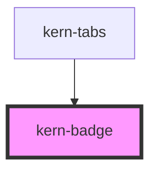

# kern-badge

<!-- Auto Generated Below -->

## Overview

Short label for properties (Gen, firmware, function) and results in tables. At most two words;
device states use kern-status instead.

## Properties

| Property | Attribute | Description                          | Type                                                  | Default     |
| -------- | --------- | ------------------------------------ | ----------------------------------------------------- | ----------- |
| `mono`   | `mono`    | Monospace text for versions and IDs. | `boolean`                                             | `false`     |
| `tone`   | `tone`    |                                      | `"accent" \| "danger" \| "neutral" \| "ok" \| "warn"` | `'neutral'` |

## Slots

| Slot | Description |
| ---- | ----------- |
|      | Badge text  |

## Dependencies

### Used by

 - [kern-tabs](../kern-tabs)

### Graph

----------------------------------------------

