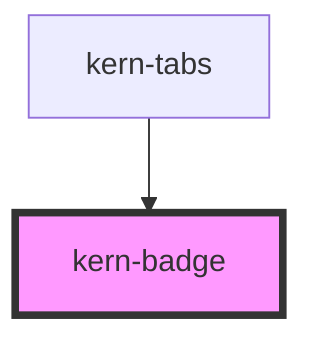

# kern-badge


<!-- Auto Generated Below -->


## Overview

Short label for properties (Gen, firmware, function) and results in tables. At most two words;
device states use kern-status instead.

## Usage

### 01-tones

# Tones

Badges label properties and results in at most two words. `tone` colours them; `neutral` is the default for plain properties such as the device generation. Device states belong in kern-status.

```html
<div style="display:flex;flex-wrap:wrap;gap:8px;align-items:center">
  <kern-badge>Gen2</kern-badge>
  <kern-badge tone="accent">Template</kern-badge>
  <kern-badge tone="ok">connected</kern-badge>
  <kern-badge tone="warn">Update</kern-badge>
  <kern-badge tone="danger">Auth failed</kern-badge>
</div>
```


### 02-mono

# Versions and IDs

`mono` sets the text in monospace for firmware versions, IDs and similar values. Badges sit well next to a name in a table cell.

```html
<p style="margin:0;display:flex;flex-wrap:wrap;gap:8px;align-items:center">
  Küche Licht <kern-badge tone="warn">Update</kern-badge>
  <kern-badge mono>1.4.4</kern-badge>
  <kern-badge mono tone="accent">1.5.0-beta2</kern-badge>
</p>
```


## Properties

| Property | Attribute | Description                          | Type                                                  | Default     |
| -------- | --------- | ------------------------------------ | ----------------------------------------------------- | ----------- |
| `mono`   | `mono`    | Monospace text for versions and IDs. | `boolean`                                             | `false`     |
| `tone`   | `tone`    |                                      | `"accent" \| "danger" \| "neutral" \| "ok" \| "warn"` | `'neutral'` |


## Slots

| Slot | Description |
| ---- | ----------- |
|      | Badge text  |


## Dependencies

### Used by

 - [kern-tabs](../kern-tabs)

### Graph


----------------------------------------------


