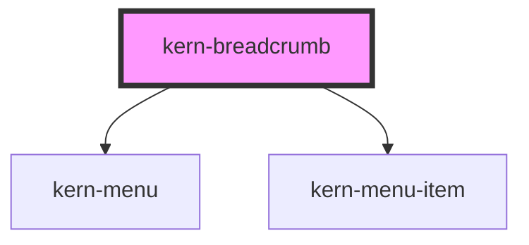

# kern-breadcrumb

<!-- Auto Generated Below -->

## Overview

Path back through a hierarchy (Standort › Raum › Gerät › Einstellungen): child links (kern-link or `<a>`), the last
child is the current page (`aria-current="page"`). With `max-items` the middle entries collapse into a „…“ menu;
picking one clicks the original link, so app routers still handle it.

## Properties

| Property    | Attribute    | Description                                                                 | Type     | Default            |
| ----------- | ------------ | --------------------------------------------------------------------------- | -------- | ------------------ |
| `label`     | `label`      | Accessible name of the navigation.                                          | `string` | `'Pfad'`           |
| `labelMore` | `label-more` |                                                                             | `string` | `'Weitere Ebenen'` |
| `maxItems`  | `max-items`  | Show at most this many entries (first, „…“ and the last ones); 0 shows all. | `number` | `0`                |

## Slots

| Slot | Description                                                       |
| ---- | ----------------------------------------------------------------- |
|      | Links; the last one (or a plain text element) is the current page |

## Dependencies

### Depends on

- [kern-menu](../kern-menu)
- [kern-menu-item](../kern-menu-item)

### Graph

----------------------------------------------

