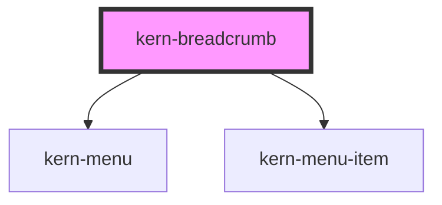

# kern-breadcrumb


<!-- Auto Generated Below -->


## Overview

Path back through a hierarchy (Standort › Raum › Gerät › Einstellungen): child links (kern-link or `<a>`), the last
child is the current page (`aria-current="page"`). With `max-items` the middle entries collapse into a „…“ menu;
picking one clicks the original link, so app routers still handle it.

## Usage

### 01-basic

# Path to the current page

Children are links (kern-link or `<a>`); the last child is the current page and gets `aria-current="page"`. A plain text element works for the last entry. `label` names the navigation.

```html
<kern-breadcrumb>
  <kern-link href="#">Haus Seeblick</kern-link>
  <kern-link href="#">Ground floor</kern-link>
  <kern-link href="#">Bath</kern-link>
  <span>Bad Lüftung</span>
</kern-breadcrumb>
```


### 02-max-items

# Collapsing long paths

With `max-items` the middle entries fold into a „…“ menu that keeps the first and the last entries visible. Picking an entry clicks the original link, so app routers still handle it. `label-more` names the menu button.

```html
<kern-breadcrumb max-items="4">
  <kern-link href="#">Haus Seeblick</kern-link>
  <kern-link href="#">Ground floor</kern-link>
  <kern-link href="#">Bath</kern-link>
  <kern-link href="#">Bad Lüftung</kern-link>
  <kern-link href="#">Settings</kern-link>
  <span>Wi-Fi</span>
</kern-breadcrumb>
```


## Properties

| Property    | Attribute    | Description                                                                 | Type                  | Default     |
| ----------- | ------------ | --------------------------------------------------------------------------- | --------------------- | ----------- |
| `label`     | `label`      | Accessible name of the navigation.                                          | `string \| undefined` | `undefined` |
| `labelMore` | `label-more` |                                                                             | `string \| undefined` | `undefined` |
| `maxItems`  | `max-items`  | Show at most this many entries (first, „…“ and the last ones); 0 shows all. | `number`              | `0`         |


## Slots

| Slot | Description                                                       |
| ---- | ----------------------------------------------------------------- |
|      | Links; the last one (or a plain text element) is the current page |


## Dependencies

### Depends on

- [kern-menu](../kern-menu)
- [kern-menu-item](../kern-menu-item)

### Graph


----------------------------------------------


