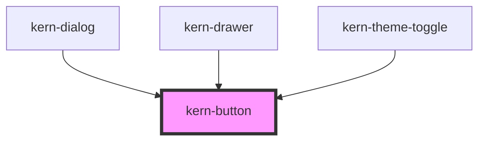

# kern-button

<!-- Auto Generated Below -->

## Overview

Button for actions. One `primary` per area; `danger` for destructive actions; `icon-only` needs `label`.
Works as a form submit/reset button through ElementInternals.

## Properties

| Property   | Attribute   | Description                                                                            | Type                                            | Default     |
| ---------- | ----------- | -------------------------------------------------------------------------------------- | ----------------------------------------------- | ----------- |
| `busy`     | `busy`      | Shows a spinner and sets aria-busy; clicks are ignored.                                | `boolean`                                       | `false`     |
| `disabled` | `disabled`  |                                                                                        | `boolean`                                       | `false`     |
| `download` | `download`  | With `href`: download instead of navigate (optionally with this file name).            | `boolean \| string \| undefined`                | `undefined` |
| `href`     | `href`      | Renders a link instead of a button.                                                    | `string \| undefined`                           | `undefined` |
| `iconOnly` | `icon-only` | Square button that shows only the `start` slot or default slot icon. Requires `label`. | `boolean`                                       | `false`     |
| `label`    | `label`     | Accessible name (required for icon-only buttons).                                      | `string \| undefined`                           | `undefined` |
| `size`     | `size`      | `sm` = 28px for tables and toolbars.                                                   | `"md" \| "sm"`                                  | `'md'`      |
| `target`   | `target`    |                                                                                        | `string \| undefined`                           | `undefined` |
| `type`     | `type`      |                                                                                        | `"button" \| "reset" \| "submit"`               | `'button'`  |
| `variant`  | `variant`   | Visual weight.                                                                         | `"danger" \| "default" \| "ghost" \| "primary"` | `'default'` |

## Slots

| Slot      | Description          |
| --------- | -------------------- |
|           | Button text          |
| `"start"` | Icon before the text |

## Shadow Parts

| Part        | Description               |
| ----------- | ------------------------- |
| `"control"` | The native button or link |

## Dependencies

### Used by

 - [kern-dialog](../kern-dialog)
 - [kern-drawer](../kern-drawer)
 - [kern-theme-toggle](../kern-theme-toggle)

### Graph

----------------------------------------------

