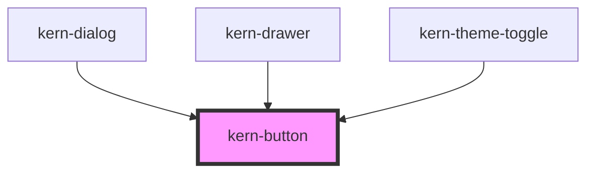

# kern-button


<!-- Auto Generated Below -->


## Overview

Button for actions. One `primary` per area; `danger` for destructive actions; `icon-only` needs `label`.
Works as a form submit/reset button through ElementInternals.

## Usage

### 01-variants

# Variants and sizes

`variant` sets the visual weight: one `primary` per area, `ghost` for quiet actions, `danger` for destructive ones. `size="sm"` (28px) fits tables and toolbars.

```html
<div style="display:flex;flex-wrap:wrap;gap:12px;align-items:center">
  <kern-button variant="primary">Start scan</kern-button>
  <kern-button>Export CSV</kern-button>
  <kern-button variant="ghost">Snapshot</kern-button>
  <kern-button variant="danger">Factory reset …</kern-button>
  <kern-button size="sm">Update</kern-button>
  <kern-button size="sm" variant="ghost">Search again</kern-button>
</div>
```


### 02-icons-and-states

# Icons, busy and disabled

Put a kern-icon into the `start` slot before the text. `icon-only` shows just the icon and needs `label` as its accessible name. `busy` shows a spinner, sets `aria-busy` and ignores clicks; `disabled` turns the button off.

```html
<div style="display:flex;flex-wrap:wrap;gap:12px;align-items:center">
  <kern-button><kern-icon slot="start" name="refresh"></kern-icon>Refresh status</kern-button>
  <kern-button variant="ghost" icon-only label="Restart Bad Lüftung"><kern-icon name="power"></kern-icon></kern-button>
  <kern-button size="sm" variant="ghost" icon-only label="Edit"><kern-icon name="edit"></kern-icon></kern-button>
  <kern-button variant="primary" busy>Scanning …</kern-button>
  <kern-button disabled>Disabled</kern-button>
</div>
```


### 03-forms-and-links

# In forms and as a link

`type="submit"` and `type="reset"` work inside a `<form>` like native buttons. With `href` the button renders a link, e.g. to download a backup; use it when an action navigates.

```html
<form style="display:grid;gap:12px;max-width:320px">
  <kern-input name="name" label="Name" value="Bad Lüftung"></kern-input>
  <div style="display:flex;gap:8px;justify-content:flex-end">
    <kern-button href="data:application/json,%7B%7D" download="bad-lueftung.json" variant="ghost">
      <kern-icon slot="start" name="download"></kern-icon>Backup
    </kern-button>
    <kern-button type="reset" variant="ghost">Reset</kern-button>
    <kern-button type="submit" variant="primary">Save</kern-button>
  </div>
  <p class="out" style="margin:0;font-size:13px;color:var(--text-muted)"></p>
</form>
```

```js
root.querySelector('form').addEventListener('submit', (e) => {
  e.preventDefault();
  root.querySelector('.out').textContent = 'submit → ' + JSON.stringify(Object.fromEntries(new FormData(e.target)));
});
```


## Properties

| Property   | Attribute   | Description                                                                            | Type                                            | Default     |
| ---------- | ----------- | -------------------------------------------------------------------------------------- | ----------------------------------------------- | ----------- |
| `busy`     | `busy`      | Shows a spinner and sets aria-busy; clicks are ignored.                                | `boolean`                                       | `false`     |
| `disabled` | `disabled`  |                                                                                        | `boolean`                                       | `false`     |
| `download` | `download`  | With `href`: download instead of navigate (optionally with this file name).            | `boolean \| string \| undefined`                | `undefined` |
| `href`     | `href`      | Renders a link instead of a button.                                                    | `string \| undefined`                           | `undefined` |
| `iconOnly` | `icon-only` | Square button that shows only the `start` slot or default slot icon. Requires `label`. | `boolean`                                       | `false`     |
| `label`    | `label`     | Accessible name (required for icon-only buttons).                                      | `string \| undefined`                           | `undefined` |
| `size`     | `size`      | `sm` = 28px for tables and toolbars.                                                   | `"md" \| "sm"`                                  | `'md'`      |
| `target`   | `target`    |                                                                                        | `string \| undefined`                           | `undefined` |
| `type`     | `type`      |                                                                                        | `"button" \| "reset" \| "submit"`               | `'button'`  |
| `variant`  | `variant`   | Visual weight.                                                                         | `"danger" \| "default" \| "ghost" \| "primary"` | `'default'` |


## Slots

| Slot      | Description          |
| --------- | -------------------- |
|           | Button text          |
| `"start"` | Icon before the text |


## Shadow Parts

| Part        | Description               |
| ----------- | ------------------------- |
| `"control"` | The native button or link |


## Dependencies

### Used by

 - [kern-dialog](../kern-dialog)
 - [kern-drawer](../kern-drawer)
 - [kern-theme-toggle](../kern-theme-toggle)

### Graph


----------------------------------------------


