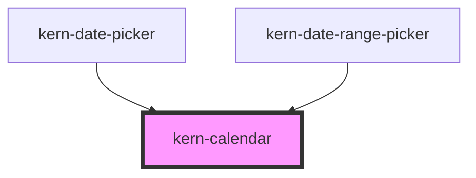

# kern-calendar


<!-- Auto Generated Below -->


## Overview

Month view for picking a date or a range, inline or inside a picker. Values are ISO dates (`2026-10-19`).
Keyboard (one tab stop): arrows move by day/week, Home/End to the start/end of the week, Page Up/Down by month,
with Shift by year, Enter or Space picks. In range mode the first pick sets `start`, the second `end`
(swapped if earlier); the range is previewed on hover and focus until then, Escape discards it.

## Usage

### 01-single

# Pick a date

An inline month view; `value` is an ISO date and `kernChange` reports `{ value }`. `show-week-numbers` adds ISO weeks (column header `label-week`), and the `footer` slot takes actions such as a “Today” button that uses `goTo()`.

```html
<kern-calendar label="Maintenance day" show-week-numbers label-week="Wk" label-prev="Previous month" label-next="Next month">
  <kern-button slot="footer" size="sm" variant="ghost">Today</kern-button>
</kern-calendar>
<pre class="out" style="font:12px var(--font-mono);color:var(--text-muted)"></pre>
```

```js
const cal = root.querySelector('kern-calendar');
const out = root.querySelector('.out');
const iso = (d) => new Date(d.getTime() - d.getTimezoneOffset() * 60000).toISOString().slice(0, 10);
root.querySelector('kern-button').addEventListener('click', () => {
  cal.value = iso(new Date());
  cal.goTo(cal.value);
});
cal.addEventListener('kernChange', (e) => (out.textContent = 'kernChange → ' + JSON.stringify(e.detail)));
```


### 02-range

# Pick a range

With `range` the first pick sets `start`, the second `end`, and `kernChange` reports `{ start, end }`. `months="2"` shows two months side by side; `max-days` locks days farther than that from `start`.

```html
<kern-calendar range months="2" max-days="14" label="Evaluation period" label-prev="Previous month" label-next="Next month"></kern-calendar>
<pre class="out" style="font:12px var(--font-mono);color:var(--text-muted)"></pre>
```

```js
const out = root.querySelector('.out');
root.querySelector('kern-calendar').addEventListener('kernChange', (e) => (out.textContent = 'kernChange → ' + JSON.stringify(e.detail)));
```


### 03-limits

# Limits and disabled days

`min` and `max` bound the selectable dates; `isDateDisabled` is a property taking a function from ISO date to boolean, e.g. to block weekends. Here only workdays in the last three months can be picked.

```html
<kern-calendar label="Report day" label-prev="Previous month" label-next="Next month"></kern-calendar>
```

```js
const cal = root.querySelector('kern-calendar');
const iso = (d) => new Date(d.getTime() - d.getTimezoneOffset() * 60000).toISOString().slice(0, 10);
const today = new Date();
cal.min = iso(new Date(today.getFullYear(), today.getMonth() - 3, today.getDate()));
cal.max = iso(today);
cal.isDateDisabled = (d) => [0, 6].includes(new Date(d + 'T00:00').getDay());
```


## Properties

| Property          | Attribute           | Description                                                                                    | Type                                      | Default              |
| ----------------- | ------------------- | ---------------------------------------------------------------------------------------------- | ----------------------------------------- | -------------------- |
| `end`             | `end`               | Range end (range mode).                                                                        | `string \| undefined`                     | `undefined`          |
| `firstDayOfWeek`  | `first-day-of-week` | 0 = Sunday … 6 = Saturday; defaults to the locale (Monday for de).                             | `number \| undefined`                     | `undefined`          |
| `isDateDisabled`  | --                  | Additional rule for unselectable days, e.g. weekends.                                          | `((iso: string) => boolean) \| undefined` | `undefined`          |
| `label`           | `label`             | Accessible name of the calendar.                                                               | `string`                                  | `'Kalender'`         |
| `labelNext`       | `label-next`        |                                                                                                | `string`                                  | `'Nächster Monat'`   |
| `labelPrev`       | `label-prev`        |                                                                                                | `string`                                  | `'Vorheriger Monat'` |
| `labelWeek`       | `label-week`        | Column header of the week numbers.                                                             | `string`                                  | `'KW'`               |
| `locale`          | `locale`            | BCP 47 locale; defaults to `<html lang>`, then the browser language.                           | `string \| undefined`                     | `undefined`          |
| `max`             | `max`               | Latest selectable date.                                                                        | `string \| undefined`                     | `undefined`          |
| `maxDays`         | `max-days`          | Range mode: longest range in days (inclusive); farther days are locked once `start` is picked. | `number \| undefined`                     | `undefined`          |
| `min`             | `min`               | Earliest selectable date.                                                                      | `string \| undefined`                     | `undefined`          |
| `months`          | `months`            | Months shown side by side.                                                                     | `1 \| 2`                                  | `1`                  |
| `range`           | `range`             | Pick a range (`start`/`end`) instead of a single `value`.                                      | `boolean`                                 | `false`              |
| `showWeekNumbers` | `show-week-numbers` | ISO week numbers in front of each row.                                                         | `boolean`                                 | `false`              |
| `start`           | `start`             | Range start (range mode).                                                                      | `string \| undefined`                     | `undefined`          |
| `value`           | `value`             | Selected date (single mode).                                                                   | `string \| undefined`                     | `undefined`          |


## Events

| Event             | Description                                                               | Type                                                                 |
| ----------------- | ------------------------------------------------------------------------- | -------------------------------------------------------------------- |
| `kernChange`      | A date was picked (`{ value }`), or a range completed (`{ start, end }`). | `CustomEvent<{ start: string; end: string; } \| { value: string; }>` |
| `kernMonthChange` | The shown month changed (`month` 1–12).                                   | `CustomEvent<{ year: number; month: number; }>`                      |


## Methods

### `goTo(iso: string) => Promise<void>`

Show the month of an ISO date and move the tab stop there (does not select).

#### Parameters

| Name  | Type     | Description |
| ----- | -------- | ----------- |
| `iso` | `string` |             |

#### Returns

Type: `Promise<void>`


### `setFocus() => Promise<void>`

Focus the active day.

#### Returns

Type: `Promise<void>`


## Slots

| Slot       | Description                                    |
| ---------- | ---------------------------------------------- |
| `"footer"` | Actions below the month, e.g. a „Heute“ button |


## Shadow Parts

| Part    | Description     |
| ------- | --------------- |
| `"day"` | Each day button |


## Dependencies

### Used by

 - [kern-date-picker](../kern-date-picker)
 - [kern-date-range-picker](../kern-date-range-picker)

### Graph


----------------------------------------------


