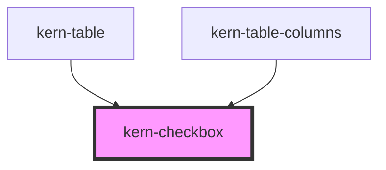

# kern-checkbox


<!-- Auto Generated Below -->


## Overview

Checkbox for selection and filters ("nur mit Firmware-Update", device selection), form-associated.

## Usage

### 01-basic

# Checkboxes and filters

Slotted text is the label; Space toggles. `disabled` boxes cannot be changed and are left out of the form.

```html
<div style="display:grid;gap:12px">
  <kern-checkbox checked>Only with firmware update</kern-checkbox>
  <kern-checkbox>Show offline devices</kern-checkbox>
  <kern-checkbox checked disabled>Include Gen 1 devices (not supported)</kern-checkbox>
</div>
```


### 02-select-all

# Select all with indeterminate

`indeterminate` shows the mixed state, e.g. when some devices are selected; it is cleared on user input. Without visible text, set `label` as the accessible name.

```html
<div style="display:grid;gap:8px">
  <kern-checkbox class="all">All devices</kern-checkbox>
  <div style="display:grid;gap:8px;padding-left:24px">
    <kern-checkbox class="one" name="device" value="kitchen" checked>Kitchen Light</kern-checkbox>
    <kern-checkbox class="one" name="device" value="fan">Bathroom Fan</kern-checkbox>
    <kern-checkbox class="one" name="device" value="garage">Garage Door</kern-checkbox>
  </div>
</div>
```

```js
const all = root.querySelector('.all');
const items = [...root.querySelectorAll('.one')];
const sync = () => {
  const n = items.filter((i) => i.checked).length;
  all.checked = n === items.length;
  all.indeterminate = n > 0 && n < items.length;
};
all.addEventListener('kernChange', (e) => items.forEach((i) => (i.checked = e.detail.checked)));
items.forEach((i) => i.addEventListener('kernChange', sync));
sync();
```


## Properties

| Property        | Attribute       | Description                                                                    | Type                  | Default     |
| --------------- | --------------- | ------------------------------------------------------------------------------ | --------------------- | ----------- |
| `checked`       | `checked`       |                                                                                | `boolean`             | `false`     |
| `disabled`      | `disabled`      |                                                                                | `boolean`             | `false`     |
| `indeterminate` | `indeterminate` | Mixed state, e.g. "some devices selected". Cleared on user input.              | `boolean`             | `false`     |
| `label`         | `label`         | Accessible name when there is no visible text (e.g. row selection in a table). | `string \| undefined` | `undefined` |
| `name`          | `name`          |                                                                                | `string \| undefined` | `undefined` |
| `value`         | `value`         |                                                                                | `string`              | `'on'`      |


## Events

| Event        | Description | Type                                 |
| ------------ | ----------- | ------------------------------------ |
| `kernChange` |             | `CustomEvent<{ checked: boolean; }>` |


## Slots

| Slot | Description |
| ---- | ----------- |
|      | Label text  |


## Shadow Parts

| Part    | Description     |
| ------- | --------------- |
| `"box"` | The visible box |


## Dependencies

### Used by

 - [kern-table](../kern-table)
 - [kern-table-columns](../kern-table-columns)

### Graph


----------------------------------------------


