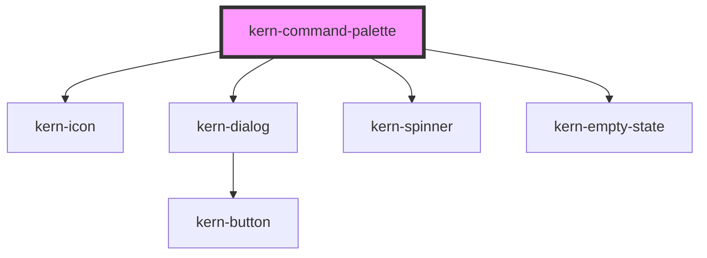

# kern-command-palette


<!-- Auto Generated Below -->


## Overview

Search field over pages, devices and actions in a modal (`kern-dialog`), to reach them by keyboard: «Boiler»,
«Updates», «Start scan». Open it with a button calling `show()`, by setting `open`, or with Ctrl+K / Cmd+K when
`shortcut` is set.

Choosing an entry closes the palette and reports its `id` in `kernSelect`; navigating, permissions and running the
action stay with the app (dangerous actions go through its confirmation, e.g. `confirm()`). Disabled entries are
shown but cannot be chosen.

By default the palette searches `items` itself: every word must occur in the label, a keyword or the group (case
and diacritics ignored); label matches rank first and are highlighted. With `filtering="external"` it shows `items`
as given: load results on `kernQueryChange` and set `items`, `loading` and `error`. Ignore answers to older queries
yourself (see the example), so a slow response cannot overwrite newer results.

Keyboard: Arrow Up/Down, Home and End move the active entry, Enter chooses it, Escape (or a click on the backdrop)
closes. The focus is in the search field while open and returns to where it was (the button, a field) on close.
The number of results is announced politely once typing pauses («5 results»).

`shortcut` registers one keydown listener on the document, removed with the last palette that uses it. Enable it
on one palette per page; with several, the open one closes and otherwise the last connected one opens. It does
not open while a modal dialog is open (kern-dialog, kern-drawer or a native one, also inside shadow roots), and
ignores keys an app handler already took (`preventDefault`).

## Usage

### 01-local

# Local search

Give the palette all `items` and it searches them itself: every word must occur in the label, a keyword or the group (case and diacritics ignored, so «kuche» finds «Küche Licht»). Label matches rank first and are highlighted; `keywords` make an IP, a MAC or a synonym findable without showing it. Groups appear in the order of their first entry.

Open it with a button calling `show()`, or with Ctrl+K / Cmd+K: `shortcut` is off by default, so enable it on one palette per page. Arrow keys, Home and End move the active entry (disabled ones are skipped), Enter or a click chooses, Escape or a click on the backdrop closes, and the focus returns to where it was.

`kernSelect` reports only the `id`; the palette is already closed. Navigating, permissions and running the action are up to your app, and dangerous actions go through its usual confirmation, here `confirm()`.

```html
<kern-button class="open">
  <kern-icon name="search" slot="start"></kern-icon>
  Search <kbd aria-hidden="true" style="margin-left:8px;font:12px var(--font-mono);color:var(--text-muted)">Ctrl K</kbd>
</kern-button>
<p class="out" style="font-size:13px;color:var(--text-muted)"></p>
<kern-command-palette shortcut></kern-command-palette>
```

```js
const { confirm } = await import('../kern/index.esm.js');
const palette = root.querySelector('kern-command-palette');
const out = root.querySelector('.out');
if (/Mac|iPhone|iPad/.test(navigator.platform)) root.querySelector('kbd').textContent = '⌘K';
palette.items = [
  { id: 'page-devices', label: 'Devices', group: 'Pages', icon: 'home', description: 'All devices of Haus Seeblick' },
  { id: 'page-updates', label: 'Updates', group: 'Pages', icon: 'download', keywords: ['firmware'] },
  { id: 'page-settings', label: 'Settings', group: 'Pages', icon: 'settings' },
  { id: 'dev-bath', label: 'Bad Lüftung', group: 'Devices', icon: 'wifi', description: 'Shelly Plus 1PM · 192.168.1.21', keywords: ['192.168.1.21', 'fan'] },
  { id: 'dev-kitchen', label: 'Küche Licht', group: 'Devices', icon: 'bulb', description: 'Shelly 1 Mini Gen3 · 192.168.1.22', keywords: ['192.168.1.22'] },
  { id: 'dev-shutter', label: 'Rollladen Süd', group: 'Devices', icon: 'wifi', description: 'Shelly Plus 2PM · offline', keywords: ['192.168.1.23', 'blind'] },
  { id: 'act-scan', label: 'Start network scan', group: 'Actions', icon: 'search' },
  { id: 'act-restart', label: 'Restart Küche Licht', group: 'Actions', icon: 'power' },
  { id: 'act-reset', label: 'Factory reset Rollladen Süd', group: 'Actions', icon: 'trash', description: 'Device is offline', disabled: true },
];
root.querySelector('.open').addEventListener('click', () => palette.show());
palette.addEventListener('kernSelect', async (e) => {
  const { id } = e.detail;
  if (id === 'act-restart') {
    const ok = await confirm({ heading: 'Restart Küche Licht?', message: 'The light is unreachable for about 10 seconds.', confirmLabel: 'Restart' });
    out.textContent = ok ? 'Restarting Küche Licht …' : 'Restart cancelled';
    return;
  }
  // Your router or action handler takes over here.
  out.textContent = `kernSelect → ${id}`;
});
```


### 02-server

# Server search

With `filtering="external"` the palette shows `items` as given and leaves the search to your server: load results on `kernQueryChange` (also fired with `''` when closing clears the search) and set `items`, `loading` and `error`. While loading, a spinner shows in the search field and the previous results stay; without any, «Searching …» appears. `error` replaces the results with an error state, and no results show «No results». The count is announced politely once typing and loading pause.

Answers can arrive out of order: the reply to «bo» may come after the one to «boiler». Ignoring stale answers is up to your app; the palette shows whatever you set last. Here a request counter drops every answer that is not for the latest query; an `AbortController` per query works as well and also saves the server work. Debounce `kernQueryChange` if your server needs it.

The example uses a fake server with 300–550 ms delay. «Fail next search» makes the next request fail.

```html
<div style="display:flex;flex-wrap:wrap;gap:12px">
  <kern-button class="open">
    <kern-icon name="search" slot="start"></kern-icon>
    Search devices
  </kern-button>
  <kern-button class="fail" variant="ghost">Fail next search</kern-button>
</div>
<p class="out" style="font-size:13px;color:var(--text-muted)"></p>
<kern-command-palette filtering="external" placeholder="Search devices, pages and actions …"></kern-command-palette>
```

```js
const { devices, fakeServer } = await import('../assets/mock.js');
const palette = root.querySelector('kern-command-palette');
// One searchable list on the "server": pages, 60 devices and actions.
const rows = [
  { id: 'page-devices', label: 'Devices', group: 'Pages', icon: 'home' },
  { id: 'page-updates', label: 'Updates', group: 'Pages', icon: 'download', keywords: ['firmware'] },
  ...devices.map((d) => ({
    id: d.id,
    label: d.name,
    description: `${d.model} · ${d.ip} · ${d.site}`,
    group: 'Devices',
    icon: d.kind === 'light' ? 'bulb' : d.kind === 'heating' || d.kind === 'sensor' ? 'thermometer' : 'wifi',
    keywords: [d.ip, d.mac],
    disabled: d.status === 'offline',
  })),
  { id: 'act-scan', label: 'Start network scan', group: 'Actions', icon: 'search' },
  { id: 'act-update-all', label: 'Update all devices', group: 'Actions', icon: 'download' },
];
const server = fakeServer({ rows, delay: 300, jitter: 250 });

let latest = 0;
async function search(query) {
  const ticket = ++latest;
  palette.loading = true;
  palette.error = undefined;
  try {
    const result = await server.query({ search: query, pageSize: 8 });
    if (ticket !== latest) return; // an older answer: a newer query is on its way
    palette.items = result.rows;
  } catch (err) {
    if (ticket !== latest) return;
    palette.items = [];
    palette.error = err.message;
  } finally {
    if (ticket === latest) palette.loading = false;
  }
}

palette.addEventListener('kernQueryChange', (e) => search(e.detail.query));
palette.addEventListener('kernSelect', (e) => (root.querySelector('.out').textContent = `kernSelect → ${e.detail.id}`));
root.querySelector('.open').addEventListener('click', () => palette.show());
root.querySelector('.fail').addEventListener('click', () => server.failNext());
search('');
```


## Properties

| Property         | Attribute          | Description                                                                                                                   | Type                    | Default     |
| ---------------- | ------------------ | ----------------------------------------------------------------------------------------------------------------------------- | ----------------------- | ----------- |
| `error`          | `error`            | Message of a failed search; shown instead of the results.                                                                     | `string \| undefined`   | `undefined` |
| `filtering`      | `filtering`        | `local`: the palette filters and ranks `items`. `external`: `items` are the results for `query` from your server.             | `"external" \| "local"` | `'local'`   |
| `items`          | --                 | Entries: `{ id, label, description?, group?, icon?, keywords?, disabled? }`. Groups appear in the order of their first entry. | `KernCommandItem[]`     | `[]`        |
| `label`          | `label`            | Accessible name of the dialog and the search field.                                                                           | `string \| undefined`   | `undefined` |
| `labelLoading`   | `label-loading`    | Shown while loading without results.                                                                                          | `string \| undefined`   | `undefined` |
| `labelNoResults` | `label-no-results` | Heading when nothing matches.                                                                                                 | `string \| undefined`   | `undefined` |
| `labelOneResult` | `label-one-result` | Announced for exactly one result.                                                                                             | `string \| undefined`   | `undefined` |
| `labelResults`   | `label-results`    | Announced number of results; `{n}` is replaced.                                                                               | `string \| undefined`   | `undefined` |
| `loading`        | `loading`          | Results are loading: a spinner in the search field, and «Searching …» while there is nothing to show.                         | `boolean`               | `false`     |
| `open`           | `open`             | Whether the palette is open.                                                                                                  | `boolean`               | `false`     |
| `placeholder`    | `placeholder`      | Placeholder of the search field.                                                                                              | `string \| undefined`   | `undefined` |
| `query`          | `query`            | The search text; changes while typing and is cleared when the palette closes.                                                 | `string`                | `''`        |
| `shortcut`       | `shortcut`         | Ctrl+K / Cmd+K (with `shortcut-key`) opens and closes the palette from anywhere in the page.                                  | `boolean`               | `false`     |
| `shortcutKey`    | `shortcut-key`     | Key pressed with Ctrl or Cmd for `shortcut`.                                                                                  | `string`                | `'k'`       |


## Events

| Event             | Description                                                                                                                     | Type                              |
| ----------------- | ------------------------------------------------------------------------------------------------------------------------------- | --------------------------------- |
| `kernClose`       | After the palette closed.                                                                                                       | `CustomEvent<void>`               |
| `kernOpen`        | After the palette opened; the focus is in the search field.                                                                     | `CustomEvent<void>`               |
| `kernQueryChange` | On every change of the search text by typing, and with `''` when closing clears it. Load results here (`filtering="external"`). | `CustomEvent<{ query: string; }>` |
| `kernSelect`      | An enabled entry was chosen (Enter or click); the palette is already closed.                                                    | `CustomEvent<{ id: string; }>`    |


## Methods

### `hide() => Promise<void>`

Closes the palette; the focus returns to where it was before opening.

#### Returns

Type: `Promise<void>`


### `show() => Promise<void>`

Opens the palette; the focus moves to the search field.

#### Returns

Type: `Promise<void>`


## Shadow Parts

| Part       | Description |
| ---------- | ----------- |
| `"option"` | Each entry  |


## Dependencies

### Depends on

- [kern-icon](../kern-icon)
- [kern-dialog](../kern-dialog)
- [kern-spinner](../kern-spinner)
- [kern-empty-state](../kern-empty-state)

### Graph


----------------------------------------------


