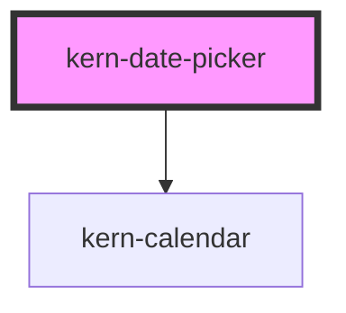

# kern-date-picker


<!-- Auto Generated Below -->


## Overview

Date field with a calendar popover, form-associated. The value is an ISO date (`2026-10-19`); the field shows
and accepts the locale's numeric format („19.10.2026“, also „19.10.“ or ISO). Typed text is applied on Enter or
when leaving the field; invalid or out-of-range dates mark the field invalid.

Keyboard: Arrow Down or Alt+Arrow Down opens the calendar (keyboard as in kern-calendar), Enter or Space picks,
Escape closes. Elements in the `footer` slot appear below the calendar; clicking one closes it.

## Usage

### 01-basic

# Date field

The value is an ISO date (`2026-10-19`); the field shows and accepts the locale's format. Typed text is applied on Enter or when leaving the field. Arrow Down or Alt+Arrow Down opens the calendar, Enter or Space picks, Escape closes.

```html
<div style="display:grid;gap:16px;max-width:280px">
  <kern-date-picker name="installed" label="Installed on" value="2026-03-14" locale="en-GB" clearable></kern-date-picker>
  <kern-date-picker label="Warranty until" value="2028-03-14" locale="de-CH" readonly></kern-date-picker>
  <output style="font:12px var(--font-mono);color:var(--text-muted)">kernChange → …</output>
</div>
```

```js
root.querySelector('kern-date-picker').addEventListener('kernChange', (e) => {
  root.querySelector('output').textContent = 'kernChange → ' + e.detail.value;
});
```


### 02-limits

# Limits, disabled days and footer

`min` and `max` limit the range; the `isDateDisabled` property adds a rule, here no weekends. Dates outside show `label-out-of-range`. Buttons in the `footer` slot appear below the calendar; clicking one closes it.

```html
<div style="max-width:280px">
  <kern-date-picker name="due" label="Maintenance on" required hint="Weekdays only" min="2026-10-01" max="2026-12-31" show-week-numbers locale="en-GB">
    <kern-button slot="footer" size="sm" variant="ghost">Today</kern-button>
  </kern-date-picker>
</div>
```

```js
const picker = root.querySelector('kern-date-picker');
picker.isDateDisabled = (iso) => [0, 6].includes(new Date(iso + 'T00:00').getDay());
root.querySelector('kern-button').addEventListener('click', () => {
  const d = new Date();
  picker.value = new Date(d.getTime() - d.getTimezoneOffset() * 60000).toISOString().slice(0, 10);
});
```


## Properties

| Property          | Attribute            | Description                                                          | Type                                      | Default     |
| ----------------- | -------------------- | -------------------------------------------------------------------- | ----------------------------------------- | ----------- |
| `ariaLabelText`   | `aria-label-text`    | Accessible name when there is no visible label.                      | `string \| undefined`                     | `undefined` |
| `clearable`       | `clearable`          | Show a button that empties the field.                                | `boolean`                                 | `false`     |
| `disabled`        | `disabled`           |                                                                      | `boolean`                                 | `false`     |
| `error`           | `error`              |                                                                      | `string \| undefined`                     | `undefined` |
| `firstDayOfWeek`  | `first-day-of-week`  | 0 = Sunday … 6 = Saturday; defaults to the locale.                   | `number \| undefined`                     | `undefined` |
| `hint`            | `hint`               |                                                                      | `string \| undefined`                     | `undefined` |
| `isDateDisabled`  | --                   | Additional rule for unselectable days, e.g. weekends.                | `((iso: string) => boolean) \| undefined` | `undefined` |
| `label`           | `label`              |                                                                      | `string \| undefined`                     | `undefined` |
| `labelClear`      | `label-clear`        |                                                                      | `string \| undefined`                     | `undefined` |
| `labelInvalid`    | `label-invalid`      | Shown for text that is not a date.                                   | `string \| undefined`                     | `undefined` |
| `labelOpen`       | `label-open`         |                                                                      | `string \| undefined`                     | `undefined` |
| `labelOutOfRange` | `label-out-of-range` | Shown for a date outside min/max or disabled.                        | `string \| undefined`                     | `undefined` |
| `locale`          | `locale`             | BCP 47 locale; defaults to `<html lang>`, then the browser language. | `string \| undefined`                     | `undefined` |
| `max`             | `max`                | Latest allowed date.                                                 | `string \| undefined`                     | `undefined` |
| `min`             | `min`                | Earliest allowed date.                                               | `string \| undefined`                     | `undefined` |
| `name`            | `name`               |                                                                      | `string \| undefined`                     | `undefined` |
| `placeholder`     | `placeholder`        | Defaults to the locale's format, e.g. „TT.MM.JJJJ“.                  | `string \| undefined`                     | `undefined` |
| `readonly`        | `readonly`           |                                                                      | `boolean`                                 | `false`     |
| `required`        | `required`           |                                                                      | `boolean`                                 | `false`     |
| `showWeekNumbers` | `show-week-numbers`  | ISO week numbers in the calendar.                                    | `boolean`                                 | `false`     |
| `size`            | `size`               |                                                                      | `"md" \| "sm"`                            | `'md'`      |
| `value`           | `value`              | ISO date `YYYY-MM-DD`, empty when none.                              | `string`                                  | `''`        |


## Events

| Event        | Description                                                    | Type                              |
| ------------ | -------------------------------------------------------------- | --------------------------------- |
| `kernChange` | When the date changes (picked, typed and applied, or cleared). | `CustomEvent<{ value: string; }>` |


## Methods

### `hide() => Promise<void>`

Closes the calendar.

#### Returns

Type: `Promise<void>`


### `setFocus() => Promise<void>`


#### Returns

Type: `Promise<void>`


### `show() => Promise<void>`

Opens the calendar.

#### Returns

Type: `Promise<void>`


## Slots

| Slot       | Description                              |
| ---------- | ---------------------------------------- |
| `"footer"` | Actions below the calendar, e.g. „Heute“ |


## Shadow Parts

| Part         | Description       |
| ------------ | ----------------- |
| `"calendar"` | The popover panel |
| `"control"`  | The field box     |


## Dependencies

### Depends on

- [kern-calendar](../kern-calendar)

### Graph


----------------------------------------------


