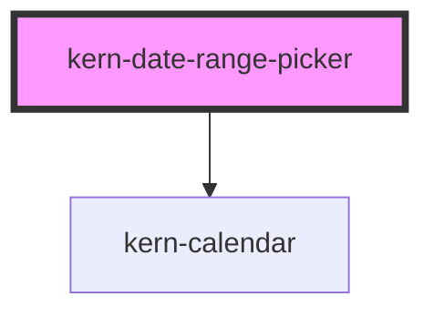

# kern-date-range-picker


<!-- Auto Generated Below -->


## Overview

Date range field: two dates („Von“ – „Bis“) with a calendar popover (two months, one on narrow screens),
form-associated. `start` and `end` are ISO dates; `value` and the form value are the ISO 8601 interval
`start/end` (empty until both are set). Typed dates are applied on Enter or when leaving a field; an end before
the start is swapped.

Presets: elements in the `presets` slot with `data-range` (ISO 8601 duration ending today, e.g. `P7D` = the last
7 days incl. today) or `data-start`/`data-end` set the range on click.

## Usage

### 01-basic

# Date range

Two dates with a calendar popover. `start` and `end` are ISO dates; `value` and the form value are the interval `start/end`. An end before the start is swapped.

```html
<div style="display:grid;gap:16px;max-width:360px">
  <kern-date-range-picker name="period" label="Report period" start="2026-10-01" end="2026-10-14" locale="en-GB" clearable></kern-date-range-picker>
  <output style="font:12px var(--font-mono);color:var(--text-muted)">kernChange → …</output>
</div>
```

```js
root.querySelector('kern-date-range-picker').addEventListener('kernChange', (e) => {
  root.querySelector('output').textContent = 'kernChange → ' + JSON.stringify(e.detail);
});
```


### 02-presets

# Presets and limits

Elements in the `presets` slot set the range on click: `data-range` is an ISO 8601 duration ending today (`P7D` = the last 7 days incl. today), or use `data-start`/`data-end`. `max-days` limits the length; `max` is set to today here so no future days can be picked.

```html
<div style="max-width:360px">
  <kern-date-range-picker label="Energy statistics" max-days="90" hint="At most 90 days" locale="en-GB" label-incomplete="Enter a start and an end">
    <kern-button slot="presets" variant="ghost" size="sm" data-range="P1D">Today</kern-button>
    <kern-button slot="presets" variant="ghost" size="sm" data-range="P7D">Last 7 days</kern-button>
    <kern-button slot="presets" variant="ghost" size="sm" data-range="P30D">Last 30 days</kern-button>
    <kern-button slot="presets" variant="ghost" size="sm" data-start="2026-01-01" data-end="2026-03-31">Q1 2026</kern-button>
  </kern-date-range-picker>
</div>
```

```js
const d = new Date();
root.querySelector('kern-date-range-picker').max = new Date(d.getTime() - d.getTimezoneOffset() * 60000).toISOString().slice(0, 10);
```


## Properties

| Property          | Attribute            | Description                                                                               | Type                                      | Default     |
| ----------------- | -------------------- | ----------------------------------------------------------------------------------------- | ----------------------------------------- | ----------- |
| `ariaLabelText`   | `aria-label-text`    | Accessible name when there is no visible label.                                           | `string \| undefined`                     | `undefined` |
| `clearable`       | `clearable`          | Show a button that empties both dates.                                                    | `boolean`                                 | `false`     |
| `disabled`        | `disabled`           |                                                                                           | `boolean`                                 | `false`     |
| `end`             | `end`                | Last day (inclusive), ISO `YYYY-MM-DD`.                                                   | `string`                                  | `''`        |
| `error`           | `error`              |                                                                                           | `string \| undefined`                     | `undefined` |
| `firstDayOfWeek`  | `first-day-of-week`  | 0 = Sunday … 6 = Saturday; defaults to the locale.                                        | `number \| undefined`                     | `undefined` |
| `hint`            | `hint`               |                                                                                           | `string \| undefined`                     | `undefined` |
| `isDateDisabled`  | --                   | Additional rule for unselectable days.                                                    | `((iso: string) => boolean) \| undefined` | `undefined` |
| `label`           | `label`              |                                                                                           | `string \| undefined`                     | `undefined` |
| `labelClear`      | `label-clear`        |                                                                                           | `string \| undefined`                     | `undefined` |
| `labelEnd`        | `label-end`          |                                                                                           | `string \| undefined`                     | `undefined` |
| `labelIncomplete` | `label-incomplete`   | Shown when only one date is set.                                                          | `string \| undefined`                     | `undefined` |
| `labelInvalid`    | `label-invalid`      |                                                                                           | `string \| undefined`                     | `undefined` |
| `labelOpen`       | `label-open`         |                                                                                           | `string \| undefined`                     | `undefined` |
| `labelOutOfRange` | `label-out-of-range` |                                                                                           | `string \| undefined`                     | `undefined` |
| `labelStart`      | `label-start`        |                                                                                           | `string \| undefined`                     | `undefined` |
| `labelTooLong`    | `label-too-long`     | Shown when the range is longer than `maxDays`; `{n}` is replaced by it.                   | `string \| undefined`                     | `undefined` |
| `locale`          | `locale`             | BCP 47 locale; defaults to `<html lang>`, then the browser language.                      | `string \| undefined`                     | `undefined` |
| `max`             | `max`                | Latest allowed date.                                                                      | `string \| undefined`                     | `undefined` |
| `maxDays`         | `max-days`           | Longest allowed range in days (inclusive).                                                | `number \| undefined`                     | `undefined` |
| `min`             | `min`                | Earliest allowed date.                                                                    | `string \| undefined`                     | `undefined` |
| `name`            | `name`               |                                                                                           | `string \| undefined`                     | `undefined` |
| `readonly`        | `readonly`           |                                                                                           | `boolean`                                 | `false`     |
| `required`        | `required`           |                                                                                           | `boolean`                                 | `false`     |
| `showWeekNumbers` | `show-week-numbers`  | ISO week numbers in the calendar.                                                         | `boolean`                                 | `false`     |
| `size`            | `size`               |                                                                                           | `"md" \| "sm"`                            | `'md'`      |
| `start`           | `start`              | First day, ISO `YYYY-MM-DD`.                                                              | `string`                                  | `''`        |
| `value`           | `value`              | ISO 8601 interval `start/end`, empty until both are set; kept in sync with `start`/`end`. | `string`                                  | `''`        |


## Events

| Event        | Description                            | Type                                                          |
| ------------ | -------------------------------------- | ------------------------------------------------------------- |
| `kernChange` | When the range is complete or cleared. | `CustomEvent<{ start: string; end: string; value: string; }>` |


## Methods

### `hide() => Promise<void>`

Closes the calendar.

#### Returns

Type: `Promise<void>`


### `setFocus() => Promise<void>`


#### Returns

Type: `Promise<void>`


### `show() => Promise<void>`

Opens the calendar.

#### Returns

Type: `Promise<void>`


## Slots

| Slot        | Description                                                                                        |
| ----------- | -------------------------------------------------------------------------------------------------- |
| `"footer"`  | Actions below the calendar                                                                         |
| `"presets"` | Quick choices beside the calendar, e.g. `<kern-button variant="ghost" size="sm" data-range="P7D">` |


## Shadow Parts

| Part         | Description       |
| ------------ | ----------------- |
| `"calendar"` | The popover panel |
| `"control"`  | The field box     |


## Dependencies

### Depends on

- [kern-calendar](../kern-calendar)

### Graph


----------------------------------------------


