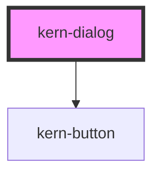

# kern-dialog

<!-- Auto Generated Below -->

## Overview

Modal dialog for confirmations and short forms, on the native `<dialog>`.
Destructive: the heading names action and device, a `kern-alert tone="warn"` states the consequence,
the confirm button is `variant="danger"` with a verb.

## Properties

| Property      | Attribute     | Description                               | Type                  | Default        |
| ------------- | ------------- | ----------------------------------------- | --------------------- | -------------- |
| `closeLabel`  | `close-label` | Accessible label of the close button.     | `string`              | `'Schliessen'` |
| `dismissible` | `dismissible` | Shows the close button and allows Escape. | `boolean`             | `true`         |
| `heading`     | `heading`     |                                           | `string \| undefined` | `undefined`    |
| `open`        | `open`        |                                           | `boolean`             | `false`        |
| `width`       | `width`       | Panel width in px.                        | `number`              | `520`          |

## Events

| Event       | Description                                                                                              | Type                                    |
| ----------- | -------------------------------------------------------------------------------------------------------- | --------------------------------------- |
| `kernClose` | After the dialog closed (Escape, close button or `close()`); `detail.returnValue` as given to `close()`. | `CustomEvent<{ returnValue: string; }>` |

## Methods

### `close(returnValue?: string) => Promise<void>`

Closes the dialog; `returnValue` is passed to `kernClose`.

#### Parameters

| Name          | Type     | Description |
| ------------- | -------- | ----------- |
| `returnValue` | `string` |             |

#### Returns

Type: `Promise<void>`

### `show() => Promise<void>`

Opens the dialog modally.

#### Returns

Type: `Promise<void>`

## Slots

| Slot       | Description                                        |
| ---------- | -------------------------------------------------- |
|            | Body                                               |
| `"footer"` | Buttons, right-aligned: cancel first, confirm last |

## Shadow Parts

| Part      | Description        |
| --------- | ------------------ |
| `"panel"` | The dialog surface |

## Dependencies

### Depends on

- [kern-button](../kern-button)

### Graph

----------------------------------------------

