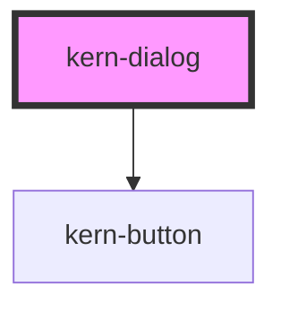

# kern-dialog


<!-- Auto Generated Below -->


## Overview

Modal dialog for confirmations and short forms, on the native `<dialog>`.
Destructive: the heading names action and device, a `kern-alert tone="warn"` states the consequence,
the confirm button is `variant="danger"` with a verb.

## Usage

### 01-basic

# Confirmation dialog

A modal dialog on the native `<dialog>`: `show()` opens it, `close(returnValue)` closes it and `kernClose` reports the value. Escape and × close it unless `dismissible="false"`. Footer buttons: cancel first, confirm last.

```html
<kern-button class="open">Restart …</kern-button>
<p class="out" style="font-size:13px;color:var(--text-muted)"></p>
<kern-dialog heading="Restart Küche Licht?" close-label="Close">
  <p>Küche Licht will be unreachable for about 10 seconds.</p>
  <kern-button slot="footer" class="cancel">Cancel</kern-button>
  <kern-button slot="footer" variant="primary" class="ok">Restart</kern-button>
</kern-dialog>
```

```js
const dialog = root.querySelector('kern-dialog');
root.querySelector('.open').addEventListener('click', () => dialog.show());
root.querySelector('.cancel').addEventListener('click', () => dialog.close('cancel'));
root.querySelector('.ok').addEventListener('click', () => dialog.close('ok'));
dialog.addEventListener('kernClose', (e) => (root.querySelector('.out').textContent = `kernClose → ${e.detail.returnValue}`));
```


### 02-destructive

# Destructive action

The heading names the action and the device, a kern-alert with `tone="warn"` states the consequence, and the confirm button is `variant="danger"` with a verb. `width` sets the panel width in px.

```html
<kern-button class="open" variant="danger">Factory reset …</kern-button>
<kern-dialog heading="Factory reset «Küche Licht»" width="440" close-label="Close">
  <kern-alert tone="warn">The device loses its configuration and starts in AP mode.</kern-alert>
  <kern-button slot="footer" class="cancel">Cancel</kern-button>
  <kern-button slot="footer" variant="danger" class="ok">Reset</kern-button>
</kern-dialog>
```

```js
const dialog = root.querySelector('kern-dialog');
root.querySelector('.open').addEventListener('click', () => dialog.show());
root.querySelector('.cancel').addEventListener('click', () => dialog.close('cancel'));
root.querySelector('.ok').addEventListener('click', () => dialog.close('reset'));
```


### 03-confirm-function

# confirm()

`confirm()`, imported from `'@yfridelance/kern'`, builds the dialog for you and resolves `true` on confirm, `false` otherwise. `danger` styles the confirm button; with `typeToConfirm` it stays disabled until that text (e.g. the MAC) is typed. Pass an array to accept any one of several answers, e.g. the device name or its MAC.

The typed text and every alternative go through `normalize` before comparing: by default `trim()` and upper case. `normalize: 'mac'` accepts a MAC in any notation (`A8:03:2A:B1:23:45`, `a8-03-2a-b1-23-45`, `A8032AB12345`) and treats other text like the default; your own `(text) => string` works too. The default label lists all alternatives («Zur Bestätigung «Boiler» oder «A8:03:2A:B1:23:45» eintippen», MACs formatted with `'mac'`); `typeToConfirmLabel` overrides it.

```html
<div style="display:flex;flex-wrap:wrap;gap:12px">
  <kern-button class="restart">Restart Bad Lüftung</kern-button>
  <kern-button class="reset" variant="danger">Factory reset …</kern-button>
  <kern-button class="delete" variant="danger">Delete Boiler …</kern-button>
</div>
<p class="out" style="font-size:13px;color:var(--text-muted)"></p>
```

```js
const { confirm } = await import('../kern/index.esm.js');
const out = root.querySelector('.out');
root.querySelector('.restart').addEventListener('click', async () => {
  const ok = await confirm({ heading: 'Restart Bad Lüftung?', message: 'The fan stops for about 10 seconds.', confirmLabel: 'Restart', cancelLabel: 'Cancel' });
  out.textContent = `confirm → ${ok}`;
});
root.querySelector('.reset').addEventListener('click', async () => {
  const ok = await confirm({
    heading: 'Factory reset «Küche Licht»',
    message: 'The device starts in AP mode afterwards.',
    confirmLabel: 'Reset',
    cancelLabel: 'Cancel',
    danger: true,
    typeToConfirm: 'A4CF12F45B21',
    typeToConfirmLabel: 'Type the MAC A4CF12F45B21 to confirm',
  });
  out.textContent = `confirm → ${ok}`;
});
root.querySelector('.delete').addEventListener('click', async () => {
  // Name or MAC, the MAC in any notation (a8-03-2a-b1-23-45, A8032AB12345 …).
  const ok = await confirm({
    heading: 'Delete «Boiler»?',
    confirmLabel: 'Delete',
    cancelLabel: 'Cancel',
    danger: true,
    typeToConfirm: ['Boiler', 'a8032ab12345'],
    normalize: 'mac',
  });
  out.textContent = `confirm → ${ok}`;
});
```


## Properties

| Property      | Attribute     | Description                               | Type                  | Default        |
| ------------- | ------------- | ----------------------------------------- | --------------------- | -------------- |
| `closeLabel`  | `close-label` | Accessible label of the close button.     | `string`              | `'Schliessen'` |
| `dismissible` | `dismissible` | Shows the close button and allows Escape. | `boolean`             | `true`         |
| `heading`     | `heading`     |                                           | `string \| undefined` | `undefined`    |
| `open`        | `open`        |                                           | `boolean`             | `false`        |
| `width`       | `width`       | Panel width in px.                        | `number`              | `520`          |


## Events

| Event       | Description                                                                                              | Type                                    |
| ----------- | -------------------------------------------------------------------------------------------------------- | --------------------------------------- |
| `kernClose` | After the dialog closed (Escape, close button or `close()`); `detail.returnValue` as given to `close()`. | `CustomEvent<{ returnValue: string; }>` |


## Methods

### `close(returnValue?: string) => Promise<void>`

Closes the dialog; `returnValue` is passed to `kernClose`.

#### Parameters

| Name          | Type     | Description |
| ------------- | -------- | ----------- |
| `returnValue` | `string` |             |

#### Returns

Type: `Promise<void>`


### `show() => Promise<void>`

Opens the dialog modally.

#### Returns

Type: `Promise<void>`


## Slots

| Slot       | Description                                        |
| ---------- | -------------------------------------------------- |
|            | Body                                               |
| `"footer"` | Buttons, right-aligned: cancel first, confirm last |


## Shadow Parts

| Part      | Description        |
| --------- | ------------------ |
| `"panel"` | The dialog surface |


## Dependencies

### Depends on

- [kern-button](../kern-button)

### Graph


----------------------------------------------


