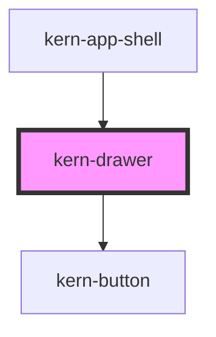

# kern-drawer


<!-- Auto Generated Below -->


## Overview

Side panel over the page for details, filters and longer forms, on the native modal `<dialog>` (focus stays inside
and returns to the opener). Full height; header and footer stay put while the body scrolls. Escape, the close
button and a click on the backdrop close it unless `dismissible` is false. For short confirmations use kern-dialog.

## Usage

### 01-basic

# Device details

A modal side panel for details and longer forms. Open it with `show()`, close it with `close(returnValue)`; Escape, × and a backdrop click close it with `cancel`. `kernClose` reports the `returnValue`. Footer buttons: cancel first, confirm last.

```html
<kern-button class="open">Details</kern-button>
<p class="out" style="font-size:13px;color:var(--text-muted)"></p>
<kern-drawer heading="Bad Lüftung">
  <kern-kv>
    <kern-kv-item label="Model">Shelly Plus 1PM</kern-kv-item>
    <kern-kv-item label="IP"><kern-copy>192.168.1.21</kern-copy></kern-kv-item>
    <kern-kv-item label="Firmware" mono>1.4.4</kern-kv-item>
  </kern-kv>
  <kern-input label="Name" value="Bad Lüftung"></kern-input>
  <kern-ip-input label="Static IP" allow="single" value="192.168.1.21"></kern-ip-input>
  <kern-step-input label="Auto-off" value="15" min="0" max="120" unit="min"></kern-step-input>
  <kern-button slot="footer" class="cancel">Cancel</kern-button>
  <kern-button slot="footer" variant="primary" class="save">Save</kern-button>
</kern-drawer>
```

```js
const drawer = root.querySelector('kern-drawer');
root.querySelector('.open').addEventListener('click', () => drawer.show());
root.querySelector('.cancel').addEventListener('click', () => drawer.close('cancel'));
root.querySelector('.save').addEventListener('click', () => drawer.close('save'));
drawer.addEventListener('kernClose', (e) => (root.querySelector('.out').textContent = `kernClose → ${e.detail.returnValue}`));
```


### 02-side-and-width

# Filters from the start edge

`side="start"` slides the panel in from the left (in left-to-right layouts), `width` sets its width in px. With `dismissible="false"` neither Escape, × nor the backdrop close it — the footer buttons must.

```html
<kern-button class="open"><kern-icon slot="start" name="filter"></kern-icon>Filter</kern-button>
<kern-drawer heading="Filter devices" side="start" width="320" dismissible="false">
  <div style="display:grid;gap:12px">
    <kern-checkbox checked>Active</kern-checkbox>
    <kern-checkbox>Missing</kern-checkbox>
    <kern-checkbox>Firmware update only</kern-checkbox>
  </div>
  <kern-button slot="footer" class="reset" variant="ghost">Reset</kern-button>
  <kern-button slot="footer" class="apply" variant="primary">Apply</kern-button>
</kern-drawer>
```

```js
const drawer = root.querySelector('kern-drawer');
root.querySelector('.open').addEventListener('click', () => drawer.show());
root.querySelector('.reset').addEventListener('click', () => drawer.close('reset'));
root.querySelector('.apply').addEventListener('click', () => drawer.close('apply'));
```


### 03-initial-focus

# Start in a field

When the panel opens, the focus goes to the first Kern field with `autofocus` (body or footer, also nested), once that field is ready; without one it lands on the close button. `kernOpen` fires after opening, for an app that picks the field itself. On close the focus returns to the opener.

```html
<kern-button class="open">Rename</kern-button>
<kern-drawer heading="Rename device">
  <kern-input label="Name" value="Bad Lüftung" autofocus></kern-input>
  <kern-input label="Room" value="Bad"></kern-input>
  <kern-button slot="footer" class="cancel">Cancel</kern-button>
  <kern-button slot="footer" variant="primary" class="save">Save</kern-button>
</kern-drawer>
```

```js
const drawer = root.querySelector('kern-drawer');
root.querySelector('.open').addEventListener('click', () => drawer.show());
root.querySelector('.cancel').addEventListener('click', () => drawer.close('cancel'));
root.querySelector('.save').addEventListener('click', () => drawer.close('save'));
```


## Properties

| Property      | Attribute     | Description                                                             | Type                  | Default     |
| ------------- | ------------- | ----------------------------------------------------------------------- | --------------------- | ----------- |
| `closeLabel`  | `close-label` | Accessible label of the close button.                                   | `string \| undefined` | `undefined` |
| `dismissible` | `dismissible` | Close button, Escape and backdrop click close the panel.                | `boolean`             | `true`      |
| `heading`     | `heading`     |                                                                         | `string \| undefined` | `undefined` |
| `open`        | `open`        |                                                                         | `boolean`             | `false`     |
| `side`        | `side`        | Edge the panel slides in from (`end` = right in left-to-right layouts). | `"end" \| "start"`    | `'end'`     |
| `width`       | `width`       | Panel width in px (at most the viewport minus 32px).                    | `number`              | `420`       |


## Events

| Event       | Description                                                                                                                                                                                                                                | Type                                    |
| ----------- | ------------------------------------------------------------------------------------------------------------------------------------------------------------------------------------------------------------------------------------------ | --------------------------------------- |
| `kernClose` | After the panel closed; `detail.returnValue` as given to `close()` (`cancel` for Escape/backdrop/close button).                                                                                                                            | `CustomEvent<{ returnValue: string; }>` |
| `kernOpen`  | After the panel opened (`show()` or `open`). The focus moves to the first Kern field with `autofocus` once it is ready, otherwise it stays on the first focusable element (the close button); without `autofocus` the app can set it here. | `CustomEvent<void>`                     |


## Methods

### `close(returnValue?: string) => Promise<void>`

Closes the panel; `returnValue` is passed to `kernClose`.

#### Parameters

| Name          | Type     | Description |
| ------------- | -------- | ----------- |
| `returnValue` | `string` |             |

#### Returns

Type: `Promise<void>`


### `show() => Promise<void>`

Opens the panel modally.

#### Returns

Type: `Promise<void>`


## Slots

| Slot       | Description                                        |
| ---------- | -------------------------------------------------- |
|            | Body                                               |
| `"footer"` | Buttons, right-aligned: cancel first, confirm last |


## Shadow Parts

| Part      | Description       |
| --------- | ----------------- |
| `"panel"` | The panel surface |


## Dependencies

### Used by

 - [kern-app-shell](../kern-app-shell)

### Depends on

- [kern-button](../kern-button)

### Graph


----------------------------------------------


