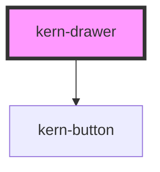

# kern-drawer

<!-- Auto Generated Below -->

## Overview

Side panel over the page for details, filters and longer forms, on the native modal `<dialog>` (focus stays inside
and returns to the opener). Full height; header and footer stay put while the body scrolls. Escape, the close
button and a click on the backdrop close it unless `dismissible` is false. For short confirmations use kern-dialog.

## Properties

| Property      | Attribute     | Description                                                             | Type                  | Default        |
| ------------- | ------------- | ----------------------------------------------------------------------- | --------------------- | -------------- |
| `closeLabel`  | `close-label` | Accessible label of the close button.                                   | `string`              | `'Schliessen'` |
| `dismissible` | `dismissible` | Close button, Escape and backdrop click close the panel.                | `boolean`             | `true`         |
| `heading`     | `heading`     |                                                                         | `string \| undefined` | `undefined`    |
| `open`        | `open`        |                                                                         | `boolean`             | `false`        |
| `side`        | `side`        | Edge the panel slides in from (`end` = right in left-to-right layouts). | `"end" \| "start"`    | `'end'`        |
| `width`       | `width`       | Panel width in px (at most the viewport minus 32px).                    | `number`              | `420`          |

## Events

| Event       | Description                                                                                                     | Type                                    |
| ----------- | --------------------------------------------------------------------------------------------------------------- | --------------------------------------- |
| `kernClose` | After the panel closed; `detail.returnValue` as given to `close()` (`cancel` for Escape/backdrop/close button). | `CustomEvent<{ returnValue: string; }>` |

## Methods

### `close(returnValue?: string) => Promise<void>`

Closes the panel; `returnValue` is passed to `kernClose`.

#### Parameters

| Name          | Type     | Description |
| ------------- | -------- | ----------- |
| `returnValue` | `string` |             |

#### Returns

Type: `Promise<void>`

### `show() => Promise<void>`

Opens the panel modally.

#### Returns

Type: `Promise<void>`

## Slots

| Slot       | Description                                        |
| ---------- | -------------------------------------------------- |
|            | Body                                               |
| `"footer"` | Buttons, right-aligned: cancel first, confirm last |

## Shadow Parts

| Part      | Description       |
| --------- | ----------------- |
| `"panel"` | The panel surface |

## Dependencies

### Depends on

- [kern-button](../kern-button)

### Graph

----------------------------------------------

