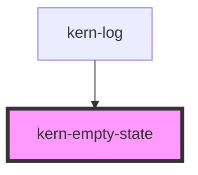

# kern-empty-state


<!-- Auto Generated Below -->


## Overview

Placeholder where content would be: nothing created yet (`empty`), no matches for the current filters
(`no-results`) or the data could not be loaded (`error`). Icon, heading, a sentence and the actions that help,
e.g. «Add device», «Reset filters» or «Try again». The app decides which state applies; for a lost connection
with data already shown, keep the data and put a kern-alert above it instead.

Only `error` is a live region (`role="status"`, announced once when it appears). The heading is plain text, so
it does not change the page outline; `heading-level` makes it a heading for screen readers when the state
replaces a whole page section.

## Usage

### 01-variants

# Variants

`variant` picks the icon and the default heading: `empty` when nothing was created yet, `no-results` when filters or a search match nothing, `error` when the data could not be loaded. The default slot holds one or two sentences, the `actions` slot the buttons that get the user going again. Only `error` is announced (once, as status).

```html
<div style="display:grid;gap:16px;grid-template-columns:repeat(auto-fit,minmax(240px,1fr))">
  <kern-card>
    <kern-empty-state>
      Add a device or scan the network to find Shelly devices.
      <kern-button slot="actions" variant="primary">Add device</kern-button>
      <kern-button slot="actions">Scan network</kern-button>
    </kern-empty-state>
  </kern-card>
  <kern-card>
    <kern-empty-state variant="no-results">
      No device matches “garage” at Haus Seeblick.
      <kern-button slot="actions">Reset filters</kern-button>
    </kern-empty-state>
  </kern-card>
  <kern-card>
    <kern-empty-state variant="error">
      The server did not answer (timeout).
      <kern-button slot="actions">Try again</kern-button>
    </kern-empty-state>
  </kern-card>
</div>
```


### 02-compact

# Compact, own heading and icon

`compact` takes less room, for a table cell, a list or a small card. `heading` replaces the default text, `icon` the glyph (any Kern glyph, see kern-icon); `icon="none"` hides it.

```html
<div style="display:grid;gap:16px;max-width:640px">
  <kern-table>
    <table>
      <thead><tr><th>Name</th><th>IP</th><th>Status</th></tr></thead>
      <tbody>
        <tr><td colspan="3" class="empty">
          <kern-empty-state compact variant="no-results" heading="No offline devices">All 60 devices answered in the last 5 minutes.</kern-empty-state>
        </td></tr>
      </tbody>
    </table>
  </kern-table>
  <kern-card heading="Schedules">
    <kern-empty-state compact icon="clock" heading="No schedules">Switch devices at fixed times, e.g. the Küche Licht at sunset.</kern-empty-state>
  </kern-card>
  <kern-card heading="Notes">
    <kern-empty-state compact icon="none" heading="No notes for this device"></kern-empty-state>
  </kern-card>
</div>
```


### 03-page

# Whole page section

The heading is plain text, so a state inside a table or card does not add to the page outline. When the state stands in for a whole section of the page, `heading-level` exposes the heading to screen readers as a heading of that level; it looks the same.

```html
<kern-empty-state heading-level="2" icon="wifi" heading="No devices found yet">
  Kern searches 192.168.1.0/24. Check that the devices are in the same network, or enter another IP range.
  <kern-button slot="actions" variant="primary">Scan again</kern-button>
  <kern-button slot="actions">Change IP range</kern-button>
</kern-empty-state>
```


## Properties

| Property       | Attribute       | Description                                                                                        | Type                                                                                                                                                                                                                                                                                                                                                                                                                                                                           | Default     |
| -------------- | --------------- | -------------------------------------------------------------------------------------------------- | ------------------------------------------------------------------------------------------------------------------------------------------------------------------------------------------------------------------------------------------------------------------------------------------------------------------------------------------------------------------------------------------------------------------------------------------------------------------------------ | ----------- |
| `compact`      | `compact`       | Less space and a smaller icon, e.g. in a table cell or a card.                                     | `boolean`                                                                                                                                                                                                                                                                                                                                                                                                                                                                      | `false`     |
| `heading`      | `heading`       | Heading; defaults to a Kern text per variant («No entries yet», «No matches», «Could not load»).   | `string \| undefined`                                                                                                                                                                                                                                                                                                                                                                                                                                                          | `undefined` |
| `headingLevel` | `heading-level` | Exposes the heading as a heading of this level (1–6) to screen readers, without changing its look. | `1 \| 2 \| 3 \| 4 \| 5 \| 6 \| undefined`                                                                                                                                                                                                                                                                                                                                                                                                                                      | `undefined` |
| `icon`         | `icon`          | Glyph instead of the variant's default (see kern-icon); `none` hides the icon.                     | `"bulb" \| "calendar" \| "check" \| "chevron-down" \| "chevron-left" \| "chevron-right" \| "chevron-up" \| "clock" \| "close" \| "copy" \| "download" \| "edit" \| "external" \| "eye" \| "eye-off" \| "filter" \| "home" \| "inbox" \| "info" \| "link" \| "lock" \| "menu" \| "minus" \| "moon" \| "more" \| "none" \| "plus" \| "power" \| "refresh" \| "search" \| "settings" \| "star" \| "sun" \| "thermometer" \| "trash" \| "upload" \| "warn" \| "wifi" \| undefined` | `undefined` |
| `variant`      | `variant`       | Which state: sets the default icon and heading.                                                    | `"empty" \| "error" \| "no-results"`                                                                                                                                                                                                                                                                                                                                                                                                                                           | `'empty'`   |


## Slots

| Slot        | Description                       |
| ----------- | --------------------------------- |
|             | Description: one or two sentences |
| `"actions"` | Buttons, e.g. a kern-button       |


## Shadow Parts

| Part        | Description |
| ----------- | ----------- |
| `"heading"` | The heading |
| `"icon"`    | The icon    |


## Dependencies

### Used by

 - [kern-log](../kern-log)

### Graph


----------------------------------------------


