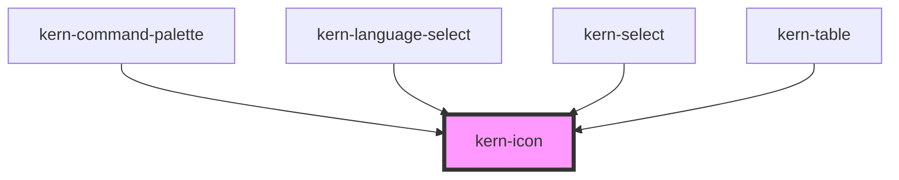

# kern-icon


<!-- Auto Generated Below -->


## Overview

One of Kern's glyphs (Lucide style), a brand icon (`brand-github`, `brand-home-assistant` …, from Simple Icons) or a
country flag (`flag-ch`, `flag-gb` …, from flag-icons). Sized by `font-size` (1em high) and coloured by
`currentColor`, so it fits text and buttons; `brand-color` shows a brand icon in its official colour, flags are
always in colour and 4:3. Decorative without `label`; with `label` it is announced as an image.

## Usage

### 01-basic

# Glyphs

`name` picks one of Kern's glyphs (the full list is exported as `ICON_NAMES`). Icons are sized by `font-size` and coloured with `currentColor`, so they follow the surrounding text. Without `label` an icon is decorative and hidden from screen readers.

```html
<div style="display:flex;flex-wrap:wrap;gap:16px;align-items:center;font-size:20px">
  <kern-icon name="wifi"></kern-icon>
  <kern-icon name="power"></kern-icon>
  <kern-icon name="refresh"></kern-icon>
  <kern-icon name="bulb" style="color:var(--warn)"></kern-icon>
  <kern-icon name="thermometer"></kern-icon>
  <kern-icon name="settings" style="font-size:28px"></kern-icon>
</div>
```


### 02-accessible

# Meaningful icons

When an icon carries information on its own, give it a `label`; it is then announced as an image. In buttons the icon stays decorative and the button gets the name instead.

```html
<p style="margin:0;display:flex;gap:12px;align-items:center">
  Bad Lüftung <kern-icon name="lock" label="Password protected"></kern-icon>
  <kern-button size="sm" variant="ghost" icon-only label="Restart"><kern-icon name="power"></kern-icon></kern-button>
</p>
```


### 03-brands

# Brand icons

Names starting with `brand-` show a logo from Simple Icons (CC0; four from other free sets, see Fundamentals → Icons), filled in `currentColor`; `brand-color` uses the official colour. The logos are trademarks of their owners: use them to refer to the product, and give them a `label` when they carry meaning on their own.

```html
<div style="display:flex;flex-wrap:wrap;gap:16px;align-items:center;font-size:24px">
  <kern-icon name="brand-home-assistant" label="Home Assistant"></kern-icon>
  <kern-icon name="brand-zigbee" label="Zigbee"></kern-icon>
  <kern-icon name="brand-mqtt" label="MQTT"></kern-icon>
  <kern-icon name="brand-shelly" label="Shelly"></kern-icon>
  <kern-icon name="brand-github" label="GitHub"></kern-icon>
  <kern-icon name="brand-home-assistant" brand-color label="Home Assistant"></kern-icon>
  <kern-icon name="brand-zigbee" brand-color label="Zigbee"></kern-icon>
  <kern-icon name="brand-google" brand-color label="Google"></kern-icon>
</div>
```


### 04-flags

# Flags

Names starting with `flag-` and an ISO 3166 country code show a flag from flag-icons (MIT), 4:3 and in colour. Each flag loads on its own the first time it is shown. A flag names a country, not a language; next to a language name it helps recognition.

```html
<div style="display:flex;flex-wrap:wrap;gap:16px;align-items:center;font-size:24px">
  <kern-icon name="flag-ch" label="Switzerland"></kern-icon>
  <kern-icon name="flag-de" label="Germany"></kern-icon>
  <kern-icon name="flag-fr" label="France"></kern-icon>
  <kern-icon name="flag-it" label="Italy"></kern-icon>
  <kern-icon name="flag-gb" label="United Kingdom"></kern-icon>
  <kern-icon name="flag-jp" label="Japan"></kern-icon>
</div>
<p style="display:flex;gap:8px;align-items:center;margin:16px 0 0"><kern-icon name="flag-ch"></kern-icon> Deutsch (Schweiz)</p>
```


## Properties

| Property            | Attribute     | Description                                                                                                        | Type                                                                                                                                                                                                                                                                                                                                                                                                                                                                                                                                                                                                                                                                                                                                                                                                                                                                                                                                                                                                                                                                                                                                                                                                                                                                                                                                                                                                                                                                                                                                                                                                                                                                                                                                                                                 | Default     |
| ------------------- | ------------- | ------------------------------------------------------------------------------------------------------------------ | ------------------------------------------------------------------------------------------------------------------------------------------------------------------------------------------------------------------------------------------------------------------------------------------------------------------------------------------------------------------------------------------------------------------------------------------------------------------------------------------------------------------------------------------------------------------------------------------------------------------------------------------------------------------------------------------------------------------------------------------------------------------------------------------------------------------------------------------------------------------------------------------------------------------------------------------------------------------------------------------------------------------------------------------------------------------------------------------------------------------------------------------------------------------------------------------------------------------------------------------------------------------------------------------------------------------------------------------------------------------------------------------------------------------------------------------------------------------------------------------------------------------------------------------------------------------------------------------------------------------------------------------------------------------------------------------------------------------------------------------------------------------------------------ | ----------- |
| `brandColor`        | `brand-color` | Brand icons in their official colour instead of `currentColor` (check the contrast: some are near-black or white). | `boolean`                                                                                                                                                                                                                                                                                                                                                                                                                                                                                                                                                                                                                                                                                                                                                                                                                                                                                                                                                                                                                                                                                                                                                                                                                                                                                                                                                                                                                                                                                                                                                                                                                                                                                                                                                                            | `false`     |
| `label`             | `label`       | Accessible name; without it the icon is decorative.                                                                | `string \| undefined`                                                                                                                                                                                                                                                                                                                                                                                                                                                                                                                                                                                                                                                                                                                                                                                                                                                                                                                                                                                                                                                                                                                                                                                                                                                                                                                                                                                                                                                                                                                                                                                                                                                                                                                                                                | `undefined` |
| `name` _(required)_ | `name`        | Glyph name, e.g. `wifi`, `power`, `refresh`, a brand icon, e.g. `brand-github`, or a flag, e.g. `flag-ch`.         | `"brand-alexa" \| "brand-android" \| "brand-apple" \| "brand-arduino" \| "brand-bluetooth" \| "brand-cloudflare" \| "brand-debian" \| "brand-docker" \| "brand-esphome" \| "brand-espressif" \| "brand-github" \| "brand-gitlab" \| "brand-google" \| "brand-google-home" \| "brand-grafana" \| "brand-home-assistant" \| "brand-homebridge" \| "brand-ikea" \| "brand-influxdb" \| "brand-linux" \| "brand-matter" \| "brand-microsoft" \| "brand-mqtt" \| "brand-nextcloud" \| "brand-node-red" \| "brand-openwrt" \| "brand-philips-hue" \| "brand-pi-hole" \| "brand-plex" \| "brand-proxmox" \| "brand-raspberry-pi" \| "brand-shelly" \| "brand-signal" \| "brand-synology" \| "brand-tailscale" \| "brand-tasmota" \| "brand-telegram" \| "brand-ubiquiti" \| "brand-ubuntu" \| "brand-whatsapp" \| "brand-wireguard" \| "brand-z-wave" \| "brand-zigbee" \| "bulb" \| "calendar" \| "check" \| "chevron-down" \| "chevron-left" \| "chevron-right" \| "chevron-up" \| "clock" \| "close" \| "copy" \| "download" \| "edit" \| "external" \| "eye" \| "eye-off" \| "filter" \| "flag-at" \| "flag-be" \| "flag-bg" \| "flag-br" \| "flag-ch" \| "flag-cn" \| "flag-cz" \| "flag-de" \| "flag-dk" \| "flag-es" \| "flag-fi" \| "flag-fr" \| "flag-gb" \| "flag-gr" \| "flag-hr" \| "flag-hu" \| "flag-ie" \| "flag-is" \| "flag-it" \| "flag-jp" \| "flag-kr" \| "flag-li" \| "flag-lu" \| "flag-nl" \| "flag-no" \| "flag-pl" \| "flag-pt" \| "flag-ro" \| "flag-se" \| "flag-si" \| "flag-sk" \| "flag-tr" \| "flag-ua" \| "flag-us" \| "home" \| "inbox" \| "info" \| "link" \| "lock" \| "menu" \| "minus" \| "moon" \| "more" \| "plus" \| "power" \| "refresh" \| "search" \| "settings" \| "star" \| "sun" \| "thermometer" \| "trash" \| "upload" \| "warn" \| "wifi"` | `undefined` |


## Dependencies

### Used by

 - [kern-command-palette](../kern-command-palette)
 - [kern-language-select](../kern-language-select)
 - [kern-select](../kern-select)
 - [kern-table](../kern-table)

### Graph


----------------------------------------------


