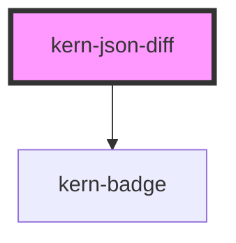

# kern-json-diff


<!-- Auto Generated Below -->


## Overview

Differences between two states of the same JSON (config before/after, target/actual, two firmware versions): one
table row per changed, added or removed path, with a summary line above. Uses `diffJson()`, which is exported too.

## Usage

### 01-config

# Config snapshots

Compare two snapshots of a device config. Set `from` and `to` as properties (or JSON strings); each changed, added or removed path gets a row, with a summary above. `label-before` and `label-after` name the two states, e.g. by the time of the snapshot.

```html
<kern-json-diff label-before="14.10. 08:00" label-after="15.10. 08:00"></kern-json-diff>
```

```js
const diff = root.querySelector('kern-json-diff');
diff.from = {
  sys: { device: { name: 'Bad Lüftung', eco_mode: false }, sntp: { server: 'time.google.com' } },
  wifi: { sta: { ssid: 'Home', ipv4mode: 'dhcp' } },
  mqtt: { enable: false, server: null },
  switch: [{ id: 0, name: 'Fan', auto_off: false }],
  cloud: { enable: true },
};
diff.to = {
  sys: { device: { name: 'Bad Lüftung', eco_mode: true }, sntp: { server: 'ch.pool.ntp.org' } },
  wifi: { sta: { ssid: 'Home', ipv4mode: 'static', ip: '192.168.1.21' } },
  mqtt: { enable: true, server: '192.168.1.5:1883' },
  switch: [{ id: 0, name: 'Fan', auto_off: true, auto_off_delay: 900 }],
};
```


### 02-ignore

# Ignore volatile paths

`ignore` lists paths that do not count, as an array or comma-separated. A path also ignores everything below it, so `sys.updates` hides the whole update object. Without it, the device clock and uptime would show up in every comparison.

```html
<kern-json-diff ignore="time,unixtime,sys.uptime,sys.updates"></kern-json-diff>
```

```js
const diff = root.querySelector('kern-json-diff');
diff.from = { time: '08:00', unixtime: 1760421600, sys: { uptime: 356420, fw: '1.4.4', updates: { stable: '1.4.4' } }, relays: [{ ison: false }] };
diff.to = { time: '08:00', unixtime: 1760508000, sys: { uptime: 442820, fw: '1.4.4', updates: { stable: '1.5.0', beta: '1.6.0-beta1' } }, relays: [{ ison: true }] };
```


### 03-long-values

# Long values and English labels

Values longer than `max-value-length` (default 80) are cut with „…“; hover a cell to see the whole value. The built-in labels are German; this example sets them to English. An empty result shows `label-none`.

```html
<kern-json-diff
  max-value-length="40"
  label-before="Target"
  label-after="Actual"
  label-path="Path"
  label-kind="Kind"
  label-added="added"
  label-removed="removed"
  label-changed="changed"
  label-none="No differences"
  label-summary="{n} differences: {changed} changed, {added} added, {removed} removed"
></kern-json-diff>
<kern-json-diff
  from='{"eco_mode":true}'
  to='{"eco_mode":true}'
  label-none="No differences"
  style="margin-top: 16px"
></kern-json-diff>
```

```js
const diff = root.querySelector('kern-json-diff');
diff.from = {
  schedule: { rules: ['0800-0-1-2-3-4-on', '2200-0-1-2-3-4-off'] },
  actions: { out_on_url: ['http://192.168.1.5:8123/api/webhook/bathroom-fan-on'] },
};
diff.to = {
  schedule: { rules: ['0700-0-1-2-3-4-5-6-on', '2200-0-1-2-3-4-5-6-off'] },
  actions: { out_on_url: ['http://192.168.1.5:8123/api/webhook/bathroom-fan-on?source=shelly&channel=0'] },
};
```


## Properties

| Property         | Attribute          | Description                                                                                                               | Type                 | Default                                                                   |
| ---------------- | ------------------ | ------------------------------------------------------------------------------------------------------------------------- | -------------------- | ------------------------------------------------------------------------- |
| `from`           | --                 | The earlier state (object, array or primitive). A string is parsed as JSON when possible.                                 | `unknown`            | `undefined`                                                               |
| `ignore`         | `ignore`           | Paths that do not count, as an array or comma-separated (`time,unixtime,sys.uptime`). A path ignores everything below it. | `string \| string[]` | `[]`                                                                      |
| `labelAdded`     | `label-added`      |                                                                                                                           | `string`             | `'neu'`                                                                   |
| `labelAfter`     | `label-after`      |                                                                                                                           | `string`             | `'Nachher'`                                                               |
| `labelBefore`    | `label-before`     | Header of the column with the earlier value, e.g. the time of the snapshot.                                               | `string`             | `'Vorher'`                                                                |
| `labelChanged`   | `label-changed`    |                                                                                                                           | `string`             | `'geändert'`                                                              |
| `labelKind`      | `label-kind`       |                                                                                                                           | `string`             | `'Art'`                                                                   |
| `labelNone`      | `label-none`       |                                                                                                                           | `string`             | `'Keine Unterschiede'`                                                    |
| `labelPath`      | `label-path`       |                                                                                                                           | `string`             | `'Pfad'`                                                                  |
| `labelRemoved`   | `label-removed`    |                                                                                                                           | `string`             | `'entfernt'`                                                              |
| `labelSummary`   | `label-summary`    | `{n}`, `{changed}`, `{added}` and `{removed}` are replaced.                                                               | `string`             | `'{n} Unterschiede: {changed} geändert, {added} neu, {removed} entfernt'` |
| `maxValueLength` | `max-value-length` | Longer values are cut with „…“; the whole value is in the tooltip.                                                        | `number`             | `80`                                                                      |
| `to`             | --                 | The later state. A string is parsed as JSON when possible.                                                                | `unknown`            | `undefined`                                                               |


## Dependencies

### Depends on

- [kern-badge](../kern-badge)

### Graph


----------------------------------------------


