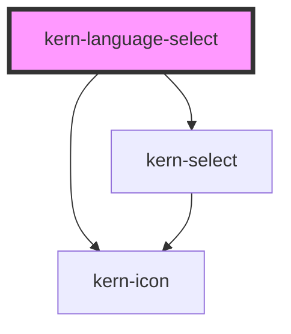

# kern-language-select


<!-- Auto Generated Below -->


## Overview

Language switcher: a dropdown with the language names («Deutsch», «English») or short codes («DE», «EN»), optionally
with flags, or the languages side by side as links or buttons (`variant="inline"`, good for two or three).
Names are shown in their own language and marked with `lang`; codes are announced with the full name.

Languages come from `languages` (`de,en,fr`) or from child `<option>` elements, which may set their own name and
flag: `<option value="de-CH" data-flag="ch">Schweizerdeutsch</option>`. With `href` (`/{locale}/`) every language
is a real link. `kernChange` reports the choice; `preventDefault()` on it stops the navigation, so an app router can
take over.

## Usage

### 01-dropdown

# Dropdown

`languages` lists the codes; each language is shown by its own name («Deutsch», «Français»), marked with `lang`, so screen readers pronounce it correctly. `kernChange` reports `{ value }`.

```html
<kern-language-select value="de" languages="de,en,fr,it"></kern-language-select>
<p class="out" style="margin:12px 0 0;font-size:13px;color:var(--text-muted)">Choose a language.</p>
```

```js
root.addEventListener('kernChange', (e) => {
  root.querySelector('.out').textContent = 'kernChange → ' + JSON.stringify(e.detail);
});
```


### 02-codes-flags

# Codes and flags

`display="code"` shows «DE», «EN»; screen readers still hear the full name. `flags` puts a flag in front: from the region of the code (`de-CH` → Switzerland), else the usual country of the language (`en` → United Kingdom). A flag names a country, not a language, so the name or code always stays next to it. When two entries share a language, the code includes the region.

```html
<div style="display:flex;flex-wrap:wrap;gap:16px;align-items:center">
  <kern-language-select value="de" languages="de,en,fr" display="code" size="sm"></kern-language-select>
  <kern-language-select value="de" languages="de,en,fr" display="code" flags size="sm"></kern-language-select>
  <kern-language-select value="de-CH" languages="de-CH,de-DE,fr-CH,it-CH" flags></kern-language-select>
</div>
```


### 03-own-names

# Own names and flags

Child `<option>` elements replace `languages` and may set their own name (the text) or flag (`data-flag`), e.g. for a dialect `Intl` does not name well.

```html
<kern-language-select value="gsw" flags>
  <option value="gsw" data-flag="ch">Schwiizerdütsch</option>
  <option value="de">Deutsch</option>
  <option value="en-US">English (US)</option>
</kern-language-select>
```


### 04-inline

# Side by side

`variant="inline"` lists the languages next to each other, the current one bold and not clickable. Good for two or three languages, e.g. in a footer or the topbar. With `href` every language is a real link (`{locale}` is replaced), with `hreflang`; without it they are buttons.

```html
<div style="display:grid;gap:12px;justify-items:start">
  <kern-language-select variant="inline" value="de" languages="de,en"></kern-language-select>
  <kern-language-select variant="inline" value="de" languages="de,fr,it" display="code" size="sm"></kern-language-select>
  <kern-language-select variant="inline" value="en" languages="de,en,fr" flags href="#/{locale}/settings"></kern-language-select>
</div>
```


### 05-switch-kern-locale

# Switching the language

The switcher only reports the choice; the app changes its language and Kern's with `setKernLocale()` (or by setting `<html lang>`, which Kern follows). With `href`, `preventDefault()` on `kernChange` keeps the page so an app router can navigate instead; Ctrl/Cmd click on a link still opens a new tab.

```html
<kern-language-select variant="inline" value="en" languages="en,de"></kern-language-select>
<div style="margin-top:12px"><kern-pagination total="380"></kern-pagination></div>
```

```js
const { setKernLocale } = await import('../kern/index.esm.js');
root.querySelector('kern-language-select').addEventListener('kernChange', (e) => setKernLocale(e.detail.value));
```

```ts Angular
<kern-language-select [value]="lang" languages="de,en" href="/{locale}/devices" (kernChange)="onLanguage($event)"></kern-language-select>

onLanguage(e: CustomEvent<{ value: string; href?: string }>) {
  e.preventDefault(); // the router navigates instead of a page load
  this.translate.use(e.detail.value);
  setKernLocale(e.detail.value);
  this.router.navigateByUrl(e.detail.href!);
}
```


## Properties

| Property    | Attribute   | Description                                                                                            | Type                     | Default      |
| ----------- | ----------- | ------------------------------------------------------------------------------------------------------ | ------------------------ | ------------ |
| `disabled`  | `disabled`  |                                                                                                        | `boolean`                | `false`      |
| `display`   | `display`   | `name` shows «Deutsch», `code` shows «DE».                                                             | `"code" \| "name"`       | `'name'`     |
| `flags`     | `flags`     | A flag before each language. A flag names a country, not a language: keep the name or code next to it. | `boolean`                | `false`      |
| `href`      | `href`      | Link per language; `{locale}` is replaced by the code, e.g. `/{locale}/`.                              | `string \| undefined`    | `undefined`  |
| `label`     | `label`     | Accessible name of the switcher.                                                                       | `string \| undefined`    | `undefined`  |
| `languages` | `languages` | Available languages, e.g. `de,en,fr`; child `<option>` elements win.                                   | `string \| string[]`     | `''`         |
| `size`      | `size`      |                                                                                                        | `"md" \| "sm"`           | `'md'`       |
| `value`     | `value`     | Current language (BCP 47), e.g. `de` or `de-CH`.                                                       | `string`                 | `''`         |
| `variant`   | `variant`   | `dropdown`, or `inline` for the languages side by side.                                                | `"dropdown" \| "inline"` | `'dropdown'` |


## Events

| Event        | Description                                                                                       | Type                                                          |
| ------------ | ------------------------------------------------------------------------------------------------- | ------------------------------------------------------------- |
| `kernChange` | A language was chosen. With `href`, `preventDefault()` keeps the page (e.g. to route in the app). | `CustomEvent<{ value: string; href?: string \| undefined; }>` |


## Slots

| Slot | Description                           |
| ---- | ------------------------------------- |
|      | `<option>` elements (read, not shown) |


## Shadow Parts

| Part       | Description                                |
| ---------- | ------------------------------------------ |
| `"active"` | The current language in the inline variant |
| `"item"`   | Each language in the inline variant        |


## Dependencies

### Depends on

- [kern-select](../kern-select)
- [kern-icon](../kern-icon)

### Graph


----------------------------------------------


