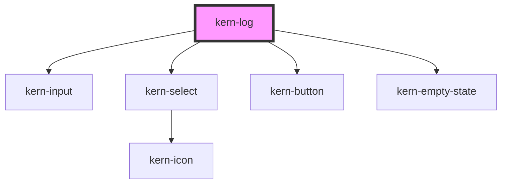

# kern-log


<!-- Auto Generated Below -->


## Overview

Structured log viewer: time, level, source and message per entry, a search and level/source filters that combine,
a live mode that follows new entries, pause, copy and download. Entries are always shown as text, never as HTML.

**Data and buffer.** The app owns the data and its transport (WebSocket, SSE, polling) and assigns new arrays to
`entries`, oldest first. The log shows at most the newest `max-entries` of them and never changes the app's array:
trim it in the app with the same limit (`entries = [...entries, ...added].slice(-1000)`), so memory stays bounded.
Rows are kept per `id`: an update moves, adds and removes rows instead of rebuilding them, so text selection, open
details and the focused row survive. When old entries drop out at the top while you read further down, the rows
you look at stay in place.

**Live mode.** With `follow` the log stays at its latest entry while it is scrolled to the end. Scroll up and the
position stays; a button counts the new entries below («23 new») and jumps back. `paused` freezes the rows shown
while the app keeps delivering: the button then counts the waiting entries and resumes.

**Keyboard.** One row is in the tab order: Arrow keys, Page Up/Down, Home and End move between rows, Enter opens
the details of a row, Ctrl/Cmd+C copies it (without a text selection); Tab reaches the row's buttons. Screen
readers hear summaries only: «New log entries: 23» (at most every 5 seconds while not following) and the number of
matches after a filter change, never every row.

## Usage

### 01-live

# Live log

An MQTT log fed by a mock broker. `follow` keeps the log at its newest entry while it is scrolled to the end. Scroll up to read: the rows stay where they are, and a button counts the new entries below («12 new») and jumps back. «Pause» freezes the rows while messages keep arriving; the button then shows how many are waiting and resumes.

The app owns the data and the buffer: it appends new entries and trims its array to the same limit as `max-entries`, so memory stays bounded. The log never changes the array; it only shows the newest `max-entries` entries. «Burst» adds 2,000 entries at once to show the limit at work.

```html
<div style="display:grid;gap:8px">
  <kern-log follow max-entries="1000" max-height="320px" file-name="mqtt.log"></kern-log>
  <div style="display:flex;gap:8px;flex-wrap:wrap">
    <kern-button size="sm" class="burst">Burst 2,000</kern-button>
    <kern-button size="sm" variant="ghost" class="clear">Clear</kern-button>
  </div>
</div>
```

```js
const log = root.querySelector('kern-log');
const MAX = 1000;
const devices = ['kitchen-light', 'bathroom-fan', 'shutter-south', 'garage-door', 'heating-pro3em'];
const messages = [
  ['debug', (d) => `PUBLISH shellies/${d}/online (retain) → true`],
  ['info', (d) => `shellies/${d}/relay/0 → on`],
  ['info', (d) => `shellies/${d}/relay/0 → off`],
  ['info', (d) => `shellies/${d}/temperature → ${(20 + Math.random() * 4).toFixed(1)}`],
  ['debug', (d) => `PINGREQ from ${d}`],
  ['warn', (d) => `Client ${d} reconnected after ${Math.ceil(Math.random() * 9)} s`],
  ['error', (d) => `Client ${d} disconnected: keep-alive timeout`],
];
let entries = [];
let next = 1;
function entry() {
  const device = devices[Math.floor(Math.random() * devices.length)];
  const r = Math.random();
  const [level, text] = messages[r < 0.03 ? 6 : r < 0.1 ? 5 : Math.floor(Math.random() * 5)];
  const id = next++;
  return {
    id, time: Date.now(), level, source: device, message: text(device),
    details: level === 'error' ? { clientId: device, lastPacket: new Date(Date.now() - 45_000).toISOString(), keepAlive: 30 } : undefined,
  };
}
// The app trims its buffer with the same limit as max-entries.
function add(list) {
  entries = [...entries, ...list].slice(-MAX);
  log.entries = entries;
}
add(Array.from({ length: 40 }, entry));
const timer = setInterval(() => {
  if (!log.isConnected) return clearInterval(timer);
  add(Array.from({ length: 1 + Math.floor(Math.random() * 3) }, entry));
}, 700);
root.querySelector('.burst').addEventListener('click', () => add(Array.from({ length: 2000 }, entry)));
root.querySelector('.clear').addEventListener('click', () => {
  entries = [];
  log.entries = entries;
});
```


### 02-filters

# Search and filters

A finished network scan. The search looks in message, source and details and marks the matches; levels and sources combine with it (several levels or sources are alternatives). The toolbar shows the number of matches with «Reset filters», and when nothing matches the log says so. `query`, `levels` and `sources` can be set from the app, e.g. to open the log with only warnings and errors; `kernFilter` reports the user's changes.

«Copy» copies the entries shown, after the filters; «Download» saves them as a text file (`kernDownload` is cancelable, to export them yourself). A single entry is copied with the button at the end of its row, or with Ctrl/Cmd+C on the focused row.

```html
<div style="display:grid;gap:8px">
  <kern-log max-height="280px" file-name="scan-192.168.1.0-24.log"></kern-log>
  <p class="state" style="margin:0;color:var(--text-muted);font-size:13px">kernFilter: –</p>
</div>
```

```js
const log = root.querySelector('kern-log');
const start = Date.parse('2026-10-20T08:00:00Z');
const hosts = [
  ['192.168.1.1', 'Router', 'info', 'Open ports: 53, 80, 443'],
  ['192.168.1.21', 'Kitchen light', 'info', 'Shelly 1 Mini Gen3, firmware 1.4.4'],
  ['192.168.1.22', 'Bathroom fan', 'warn', 'Shelly Plus 1PM, firmware 1.3.3: update available'],
  ['192.168.1.23', 'Shutter south', 'info', 'Shelly Plus 2PM, firmware 1.4.4'],
  ['192.168.1.30', 'NAS', 'warn', 'SMB1 enabled'],
  ['192.168.1.41', 'Garage door', 'error', 'No response to HTTP after 3 attempts'],
  ['192.168.1.42', 'Heating', 'info', 'Shelly Pro 3EM, firmware 1.4.4'],
  ['192.168.1.77', 'Unknown', 'warn', 'Unknown device, MAC A8:03:2A:7F:10:C4'],
];
const entries = [{ id: 0, time: start, level: 'info', source: 'scanner', message: 'Scan of 192.168.1.0/24 started (254 addresses)' }];
hosts.forEach(([ip, name, level, text], i) => {
  const t = start + (i + 1) * 1700;
  entries.push({ id: `${ip}-ping`, time: t, level: 'debug', source: ip, message: `ICMP echo reply from ${ip} in ${2 + i} ms` });
  entries.push({
    id: ip, time: t + 400, level, source: ip, message: `${name}: ${text}`,
    details: level === 'error' ? 'GET http://' + ip + '/shelly\n  attempt 1: timeout after 2000 ms\n  attempt 2: timeout after 2000 ms\n  attempt 3: connection refused' : undefined,
  });
});
entries.push({ id: 'done', time: start + 16_000, level: 'info', source: 'scanner', message: 'Scan finished: 8 hosts, 3 warnings, 1 error' });
log.entries = entries;
log.levels = ['info', 'warn', 'error'];
const state = root.querySelector('.state');
log.addEventListener('kernFilter', (e) => (state.textContent = `kernFilter: ${JSON.stringify(e.detail)}`));
```


### 03-compact

# Details, wrapping and a bare log

In a job drawer or a card, `no-filters` leaves only pause, copy and download, and `wrap` wraps long messages instead of scrolling sideways. Entries with `details` get a toggle (or Enter on the focused row) that shows them below the message: strings as given, objects as JSON. Everything is shown as text, so HTML in a message stays visible as markup.

Narrow logs move the message below time, level and source. Texts follow the Kern language (`setKernLocale()`, `<html lang>`); label properties override single texts, here in German.

```html
<kern-card heading="Firmware update · Bathroom fan" style="max-width:420px">
  <kern-log no-filters wrap max-height="240px" label-pause="Anhalten" label-resume="Fortsetzen" label-copy="Kopieren" label-download="Herunterladen"></kern-log>
</kern-card>
```

```js
const log = root.querySelector('kern-log');
const t = Date.parse('2026-10-20T08:00:00Z');
log.entries = [
  { id: 1, time: t, level: 'info', source: 'updater', message: 'Checking 192.168.1.22 (Bathroom fan): firmware 1.3.3 → 1.4.4' },
  { id: 2, time: t + 1200, level: 'info', source: 'updater', message: 'Downloading https://updates.example.net/shelly/plus1pm/1.4.4/firmware.zip (1.6 MB)' },
  { id: 3, time: t + 5200, level: 'warn', source: 'updater', message: 'Signature check took 4.1 s (expected < 2 s)' },
  { id: 4, time: t + 6400, level: 'info', source: 'device', message: '<b>Rebooting</b> – markup in messages is shown as text' },
  { id: 5, time: t + 21_000, level: 'error', source: 'device', message: 'Device did not come back within 15 s', details: { ip: '192.168.1.22', attempts: 3, lastError: 'ECONNREFUSED' } },
  { id: 6, time: t + 34_000, level: 'info', source: 'device', message: 'Device back online, firmware 1.4.4' },
];
```


## Properties

| Property          | Attribute           | Description                                                                                 | Type                  | Default     |
| ----------------- | ------------------- | ------------------------------------------------------------------------------------------- | --------------------- | ----------- |
| `entries`         | --                  | The entries, oldest first. Assign a new array for updates; `id` keeps each row.             | `KernLogEntry[]`      | `[]`        |
| `fileName`        | `file-name`         | File name of the download.                                                                  | `string`              | `'log.txt'` |
| `follow`          | `follow`            | Follow new entries while scrolled to the end; scrolled up, the position stays.              | `boolean`             | `false`     |
| `label`           | `label`             | Accessible name of the list.                                                                | `string \| undefined` | `undefined` |
| `labelAllLevels`  | `label-all-levels`  |                                                                                             | `string \| undefined` | `undefined` |
| `labelAllSources` | `label-all-sources` |                                                                                             | `string \| undefined` | `undefined` |
| `labelAnnounce`   | `label-announce`    | Screen reader hint for new entries; `{n}` is replaced.                                      | `string \| undefined` | `undefined` |
| `labelCopied`     | `label-copied`      |                                                                                             | `string \| undefined` | `undefined` |
| `labelCopy`       | `label-copy`        |                                                                                             | `string \| undefined` | `undefined` |
| `labelCopyEntry`  | `label-copy-entry`  |                                                                                             | `string \| undefined` | `undefined` |
| `labelCount`      | `label-count`       | Number of matches; `{n}` and `{total}` are replaced.                                        | `string \| undefined` | `undefined` |
| `labelDebug`      | `label-debug`       |                                                                                             | `string \| undefined` | `undefined` |
| `labelDetails`    | `label-details`     |                                                                                             | `string \| undefined` | `undefined` |
| `labelDownload`   | `label-download`    |                                                                                             | `string \| undefined` | `undefined` |
| `labelError`      | `label-error`       |                                                                                             | `string \| undefined` | `undefined` |
| `labelInfo`       | `label-info`        |                                                                                             | `string \| undefined` | `undefined` |
| `labelLatest`     | `label-latest`      |                                                                                             | `string \| undefined` | `undefined` |
| `labelLevel`      | `label-level`       |                                                                                             | `string \| undefined` | `undefined` |
| `labelNew`        | `label-new`         | Button text for new or waiting entries; `{n}` is replaced.                                  | `string \| undefined` | `undefined` |
| `labelPause`      | `label-pause`       |                                                                                             | `string \| undefined` | `undefined` |
| `labelReset`      | `label-reset`       |                                                                                             | `string \| undefined` | `undefined` |
| `labelResume`     | `label-resume`      |                                                                                             | `string \| undefined` | `undefined` |
| `labelSearch`     | `label-search`      |                                                                                             | `string \| undefined` | `undefined` |
| `labelSource`     | `label-source`      |                                                                                             | `string \| undefined` | `undefined` |
| `labelWarn`       | `label-warn`        |                                                                                             | `string \| undefined` | `undefined` |
| `levels`          | --                  | Levels shown (`debug`, `info`, `warn`, `error`); empty shows all.                           | `string[]`            | `[]`        |
| `maxEntries`      | `max-entries`       | At most this many entries are shown (the newest). Trim the app's array with the same limit. | `number`              | `1000`      |
| `maxHeight`       | `max-height`        | Scroll beyond this height, e.g. `320px`. Alternatively give the element a height.           | `string \| undefined` | `undefined` |
| `noFilters`       | `no-filters`        | Hide the search and the filters (pause, copy and download stay).                            | `boolean`             | `false`     |
| `paused`          | `paused`            | Freeze the rows shown; new entries wait and are counted. Set by the Pause button too.       | `boolean`             | `false`     |
| `query`           | `query`             | Search text: case-insensitive, in message, source and details.                              | `string`              | `''`        |
| `sources`         | --                  | Sources shown; empty shows all.                                                             | `string[]`            | `[]`        |
| `wrap`            | `wrap`              | Wrap long messages instead of scrolling sideways.                                           | `boolean`             | `false`     |


## Events

| Event          | Description                                                                      | Type                                                               |
| -------------- | -------------------------------------------------------------------------------- | ------------------------------------------------------------------ |
| `kernCopy`     | After a successful copy of one entry or of all entries shown.                    | `CustomEvent<{ value: string; count: number; }>`                   |
| `kernDownload` | Before the download of the entries shown; cancel it to export the text yourself. | `CustomEvent<{ value: string; count: number; fileName: string; }>` |
| `kernFilter`   | Search, levels or sources changed by the user.                                   | `CustomEvent<KernLogFilter>`                                       |
| `kernPause`    | Paused or resumed by the user.                                                   | `CustomEvent<{ paused: boolean; }>`                                |


## Methods

### `getText() => Promise<string>`

The entries shown (after the filters), as text: one line per entry, details indented.

#### Returns

Type: `Promise<string>`


### `scrollToEnd() => Promise<void>`

Scroll to the latest entry.

#### Returns

Type: `Promise<void>`


## Shadow Parts

| Part        | Description                                |
| ----------- | ------------------------------------------ |
| `"latest"`  | The «Jump to latest» / «Resume» button     |
| `"list"`    | The scrolling list of rows                 |
| `"toolbar"` | Search, filters and actions above the rows |


## CSS Custom Properties

| Name                      | Description                                  |
| ------------------------- | -------------------------------------------- |
| `--kern-log-source-width` | Width of the source column (default `16ch`). |


## Dependencies

### Depends on

- [kern-input](../kern-input)
- [kern-select](../kern-select)
- [kern-button](../kern-button)
- [kern-empty-state](../kern-empty-state)

### Graph


----------------------------------------------


