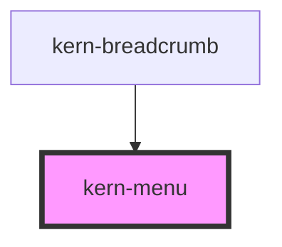

# kern-menu


<!-- Auto Generated Below -->


## Overview

Action menu behind a trigger (e.g. a „⋯“ kern-button): kern-menu-item children, `<hr>` as separator. Opens on click,
Enter, Space or Arrow Down (Arrow Up starts at the end); Arrow keys, Home/End and letters move, Enter picks, Escape
or Tab closes. Picking emits `kernSelect` and returns the focus to the trigger.

## Usage

### 01-basic

# Row actions

Put the trigger into the `trigger` slot — usually an `icon-only` kern-button with `label` — and kern-menu-item elements into the menu, with `<hr>` as separator. `icon` adds a glyph, `tone="danger"` marks destructive actions and `disabled` greys an item out. Picking one emits `kernSelect` with the item's `value`.

```html
<kern-menu align="start" label="Actions for Rollladen Süd">
  <kern-button slot="trigger" variant="ghost" icon-only label="More actions"><kern-icon name="more"></kern-icon></kern-button>
  <kern-menu-item value="reboot" icon="power">Restart</kern-menu-item>
  <kern-menu-item value="refresh" icon="refresh">Query status</kern-menu-item>
  <kern-menu-item value="edit" icon="edit">Rename</kern-menu-item>
  <hr>
  <kern-menu-item value="reset" icon="warn" tone="danger">Factory reset</kern-menu-item>
  <kern-menu-item value="delete" icon="trash" disabled>Delete</kern-menu-item>
</kern-menu>
<p class="out" style="font-size:13px;color:var(--text-muted)">Pick an action.</p>
```

```js
root.querySelector('kern-menu').addEventListener('kernSelect', (e) => {
  root.querySelector('.out').textContent = `kernSelect → ${e.detail.value}`;
});
```


### 02-align-and-text-trigger

# Aligned to the end

`align="end"` lines up the menu's right edge with the trigger, for triggers at the right of a row or toolbar. Without `label` the menu takes its name from the trigger's text; items without `value` pass their text.

```html
<div style="display:flex;justify-content:flex-end">
  <kern-menu align="end">
    <kern-button slot="trigger" size="sm">Export <kern-icon name="chevron-down"></kern-icon></kern-button>
    <kern-menu-item icon="download">CSV</kern-menu-item>
    <kern-menu-item icon="download">JSON</kern-menu-item>
    <kern-menu-item icon="copy">Copy IP list</kern-menu-item>
  </kern-menu>
</div>
```


### 03-keyboard

# Keyboard

Enter, Space or Arrow Down open the menu at the first item, Arrow Up at the last. Arrow keys, Home and End move between items, a letter jumps to the next item starting with it. Enter picks, Escape or Tab closes, and the focus returns to the trigger. `show()` and `hide()` open and close it from script.

```html
<div style="display:flex;gap:12px;align-items:center">
  <kern-menu label="Firmware channel">
    <kern-button slot="trigger">Channel</kern-button>
    <kern-menu-item value="stable">Stable</kern-menu-item>
    <kern-menu-item value="beta">Beta</kern-menu-item>
    <kern-menu-item value="dev" disabled>Development</kern-menu-item>
  </kern-menu>
  <kern-button class="open" variant="ghost">Open with show()</kern-button>
</div>
```

```js
root.querySelector('.open').addEventListener('click', () => root.querySelector('kern-menu').show());
```


## Properties

| Property | Attribute | Description                                                   | Type                  | Default     |
| -------- | --------- | ------------------------------------------------------------- | --------------------- | ----------- |
| `align`  | `align`   | Which edges line up with the trigger.                         | `"end" \| "start"`    | `'start'`   |
| `label`  | `label`   | Accessible name of the menu (defaults to the trigger's text). | `string \| undefined` | `undefined` |


## Events

| Event        | Description         | Type                              |
| ------------ | ------------------- | --------------------------------- |
| `kernSelect` | An item was picked. | `CustomEvent<{ value: string; }>` |


## Methods

### `hide() => Promise<void>`

Closes the menu.

#### Returns

Type: `Promise<void>`


### `show() => Promise<void>`

Opens the menu and focuses the first item.

#### Returns

Type: `Promise<void>`


## Slots

| Slot        | Description                                   |
| ----------- | --------------------------------------------- |
|             | kern-menu-item elements and `<hr>` separators |
| `"trigger"` | The element that opens the menu               |


## Shadow Parts

| Part     | Description       |
| -------- | ----------------- |
| `"menu"` | The popover panel |


## Dependencies

### Used by

 - [kern-breadcrumb](../kern-breadcrumb)

### Graph


----------------------------------------------


