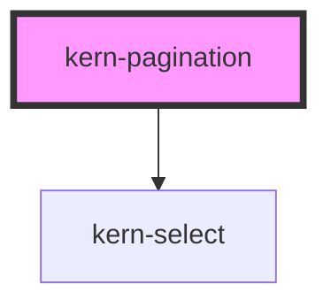

# kern-pagination

<!-- Auto Generated Below -->

## Overview

Paging for long tables and lists: range („1–25 von 380“), optional page size, first/previous, page numbers with
„…“, next/last. Emits `kernPageChange`; the app loads the page. Changing the page size keeps the first visible
item on screen.

## Properties

| Property        | Attribute         | Description                                                                      | Type                  | Default                     |
| --------------- | ----------------- | -------------------------------------------------------------------------------- | --------------------- | --------------------------- |
| `label`         | `label`           |                                                                                  | `string`              | `'Seiten'`                  |
| `labelFirst`    | `label-first`     |                                                                                  | `string`              | `'Erste Seite'`             |
| `labelLast`     | `label-last`      |                                                                                  | `string`              | `'Letzte Seite'`            |
| `labelNext`     | `label-next`      |                                                                                  | `string`              | `'Nächste Seite'`           |
| `labelPage`     | `label-page`      | `{n}` is replaced.                                                               | `string`              | `'Seite {n}'`               |
| `labelPageSize` | `label-page-size` |                                                                                  | `string`              | `'Pro Seite'`               |
| `labelPrevious` | `label-previous`  |                                                                                  | `string`              | `'Vorherige Seite'`         |
| `labelRange`    | `label-range`     | `{from}`, `{to}` and `{total}` are replaced.                                     | `string`              | `'{from}–{to} von {total}'` |
| `locale`        | `locale`          | BCP 47 locale for numbers; defaults to `<html lang>`, then the browser language. | `string \| undefined` | `undefined`                 |
| `page`          | `page`            | Current page, from 1.                                                            | `number`              | `1`                         |
| `pageSize`      | `page-size`       |                                                                                  | `number`              | `25`                        |
| `pageSizes`     | `page-sizes`      | Offered page sizes, e.g. `10,25,50,100`; empty hides the choice.                 | `number[] \| string`  | `''`                        |
| `siblings`      | `siblings`        | Page numbers on each side of the current one.                                    | `number`              | `1`                         |
| `total`         | `total`           | Number of items.                                                                 | `number`              | `0`                         |

## Events

| Event            | Description                    | Type                                               |
| ---------------- | ------------------------------ | -------------------------------------------------- |
| `kernPageChange` | The page or page size changed. | `CustomEvent<{ page: number; pageSize: number; }>` |

## Dependencies

### Depends on

- [kern-select](../kern-select)

### Graph

----------------------------------------------

