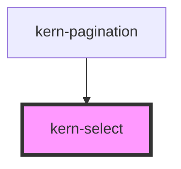

# kern-select

<!-- Auto Generated Below -->

## Overview

Labelled choice with its own dropdown list, form-associated. Options come from the `options`
property or from child `<option>` elements (kept in sync, so `@for` / `*ngFor` over options works).
Elements in the `footer` slot appear below the list, e.g. a button "Standorte bearbeiten"; clicking
one closes the list.

`searchable` adds a search field to the list (filters by label). `multiple` makes `value` a `string[]`: the field
shows chips (× removes, Backspace removes the last), the list stays open and toggles options; the form gets one
entry per value.

Keyboard: Enter, Space or Arrow keys open; Arrow keys, Home, End and typing a letter move; Enter
or Space picks; Escape closes; Tab moves on to the footer.

## Properties

| Property         | Attribute          | Description                                                                               | Type                        | Default               |
| ---------------- | ------------------ | ----------------------------------------------------------------------------------------- | --------------------------- | --------------------- |
| `ariaLabelText`  | `aria-label-text`  | Accessible name when there is no visible label.                                           | `string \| undefined`       | `undefined`           |
| `disabled`       | `disabled`         |                                                                                           | `boolean`                   | `false`               |
| `error`          | `error`            |                                                                                           | `string \| undefined`       | `undefined`           |
| `hint`           | `hint`             |                                                                                           | `string \| undefined`       | `undefined`           |
| `label`          | `label`            |                                                                                           | `string \| undefined`       | `undefined`           |
| `labelNoResults` | `label-no-results` |                                                                                           | `string`                    | `'Keine Treffer'`     |
| `labelRemove`    | `label-remove`     | Accessible name of a chip's ×; `{label}` is replaced.                                     | `string`                    | `'{label} entfernen'` |
| `labelSearch`    | `label-search`     |                                                                                           | `string`                    | `'Suchen …'`          |
| `multiple`       | `multiple`         | Several values; `value` becomes a `string[]`.                                             | `boolean`                   | `false`               |
| `name`           | `name`             |                                                                                           | `string \| undefined`       | `undefined`           |
| `options`        | --                 | Takes precedence over child `<option>` elements.                                          | `KernOption[] \| undefined` | `undefined`           |
| `placeholder`    | `placeholder`      | Shown when no option is selected.                                                         | `string \| undefined`       | `undefined`           |
| `required`       | `required`         |                                                                                           | `boolean`                   | `false`               |
| `searchable`     | `searchable`       | Search field in the list; filters options by label.                                       | `boolean`                   | `false`               |
| `size`           | `size`             |                                                                                           | `"md" \| "sm"`              | `'md'`                |
| `value`          | `value`            | The picked value; with `multiple` a `string[]` (a comma-separated attribute is accepted). | `string \| string[]`        | `''`                  |

## Events

| Event        | Description                                                   | Type                                          |
| ------------ | ------------------------------------------------------------- | --------------------------------------------- |
| `kernChange` | When the user picks (or, with `multiple`, toggles) an option. | `CustomEvent<{ value: string \| string[]; }>` |

## Methods

### `hide() => Promise<void>`

Closes the dropdown.

#### Returns

Type: `Promise<void>`

### `setFocus() => Promise<void>`

#### Returns

Type: `Promise<void>`

### `show() => Promise<void>`

Opens the dropdown.

#### Returns

Type: `Promise<void>`

## Slots

| Slot       | Description                                                    |
| ---------- | -------------------------------------------------------------- |
|            | `<option>` elements (read, not shown)                          |
| `"footer"` | Actions below the list (kern-button variant="ghost" size="sm") |

## Shadow Parts

| Part        | Description          |
| ----------- | -------------------- |
| `"chip"`    | Each chip (multiple) |
| `"control"` | The trigger          |
| `"listbox"` | The dropdown panel   |
| `"option"`  | Each option          |

## Dependencies

### Used by

 - [kern-pagination](../kern-pagination)

### Graph

----------------------------------------------

