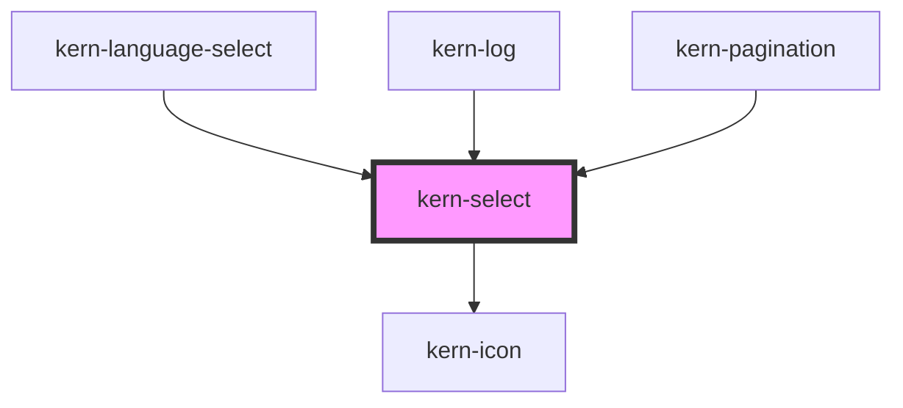

# kern-select


<!-- Auto Generated Below -->


## Overview

Labelled choice with its own dropdown list, form-associated. Options come from the `options`
property or from child `<option>` elements (kept in sync, so `@for` / `*ngFor` over options works).
Elements in the `footer` slot appear below the list, e.g. a button "Standorte bearbeiten"; clicking
one closes the list.

`searchable` adds a search field to the list (filters by label). `multiple` makes `value` a `string[]`: the field
shows chips (× removes, Backspace removes the last), the list stays open and toggles options; the form gets one
entry per value.

Keyboard: Enter, Space or Arrow keys open; Arrow keys, Home, End and typing a letter move; Enter
or Space picks; Escape closes; Tab moves on to the footer.

## Usage

### 01-basic

# Basic select

Options come from child `<option>` elements (`disabled` and `selected` are read). Keyboard: Enter, Space or the arrow keys open the list; arrow keys, Home, End or typing a letter move; Enter or Space picks; Escape closes.

```html
<div style="display:grid;gap:16px;max-width:320px">
  <kern-select label="Site" value="home" hint="Where the device is installed">
    <option value="home">Lakeview House</option>
    <option value="flat">Holiday Flat</option>
    <option value="office">Office Bern</option>
  </kern-select>
  <kern-select label="Update channel" placeholder="Choose a channel" required error="Please choose a channel">
    <option value="stable">Stable</option>
    <option value="beta">Beta</option>
  </kern-select>
  <kern-select size="sm" aria-label-text="Site" value="home" disabled>
    <option value="home">Lakeview House</option>
  </kern-select>
</div>
```


### 02-searchable-multiple

# Searchable and multiple

`searchable` adds a search field that filters by label. With `multiple`, `value` is a `string[]` shown as chips (× or Backspace removes one), the list stays open while you toggle options, and the form receives one entry per value.

```html
<div style="display:grid;gap:16px;max-width:360px">
  <kern-select label="Model" placeholder="Choose a model" searchable>
    <option value="1pm">Plus 1PM</option>
    <option value="2pm">Plus 2PM</option>
    <option value="i4">Plus i4</option>
    <option value="uni">Plus Uni</option>
    <option value="ht" disabled>H&amp;T (not supported)</option>
    <option value="dimmer">Dimmer 2</option>
    <option value="em">Pro 3EM</option>
    <option value="mini">Mini 1PM Gen3</option>
  </kern-select>
  <kern-select label="Rooms" placeholder="Choose rooms" multiple searchable>
    <option value="bath" selected>Bathroom</option>
    <option value="kitchen" selected>Kitchen</option>
    <option value="living">Living room</option>
    <option value="bedroom">Bedroom</option>
    <option value="garage">Garage</option>
    <option value="garden">Garden</option>
  </kern-select>
  <output style="font:12px var(--font-mono);color:var(--text-muted)">kernChange → …</output>
</div>
```

```js
const out = root.querySelector('output');
for (const el of root.querySelectorAll('kern-select')) {
  el.addEventListener('kernChange', (e) => (out.textContent = 'kernChange → ' + JSON.stringify(e.detail)));
}
```


### 03-options-footer

# Options property and footer

The `options` property (`{ value, label, disabled? }[]`) takes precedence over child elements and suits data from an API. Buttons in the `footer` slot appear below the list; clicking one closes it.

```html
<div style="max-width:320px">
  <kern-select label="Gateway" placeholder="Choose a gateway">
    <kern-button slot="footer" size="sm" variant="ghost">Manage gateways …</kern-button>
  </kern-select>
</div>
```

```js
const select = root.querySelector('kern-select');
select.options = [
  { value: '192.168.1.1', label: 'Router (192.168.1.1)' },
  { value: '192.168.1.2', label: 'Pi-hole (192.168.1.2)' },
  { value: '192.168.1.3', label: 'Old router (offline)', disabled: true },
];
select.value = '192.168.1.1';
```


### 04-icons

# Options with icons

`data-icon` on an `<option>` puts a kern-icon before the label, in the list and in the field (`icon` in `options`). `aria-label` gives a short label its full name for screen readers, `lang` marks its language.

```html
<kern-select label="Region" value="ch" style="max-width:260px">
  <option value="ch" data-icon="flag-ch">Switzerland</option>
  <option value="de" data-icon="flag-de">Germany</option>
  <option value="at" data-icon="flag-at">Austria</option>
</kern-select>
```


## Properties

| Property         | Attribute          | Description                                                                               | Type                        | Default     |
| ---------------- | ------------------ | ----------------------------------------------------------------------------------------- | --------------------------- | ----------- |
| `ariaLabelText`  | `aria-label-text`  | Accessible name when there is no visible label.                                           | `string \| undefined`       | `undefined` |
| `disabled`       | `disabled`         |                                                                                           | `boolean`                   | `false`     |
| `error`          | `error`            |                                                                                           | `string \| undefined`       | `undefined` |
| `hint`           | `hint`             |                                                                                           | `string \| undefined`       | `undefined` |
| `label`          | `label`            |                                                                                           | `string \| undefined`       | `undefined` |
| `labelNoResults` | `label-no-results` |                                                                                           | `string \| undefined`       | `undefined` |
| `labelRemove`    | `label-remove`     | Accessible name of a chip's ×; `{label}` is replaced.                                     | `string \| undefined`       | `undefined` |
| `labelSearch`    | `label-search`     |                                                                                           | `string \| undefined`       | `undefined` |
| `multiple`       | `multiple`         | Several values; `value` becomes a `string[]`.                                             | `boolean`                   | `false`     |
| `name`           | `name`             |                                                                                           | `string \| undefined`       | `undefined` |
| `options`        | --                 | Takes precedence over child `<option>` elements.                                          | `KernOption[] \| undefined` | `undefined` |
| `placeholder`    | `placeholder`      | Shown when no option is selected.                                                         | `string \| undefined`       | `undefined` |
| `required`       | `required`         |                                                                                           | `boolean`                   | `false`     |
| `searchable`     | `searchable`       | Search field in the list; filters options by label.                                       | `boolean`                   | `false`     |
| `size`           | `size`             |                                                                                           | `"md" \| "sm"`              | `'md'`      |
| `value`          | `value`            | The picked value; with `multiple` a `string[]` (a comma-separated attribute is accepted). | `string \| string[]`        | `''`        |


## Events

| Event        | Description                                                   | Type                                          |
| ------------ | ------------------------------------------------------------- | --------------------------------------------- |
| `kernChange` | When the user picks (or, with `multiple`, toggles) an option. | `CustomEvent<{ value: string \| string[]; }>` |


## Methods

### `hide() => Promise<void>`

Closes the dropdown.

#### Returns

Type: `Promise<void>`


### `setFocus() => Promise<void>`


#### Returns

Type: `Promise<void>`


### `show() => Promise<void>`

Opens the dropdown.

#### Returns

Type: `Promise<void>`


## Slots

| Slot       | Description                                                    |
| ---------- | -------------------------------------------------------------- |
|            | `<option>` elements (read, not shown)                          |
| `"footer"` | Actions below the list (kern-button variant="ghost" size="sm") |


## Shadow Parts

| Part        | Description          |
| ----------- | -------------------- |
| `"chip"`    | Each chip (multiple) |
| `"control"` | The trigger          |
| `"listbox"` | The dropdown panel   |
| `"option"`  | Each option          |


## Dependencies

### Used by

 - [kern-language-select](../kern-language-select)
 - [kern-log](../kern-log)
 - [kern-pagination](../kern-pagination)

### Depends on

- [kern-icon](../kern-icon)

### Graph


----------------------------------------------


