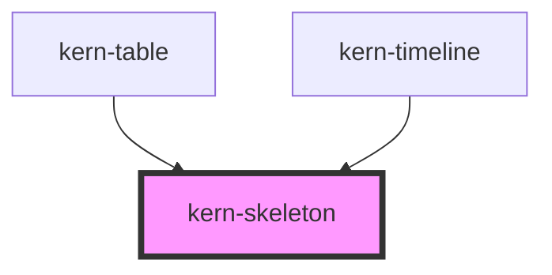

# kern-skeleton


<!-- Auto Generated Below -->


## Overview

Placeholder in the shape of content that is still loading, so the layout does not jump. `text` draws lines (the last
one shorter), `block` a rectangle (cards, stats, charts), `circle` an avatar or status dot. Hidden from assistive
technology; mark the loading container with `aria-busy="true"` instead.

## Usage

### 01-variants

# Placeholders while loading

`text` draws `lines` lines (the last one shorter), `block` a rectangle with `width` and `height`, `circle` a dot of `size`. Skeletons are hidden from assistive technology; mark the loading container with `aria-busy="true"` instead.

```html
<div aria-busy="true" style="display:grid;gap:16px;max-width:360px">
  <div style="display:flex;gap:12px;align-items:center">
    <kern-skeleton variant="circle" size="32px"></kern-skeleton>
    <kern-skeleton lines="2"></kern-skeleton>
  </div>
  <kern-skeleton lines="3" width="80%"></kern-skeleton>
  <kern-skeleton variant="block" height="80px"></kern-skeleton>
</div>
```


### 02-swap

# Replacing with content

Keep the skeleton the same size as the content it stands for, then swap it once the data has arrived, so the layout does not jump.

```html
<kern-card heading="Bad Lüftung" aria-busy="true" style="max-width:320px">
  <div class="body"><kern-skeleton lines="3"></kern-skeleton></div>
  <kern-button slot="footer" size="sm" class="load">Load again</kern-button>
</kern-card>
```

```js
const card = root.querySelector('kern-card');
const body = root.querySelector('.body');
const load = () => {
  card.setAttribute('aria-busy', 'true');
  body.innerHTML = '<kern-skeleton lines="3"></kern-skeleton>';
  setTimeout(() => {
    body.innerHTML = 'Plus 1PM<br>192.168.1.21<br>Firmware 1.4.4';
    card.removeAttribute('aria-busy');
  }, 1500);
};
root.querySelector('.load').addEventListener('click', load);
load();
```


## Properties

| Property  | Attribute | Description                                                  | Type                            | Default     |
| --------- | --------- | ------------------------------------------------------------ | ------------------------------- | ----------- |
| `height`  | `height`  | Height of a block, e.g. `80px`.                              | `string \| undefined`           | `undefined` |
| `lines`   | `lines`   | Number of lines (text).                                      | `number`                        | `1`         |
| `size`    | `size`    | Diameter of a circle, e.g. `32px`.                           | `string`                        | `'32px'`    |
| `variant` | `variant` |                                                              | `"block" \| "circle" \| "text"` | `'text'`    |
| `width`   | `width`   | Width, e.g. `120px` or `60%` (text and block; default 100%). | `string \| undefined`           | `undefined` |


## Dependencies

### Used by

 - [kern-table](../kern-table)
 - [kern-timeline](../kern-timeline)

### Graph


----------------------------------------------


