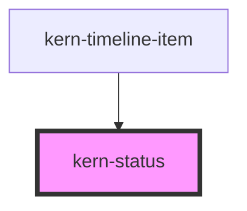

# kern-status


<!-- Auto Generated Below -->


## Overview

State of a device, job or server: a dot whose shape and colour differ per tone, plus the word.
ok = circle, warn = diamond, danger = square, busy = pulsing circle, neutral = hollow circle.

## Usage

### 01-tones

# Device states

A dot plus the state as a word. Each tone has its own shape as well as colour, so the state does not depend on colour alone: `ok` circle, `warn` diamond, `danger` square, `busy` pulsing circle, `neutral` hollow circle.

```html
<div style="display:flex;flex-wrap:wrap;gap:16px;align-items:center">
  <kern-status tone="ok">Active</kern-status>
  <kern-status tone="warn">Missing</kern-status>
  <kern-status tone="danger">Offline</kern-status>
  <kern-status tone="busy">Scanning</kern-status>
  <kern-status>Reset</kern-status>
</div>
```


### 02-in-context

# In headers and lists

Typical places are the topbar (server connection), page headers and list rows. Always keep the word: the dot alone is only for the `start` slot of a kern-list-item whose text already states the state.

```html
<kern-list label="Devices" style="max-width:420px">
  <kern-list-item heading="Bad Lüftung" description="Plus 1PM · 192.168.1.21">
    <kern-status slot="meta" tone="ok">Active</kern-status>
  </kern-list-item>
  <kern-list-item heading="Rollladen Süd" description="Pro 2PM · not reachable since yesterday">
    <kern-status slot="start" tone="warn"></kern-status>
  </kern-list-item>
</kern-list>
```


## Properties

| Property | Attribute | Description | Type                                                | Default     |
| -------- | --------- | ----------- | --------------------------------------------------- | ----------- |
| `tone`   | `tone`    |             | `"busy" \| "danger" \| "neutral" \| "ok" \| "warn"` | `'neutral'` |


## Slots

| Slot | Description                           |
| ---- | ------------------------------------- |
|      | The state as a word (always required) |


## Shadow Parts

| Part    | Description   |
| ------- | ------------- |
| `"dot"` | The indicator |


## Dependencies

### Used by

 - [kern-timeline-item](../kern-timeline-item)

### Graph


----------------------------------------------


