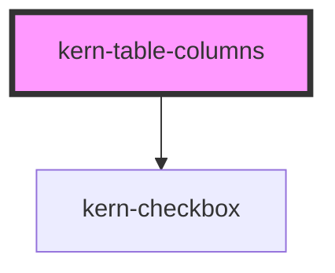

# kern-table-columns


<!-- Auto Generated Below -->


## Overview

Column chooser for a `kern-table` in data mode: a checkbox per column to show or hide it and buttons to move it up
or down (also Alt+↑/↓ in its row). Pinned columns are marked and move within their group. It edits a column state
and reports it with `kernColumnsChange`; the app sets it on the table (`table.columnState = e.detail.state`) and
stores it if it wants. Put it in a `kern-drawer`, a dialog or a panel next to the table.

## Usage

### 01-basic

# Choose and order columns

`kern-table-columns` edits a column state for a `kern-table` in data mode: a checkbox per column shows or hides it, the arrow buttons (or Alt+↑/↓ anywhere in its row) move it. The focus stays on the button pressed, and the new position is announced. Pinned columns are marked and move within their group; columns with `hideable: false` and the last `min-visible-columns` can't be hidden. Give it the table's `columns` and set the state it reports with `kernColumnsChange` on the table; storing it is up to the app.

```html
<div style="display:flex;flex-wrap:wrap;gap:var(--space-4);align-items:flex-start">
  <kern-card heading="Columns" style="flex:0 1 280px">
    <kern-table-columns min-visible-columns="2"></kern-table-columns>
  </kern-card>
  <kern-table compact style="flex:1 1 320px;min-width:0"></kern-table>
</div>
```

```js
const table = root.querySelector('kern-table');
const picker = root.querySelector('kern-table-columns');
const columns = [
  { key: 'name', label: 'Name', sortable: true, sorted: 'asc', hideable: false, pinned: 'start' },
  { key: 'ip', label: 'IP', mono: true },
  { key: 'firmware', label: 'Firmware', mono: true },
  { key: 'status', label: 'Status' },
  { key: 'site', label: 'Site', hidden: true },
];
table.columns = picker.columns = columns;
table.rows = [
  { id: 1, name: 'Kitchen light', ip: '192.168.1.34', firmware: '1.4.4', status: 'online', site: 'Haus Seeblick' },
  { id: 2, name: 'Bathroom fan', ip: '192.168.1.21', firmware: '1.4.2', status: 'update', site: 'Haus Seeblick' },
  { id: 3, name: 'Shutter south', ip: '192.168.1.52', firmware: '1.3.3', status: 'offline', site: 'Ferienwohnung' },
];
picker.addEventListener('kernColumnsChange', (e) => {
  table.columnState = e.detail.state;
});
```


## Properties

| Property            | Attribute             | Description                                                                                                   | Type                             | Default     |
| ------------------- | --------------------- | ------------------------------------------------------------------------------------------------------------- | -------------------------------- | ----------- |
| `columnState`       | --                    | The column state shown; changed by the user unless `kernColumnsChange` is cancelled. Default: from `columns`. | `KernColumnState[] \| undefined` | `undefined` |
| `columns`           | --                    | The table's columns (`key`, `label`, `hideable`, default `hidden` and `pinned`).                              | `KernTableColumn<any>[]`         | `[]`        |
| `label`             | `label`               | Accessible name of the list.                                                                                  | `string \| undefined`            | `undefined` |
| `labelMoveDown`     | `label-move-down`     | Accessible name of a move-down button; `{label}` is the column.                                               | `string \| undefined`            | `undefined` |
| `labelMoveUp`       | `label-move-up`       | Accessible name of a move-up button; `{label}` is the column.                                                 | `string \| undefined`            | `undefined` |
| `labelMoved`        | `label-moved`         | Announced after a move; `{label}`, `{position}` and `{count}` are replaced.                                   | `string \| undefined`            | `undefined` |
| `labelPinnedEnd`    | `label-pinned-end`    | Mark of a column pinned to the end.                                                                           | `string \| undefined`            | `undefined` |
| `labelPinnedStart`  | `label-pinned-start`  | Mark of a column pinned to the start.                                                                         | `string \| undefined`            | `undefined` |
| `minVisibleColumns` | `min-visible-columns` | At least this many columns stay visible: their checkboxes can't be cleared.                                   | `number`                         | `1`         |


## Events

| Event               | Description                                                                                                                      | Type                                         |
| ------------------- | -------------------------------------------------------------------------------------------------------------------------------- | -------------------------------------------- |
| `kernColumnsChange` | A column was shown, hidden or moved. `state` is the complete new column state. Cancelable: `preventDefault()` keeps it as it is. | `CustomEvent<{ state: KernColumnState[]; }>` |


## Dependencies

### Depends on

- [kern-checkbox](../kern-checkbox)

### Graph


----------------------------------------------


