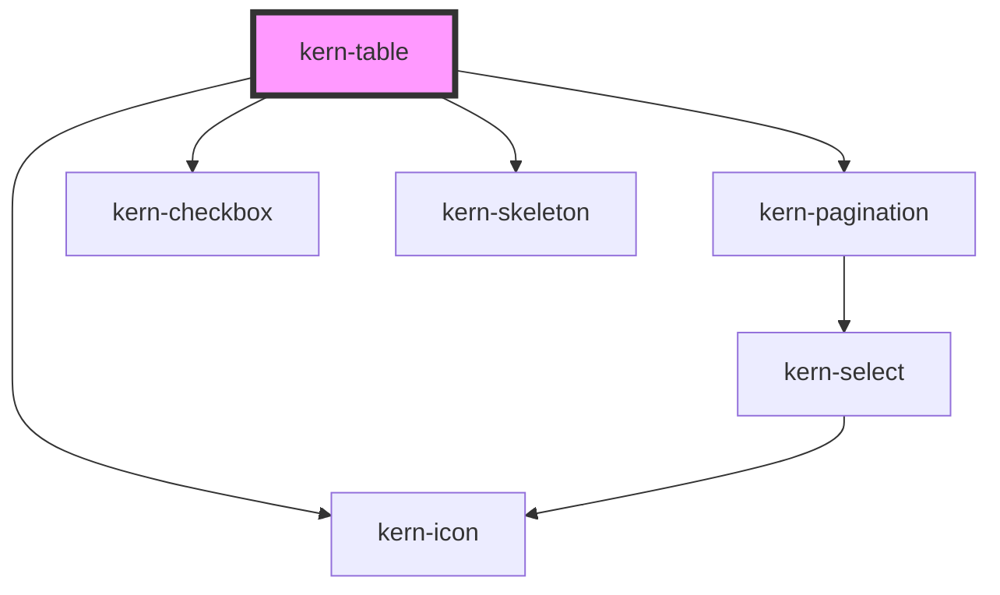

# kern-table


<!-- Auto Generated Below -->


## Overview

Dense data table: wraps a native `<table>` (light DOM, so cells can hold any markup and Angular bindings).
Sortable column: `<th sortable>`; `sorted="asc|desc"` is the current direction (the table sets `aria-sort`),
`data-key` names the column (else its index). `<td data-value="-71">` sorts by that value instead of the cell text.
Cells: `class="mono"` (IP, MAC, IDs), `class="num"` (right-aligned figures).
Rows: `class="clickable"`, `aria-selected="true"`, `class="dim"` (reset/inactive).
Empty state: `<td colspan="…" class="empty">`.

Data mode: with `columns` (and `rows`) the table builds its own `<table>`; don't combine it with own markup.
Assign new arrays to update it.

Pagination: `page-size` adds a `kern-pagination` below the rows. `internal` pages the rows itself (back to page 1
after sorting); `external` shows the rows it gets and the app loads a page on `kernPageChange` (bubbles from the
embedded pagination) and sets `total`. Labels: set them on `table.querySelector('kern-pagination')`.

Selection: `selectable` adds a first column with a `kern-checkbox` per row and one in the header for the visible rows
of the current page. Rows are identified by `data-key` on the `<tr>` (data mode: `rowKey`, default `row.id` or the
index). `selected` holds the keys and survives sorting, paging and new rows; selected rows get `aria-selected="true"`.

Detail rows: a `<tr kern-details>` right after its row is hidden until the row is expanded; it spans all columns,
moves with its row when sorting and is no row for paging or sorting. A `<button kern-expand>` in the row toggles it
(the table sets `aria-expanded` and `aria-controls`). Data mode: `detail` adds a chevron column and the detail rows.
`expanded` holds the keys of the open rows.

## Usage

### 01-device-table

# Device table

`kern-table` wraps a native `<table>` in the light DOM, so cells can hold any markup. Use `class="mono"` for IPs, MACs and IDs, `class="num"` for right-aligned figures, and `class="clickable"`, `aria-selected="true"` or `class="dim"` on rows.

```html
<kern-table>
  <table>
    <thead>
      <tr><th>Name</th><th>Model</th><th>IP</th><th>MAC</th><th>Signal</th><th>Status</th><th class="num">Power</th></tr>
    </thead>
    <tbody>
      <tr class="clickable">
        <td>Bathroom fan</td><td>Plus 1PM</td>
        <td class="mono">192.168.1.21</td>
        <td class="mono"><kern-copy>C82B961A3F00</kern-copy></td>
        <td><kern-signal rssi="-58" hide-value label="Wi-Fi signal"></kern-signal></td>
        <td><kern-status tone="ok">Active</kern-status></td>
        <td class="num">42 W</td>
      </tr>
      <tr class="clickable" aria-selected="true">
        <td>Kitchen light <kern-badge tone="warn">Update</kern-badge></td><td>Shelly 1</td>
        <td class="mono">192.168.1.34</td>
        <td class="mono"><kern-copy>A4CF12F45B21</kern-copy></td>
        <td><kern-signal rssi="-71" hide-value label="Wi-Fi signal"></kern-signal></td>
        <td><kern-status tone="ok">Active</kern-status></td>
        <td class="num">9 W</td>
      </tr>
      <tr class="clickable">
        <td>Shutter south</td><td>Pro 2PM</td>
        <td class="mono">192.168.1.52</td>
        <td class="mono"><kern-copy>34987A6E01C4</kern-copy></td>
        <td><kern-signal rssi="-84" hide-value label="Wi-Fi signal"></kern-signal></td>
        <td><kern-status tone="warn">Missing</kern-status></td>
        <td class="num">–</td>
      </tr>
      <tr class="dim">
        <td>Garage door</td><td>Plus Uni</td>
        <td class="mono">–</td>
        <td class="mono">E86BEA112B90</td>
        <td>–</td>
        <td><kern-status>Reset</kern-status></td>
        <td class="num">–</td>
      </tr>
    </tbody>
  </table>
</kern-table>
```


### 02-sortable

# Sortable columns

Mark a header with `sortable` and the table sorts its rows itself: numbers numerically, text in the page language, empty cells (and `–`) last. `sorted="asc|desc"` sets the initial order; the table keeps it and `aria-sort` up to date. Where a cell shows a component instead of its value, put the value in `data-value`. `compact` makes rows 30px instead of 36px.

```html
<kern-table compact>
  <table>
    <thead>
      <tr>
        <th sortable sorted="asc">Name</th>
        <th sortable>IP</th>
        <th sortable>Signal</th>
        <th sortable class="num">Uptime (h)</th>
      </tr>
    </thead>
    <tbody>
      <tr>
        <td>Kitchen light</td><td class="mono">192.168.1.34</td>
        <td data-value="-71"><kern-signal rssi="-71" hide-value label="Wi-Fi signal"></kern-signal></td>
        <td class="num">412</td>
      </tr>
      <tr>
        <td>Bathroom fan</td><td class="mono">192.168.1.21</td>
        <td data-value="-58"><kern-signal rssi="-58" hide-value label="Wi-Fi signal"></kern-signal></td>
        <td class="num">99</td>
      </tr>
      <tr>
        <td>Shutter south</td><td class="mono">192.168.1.52</td>
        <td data-value="-84"><kern-signal rssi="-84" hide-value label="Wi-Fi signal"></kern-signal></td>
        <td class="num">7</td>
      </tr>
      <tr>
        <td>Garage door</td><td class="mono">192.168.1.9</td>
        <td>–</td>
        <td class="num">–</td>
      </tr>
    </tbody>
  </table>
</kern-table>
```


### 03-external

# Controlled from outside

With `controlled="external"` the table does not touch the rows. A click on a sortable header (or `sortBy()`) only emits `kernSort` with `{ key, column, direction }`; your code loads or orders the data and sets `sorted` on the header. Use this when the server sorts, or when a framework renders the rows (Angular `@for`). `data-key` names a column, otherwise `key` is its index.

```html
<kern-table controlled="external">
  <table>
    <thead>
      <tr>
        <th sortable data-key="name">Name</th>
        <th sortable data-key="power" sorted="desc" class="num">Power (W)</th>
      </tr>
    </thead>
    <tbody></tbody>
  </table>
</kern-table>
```

```js
const devices = [
  { name: 'Bathroom fan', power: 42 },
  { name: 'Kitchen light', power: 9 },
  { name: 'Heat pump', power: 1840 },
];
const table = root.querySelector('kern-table');
const render = (key, direction) => {
  const sorted = [...devices].sort((a, b) => (a[key] < b[key] ? -1 : a[key] > b[key] ? 1 : 0) * (direction === 'asc' ? 1 : -1));
  root.querySelector('tbody').innerHTML = sorted.map((d) => `<tr><td>${d.name}</td><td class="num">${d.power}</td></tr>`).join('');
  root.querySelectorAll('th').forEach((th) => (th.dataset.key === key ? th.setAttribute('sorted', direction) : th.removeAttribute('sorted')));
};
table.addEventListener('kernSort', (ev) => render(ev.detail.key, ev.detail.direction));
render('power', 'desc');
```


### 04-empty

# Empty state

When a filter matches nothing, render a single cell spanning all columns with `class="empty"`.

```html
<kern-table>
  <table>
    <thead>
      <tr><th>Name</th><th>IP</th><th>Status</th></tr>
    </thead>
    <tbody>
      <tr><td colspan="3" class="empty">No devices match “garage”.</td></tr>
    </tbody>
  </table>
</kern-table>
```


### 05-data

# Built from data

Set `columns` and `rows` and the table builds its own `<table>`; don't combine this with own markup. Each column reads `row[key]`; `cell` returns a Node (for components like `kern-signal`) or text, `sortValue` what to sort by. `getRowClass`, `getCellClass` and `getHeaderCellClass` add classes; `kernRowClick` reports clicks on a row (not on buttons or fields in it). Assign new arrays to update the table. Sorting, `controlled` and `sortBy()` work as with markup.

```html
<kern-table></kern-table>
<p class="last-click">Click a row.</p>
```

```js
const el = (tag, attrs, text) => Object.assign(document.createElement(tag), attrs, text ? { textContent: text } : {});
const table = root.querySelector('kern-table');
table.columns = [
  { key: 'name', label: 'Name', sortable: true, sorted: 'asc' },
  { key: 'ip', label: 'IP', sortable: true, mono: true },
  {
    key: 'rssi', label: 'Signal', sortable: true,
    cell: (d) => (d.rssi == null ? '–' : Object.assign(el('kern-signal'), { rssi: d.rssi, hideValue: true, label: 'Wi-Fi signal' })),
  },
  {
    key: 'online', label: 'Status',
    cell: (d) => Object.assign(el('kern-status', {}, d.online ? 'Active' : 'Missing'), { tone: d.online ? 'ok' : 'warn' }),
  },
  { key: 'power', label: 'Power (W)', sortable: true, align: 'end' },
];
table.rows = [
  { name: 'Kitchen light', ip: '192.168.1.34', rssi: -71, online: true, power: 9 },
  { name: 'Bathroom fan', ip: '192.168.1.21', rssi: -58, online: true, power: 42 },
  { name: 'Shutter south', ip: '192.168.1.52', rssi: -84, online: false, power: null },
  { name: 'Garage door', ip: null, rssi: null, online: false, power: null, reset: true },
];
table.getRowClass = (d) => (d.reset ? 'dim' : 'clickable');
table.addEventListener('kernRowClick', (ev) => {
  root.querySelector('.last-click').textContent = `Clicked: ${ev.detail.row.name}`;
});
```


### 06-loading

# Loading

`loading` dims the content, shows a bar under the header and sets `aria-busy`. In data mode without rows it shows `loading-rows` skeleton rows instead; `label-empty` is the text for empty data. `loading` works with markup too.

```html
<kern-button>Reload</kern-button>
<kern-table loading></kern-table>
```

```js
const table = root.querySelector('kern-table');
const data = [
  { name: 'Kitchen light', uptime: 412 },
  { name: 'Bathroom fan', uptime: 99 },
];
table.columns = [
  { key: 'name', label: 'Name', sortable: true },
  { key: 'uptime', label: 'Uptime (h)', sortable: true, align: 'end' },
];
table.rows = [];
const load = () => {
  table.loading = true;
  setTimeout(() => {
    table.rows = data.map((d) => ({ ...d, uptime: d.uptime + Math.floor(Math.random() * 5) }));
    table.loading = false;
  }, 1500);
};
root.querySelector('kern-button').addEventListener('click', load);
load();
```


### 07-pagination

# Pagination

`page-size` adds a `kern-pagination` below the rows; `page-sizes` offers other sizes. The table pages its rows itself, with data or with own markup, and goes back to page 1 after sorting. `kernPageChange` bubbles from the embedded pagination; set its labels on `table.querySelector('kern-pagination')`.

```html
<kern-table compact page-size="5" page-sizes="5,10,25"></kern-table>
```

```js
const table = root.querySelector('kern-table');
const rooms = ['Kitchen', 'Bathroom', 'Garage', 'Office', 'Bedroom', 'Hallway', 'Garden', 'Attic'];
const kinds = ['light', 'fan', 'shutter'];
table.columns = [
  { key: 'name', label: 'Name', sortable: true, sorted: 'asc' },
  { key: 'ip', label: 'IP', sortable: true, mono: true },
  { key: 'power', label: 'Power (W)', sortable: true, align: 'end' },
];
table.rows = Array.from({ length: 23 }, (_, i) => ({
  name: `${rooms[i % rooms.length]} ${kinds[i % kinds.length]}`,
  ip: `192.168.1.${20 + i}`,
  power: (i * 37) % 120,
}));
```


### 08-pagination-external

# Paging on the server

With `controlled="external"` the table shows the rows it gets and only reports `kernPageChange` and `kernSort`. Your code loads the page and sets `rows`, `total` and `page` (usually back to 1 after sorting). Here a timeout stands in for the server.

```html
<kern-table controlled="external" page-size="5" page-sizes="5,10"></kern-table>
```

```js
const table = root.querySelector('kern-table');
const all = Array.from({ length: 42 }, (_, i) => ({ id: `SH-${String(i + 1).padStart(3, '0')}`, uptime: (i * 53) % 900 }));
const state = { page: 1, pageSize: 5, key: 'id', direction: 'asc' };
const columns = () => [
  { key: 'id', label: 'Device ID', sortable: true, mono: true },
  { key: 'uptime', label: 'Uptime (h)', sortable: true, align: 'end' },
].map((c) => ({ ...c, sorted: c.key === state.key ? state.direction : undefined }));

const load = () => {
  table.loading = true;
  setTimeout(() => {
    // “Server”: sort, then cut the page
    const sign = state.direction === 'asc' ? 1 : -1;
    const sorted = [...all].sort((a, b) => (a[state.key] > b[state.key] ? 1 : a[state.key] < b[state.key] ? -1 : 0) * sign);
    const start = (state.page - 1) * state.pageSize;
    table.columns = columns();
    table.total = all.length;
    table.page = state.page;
    table.rows = sorted.slice(start, start + state.pageSize);
    table.loading = false;
  }, 400);
};
table.addEventListener('kernPageChange', (ev) => {
  Object.assign(state, ev.detail);
  load();
});
table.addEventListener('kernSort', (ev) => {
  Object.assign(state, { key: ev.detail.key, direction: ev.detail.direction, page: 1 });
  load();
});
load();
```


### 09-selectable

# Selectable rows

`selectable` adds a first column with a checkbox per row. The header checkbox selects or clears the visible rows of the current page and shows a mixed state when only some of them are selected. Rows are identified by `data-key` on the `<tr>`; `selected` holds the keys and survives sorting, paging and new rows, and selected rows get `aria-selected="true"`. `kernSelectionChange` reports the new keys (cancel it to keep `selected` as it is). A click on a checkbox is no row click. `label-select-all` and `label-select-row` name the checkboxes for screen readers.

```html
<kern-table selectable compact page-size="3">
  <table>
    <thead>
      <tr><th sortable sorted="asc">Name</th><th sortable>IP</th><th sortable class="num">Power (W)</th></tr>
    </thead>
    <tbody>
      <tr data-key="A4CF12F45B21"><td>Kitchen light</td><td class="mono">192.168.1.34</td><td class="num">9</td></tr>
      <tr data-key="C82B961A3F00"><td>Bathroom fan</td><td class="mono">192.168.1.21</td><td class="num">42</td></tr>
      <tr data-key="34987A6E01C4"><td>Shutter south</td><td class="mono">192.168.1.52</td><td class="num">3</td></tr>
      <tr data-key="E86BEA112B90"><td>Garage door</td><td class="mono">192.168.1.9</td><td class="num">0</td></tr>
      <tr data-key="B0A73291C5E8"><td>Office plug</td><td class="mono">192.168.1.61</td><td class="num">120</td></tr>
    </tbody>
  </table>
</kern-table>
<p class="selection">No devices selected.</p>
```

```js
root.querySelector('kern-table').addEventListener('kernSelectionChange', (ev) => {
  const n = ev.detail.selected.length;
  root.querySelector('.selection').textContent = n ? `${n} selected: ${ev.detail.selected.join(', ')}` : 'No devices selected.';
});
```


### 10-selectable-data

# Selectable rows from data

In data mode `rowKey` returns a row's key (default: `row.id`, else its index in `rows`). Set `selected` to select rows from the app, e.g. for a bulk action like “only devices with changes”; the table keeps keys of rows that are filtered out.

```html
<kern-toolbar>
  <kern-button size="sm" class="updates">Only with update</kern-button>
  <kern-button size="sm" variant="ghost" class="none">None</kern-button>
  <span class="count" slot="end">0 selected</span>
</kern-toolbar>
<kern-table selectable compact></kern-table>
```

```js
const table = root.querySelector('kern-table');
const devices = [
  { mac: 'A4CF12F45B21', name: 'Kitchen light', firmware: '1.4.2', update: true },
  { mac: 'C82B961A3F00', name: 'Bathroom fan', firmware: '1.5.0', update: false },
  { mac: '34987A6E01C4', name: 'Shutter south', firmware: '1.3.9', update: true },
  { mac: 'E86BEA112B90', name: 'Garage door', firmware: '1.5.0', update: false },
];
table.columns = [
  { key: 'name', label: 'Name', sortable: true, sorted: 'asc' },
  { key: 'mac', label: 'MAC', mono: true },
  { key: 'firmware', label: 'Firmware', sortable: true, mono: true },
];
table.rows = devices;
table.rowKey = (d) => d.mac;
const select = (keys) => {
  table.selected = keys;
  root.querySelector('.count').textContent = `${keys.length} selected`;
};
table.addEventListener('kernSelectionChange', (ev) => select(ev.detail.selected));
root.querySelector('.updates').addEventListener('click', () => select(devices.filter((d) => d.update).map((d) => d.mac)));
root.querySelector('.none').addEventListener('click', () => select([]));
```


### 11-details

# Detail rows

A `<tr kern-details>` right after a row is its detail row: hidden until the row is expanded, spanning all columns (the selection column, too). It moves with its row when sorting, doesn't count as a row for paging and hides with its row. A `<button kern-expand>` in the row toggles it; the table sets `aria-expanded` and `aria-controls`. `expanded` holds the keys of the open rows (`data-key`), `kernRowToggle` reports `{ key, open }` (cancel it to keep `expanded`), and `toggleRow(key, open?)` opens or closes a row from the app.

```html
<kern-table selectable compact page-size="3">
  <table>
    <thead>
      <tr><th sortable sorted="asc">Device</th><th sortable class="num">Changes</th><th>Template</th></tr>
    </thead>
    <tbody>
      <tr data-key="A4CF12F45B21">
        <td>Kitchen light</td><td class="num">2</td>
        <td><button kern-expand>Preview <kern-icon name="chevron-right"></kern-icon></button></td>
      </tr>
      <tr kern-details><td>
        <kern-kv>
          <kern-kv-item label="Wi-Fi AP">on → off</kern-kv-item>
          <kern-kv-item label="Eco mode">off → on</kern-kv-item>
        </kern-kv>
      </td></tr>
      <tr data-key="C82B961A3F00">
        <td>Bathroom fan</td><td class="num">0</td><td>–</td>
      </tr>
      <tr data-key="34987A6E01C4">
        <td>Shutter south</td><td class="num">1</td>
        <td><button kern-expand>Preview <kern-icon name="chevron-right"></kern-icon></button></td>
      </tr>
      <tr kern-details><td>
        <kern-kv><kern-kv-item label="Cloud">on → off</kern-kv-item></kern-kv>
      </td></tr>
      <tr data-key="B0A73291C5E8">
        <td>Office plug</td><td class="num">3</td>
        <td><button kern-expand>Preview <kern-icon name="chevron-right"></kern-icon></button></td>
      </tr>
      <tr kern-details><td>
        <kern-kv>
          <kern-kv-item label="Name">Plug → Office plug</kern-kv-item>
          <kern-kv-item label="Power on">last → off</kern-kv-item>
          <kern-kv-item label="Cloud">on → off</kern-kv-item>
        </kern-kv>
      </td></tr>
    </tbody>
  </table>
</kern-table>
<p><kern-button size="sm" class="all">Open all</kern-button></p>
```

```js
const table = root.querySelector('kern-table');
root.querySelector('.all').addEventListener('click', () => {
  table.expanded = ['A4CF12F45B21', '34987A6E01C4', 'B0A73291C5E8'];
});
```


### 12-details-data

# Detail rows from data

In data mode `detail` returns the content of a row's detail row (a Node or text) and adds a first column with a chevron toggle. It is called when a row is opened for the first time. `label-expand-row` names the toggle for screen readers.

```html
<kern-table compact></kern-table>
```

```js
const table = root.querySelector('kern-table');
table.columns = [
  { key: 'time', label: 'Time', sortable: true, sorted: 'desc', mono: true },
  { key: 'device', label: 'Device', sortable: true },
  { key: 'message', label: 'Message' },
];
table.rows = [
  { id: 1, time: '14:02:11', device: 'Kitchen light', message: 'Firmware update finished', data: { from: '1.4.2', to: '1.5.0' } },
  { id: 2, time: '13:58:40', device: 'Shutter south', message: 'Connection lost', data: { rssi: -88, retries: 3 } },
  { id: 3, time: '13:12:05', device: 'Bathroom fan', message: 'Config changed', data: { eco: true } },
];
table.detail = (row) => Object.assign(document.createElement('kern-json'), { data: row.data });
```


## Properties

| Property             | Attribute          | Description                                                                                                                                                                                   | Type                                                                                            | Default      |
| -------------------- | ------------------ | --------------------------------------------------------------------------------------------------------------------------------------------------------------------------------------------- | ----------------------------------------------------------------------------------------------- | ------------ |
| `columns`            | --                 | Data mode: column definitions. The table builds its own `<table>` from them and `rows`.                                                                                                       | `KernTableColumn<any>[] \| undefined`                                                           | `undefined`  |
| `compact`            | `compact`          | 30px rows instead of 36px.                                                                                                                                                                    | `boolean`                                                                                       | `false`      |
| `controlled`         | `controlled`       | `internal`: the table sorts its rows itself. `external`: it only emits `kernSort`; the app orders the rows and sets `sorted` on the header (in data mode: new `rows` and `columns[].sorted`). | `"external" \| "internal"`                                                                      | `'internal'` |
| `detail`             | --                 | Data mode: content of a row's detail row; adds a first column with a toggle. Called when the row is first opened.                                                                             | `((row: any, index: number) => string \| Node) \| undefined`                                    | `undefined`  |
| `expanded`           | --                 | Keys of the expanded rows (see `selected` for keys).                                                                                                                                          | `string[]`                                                                                      | `[]`         |
| `getCellClass`       | --                 | Data mode: classes for a cell.                                                                                                                                                                | `((row: any, column: KernTableColumn<any>, index: number) => string \| undefined) \| undefined` | `undefined`  |
| `getHeaderCellClass` | --                 | Data mode: classes for a header cell.                                                                                                                                                         | `((column: KernTableColumn<any>) => string \| undefined) \| undefined`                          | `undefined`  |
| `getRowClass`        | --                 | Data mode: classes for a row, e.g. `clickable` or `dim`.                                                                                                                                      | `((row: any, index: number) => string \| undefined) \| undefined`                               | `undefined`  |
| `labelEmpty`         | `label-empty`      | Data mode: shown when `rows` is empty.                                                                                                                                                        | `string \| undefined`                                                                           | `undefined`  |
| `labelExpandRow`     | `label-expand-row` | Data mode: accessible name of the toggle button of a row.                                                                                                                                     | `string \| undefined`                                                                           | `undefined`  |
| `labelSelectAll`     | `label-select-all` | Accessible name of the header checkbox.                                                                                                                                                       | `string \| undefined`                                                                           | `undefined`  |
| `labelSelectRow`     | `label-select-row` | Accessible name of a row checkbox.                                                                                                                                                            | `string \| undefined`                                                                           | `undefined`  |
| `loading`            | `loading`          | Loading: content dimmed, a bar under the header, `aria-busy`; in data mode without rows, skeleton rows.                                                                                       | `boolean`                                                                                       | `false`      |
| `loadingRows`        | `loading-rows`     | Data mode: number of skeleton rows while loading without rows.                                                                                                                                | `number`                                                                                        | `3`          |
| `page`               | `page`             | Current page, from 1.                                                                                                                                                                         | `number`                                                                                        | `1`          |
| `pageSize`           | `page-size`        | Rows per page; turns the pagination on.                                                                                                                                                       | `number \| undefined`                                                                           | `undefined`  |
| `pageSizes`          | `page-sizes`       | Offered page sizes, e.g. `10,25,50`; empty hides the choice.                                                                                                                                  | `number[] \| string`                                                                            | `''`         |
| `rowKey`             | --                 | Data mode: key of a row for `selected`. Default: `row.id`, else the index in `rows`.                                                                                                          | `((row: any, index: number) => string) \| undefined`                                            | `undefined`  |
| `rows`               | --                 | Data mode: one object per row; each column reads `row[column.key]`.                                                                                                                           | `any[] \| undefined`                                                                            | `undefined`  |
| `selectable`         | `selectable`       | Adds a first column with a checkbox per row and a header checkbox for the visible rows of the current page.                                                                                   | `boolean`                                                                                       | `false`      |
| `selected`           | --                 | Keys of the selected rows (`data-key`, in data mode `rowKey`). Keys of rows not shown (filtered, other page) stay.                                                                            | `string[]`                                                                                      | `[]`         |
| `total`              | `total`            | `controlled="external"`: number of all rows (the table only gets the current page).                                                                                                           | `number \| undefined`                                                                           | `undefined`  |


## Events

| Event                 | Description                                                                                                                                   | Type                                                                          |
| --------------------- | --------------------------------------------------------------------------------------------------------------------------------------------- | ----------------------------------------------------------------------------- |
| `kernRowClick`        | Data mode: a row was clicked (not on a button, link or field in it). `index` is the position in `rows`.                                       | `CustomEvent<{ row: any; index: number; }>`                                   |
| `kernRowToggle`       | A row's details were opened or closed (button or `toggleRow()`). Cancelable: `preventDefault()` keeps `expanded` as it is.                    | `CustomEvent<{ key: string; open: boolean; }>`                                |
| `kernSelectionChange` | The selection was changed with a checkbox. Cancelable: `preventDefault()` keeps `selected` as it is.                                          | `CustomEvent<{ selected: string[]; }>`                                        |
| `kernSort`            | A sortable header was activated (or `sortBy()` called), with the requested direction. Cancelable: `preventDefault()` skips the built-in sort. | `CustomEvent<{ key: string; column: number; direction: KernSortDirection; }>` |


## Methods

### `sortBy(column: string | number, direction?: KernSortDirection) => Promise<void>`

Sorts by a column (`data-key` or index); without `direction` it toggles, starting with `asc`. With `controlled="external"` it only emits `kernSort`.

#### Parameters

| Name        | Type                             | Description |
| ----------- | -------------------------------- | ----------- |
| `column`    | `string \| number`               |             |
| `direction` | `KernSortDirection \| undefined` |             |

#### Returns

Type: `Promise<void>`


### `toggleRow(key: string, open?: boolean) => Promise<void>`

Opens or closes a row's details (`open` omitted: toggles). Emits `kernRowToggle`.

#### Parameters

| Name   | Type                   | Description |
| ------ | ---------------------- | ----------- |
| `key`  | `string`               |             |
| `open` | `boolean \| undefined` |             |

#### Returns

Type: `Promise<void>`


## Slots

| Slot | Description                           |
| ---- | ------------------------------------- |
|      | A native `<table>` (not in data mode) |


## Dependencies

### Depends on

- [kern-pagination](../kern-pagination)
- [kern-checkbox](../kern-checkbox)
- [kern-skeleton](../kern-skeleton)
- [kern-icon](../kern-icon)

### Graph


----------------------------------------------


