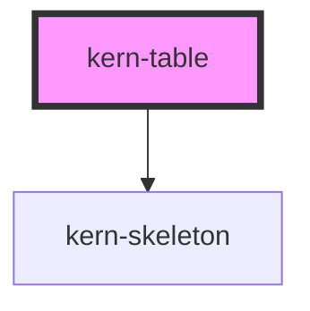

# kern-table


<!-- Auto Generated Below -->


## Overview

Dense data table: wraps a native `<table>` (light DOM, so cells can hold any markup and Angular bindings).
Sortable column: `<th sortable>`; `sorted="asc|desc"` is the current direction (the table sets `aria-sort`),
`data-key` names the column (else its index). `<td data-value="-71">` sorts by that value instead of the cell text.
Cells: `class="mono"` (IP, MAC, IDs), `class="num"` (right-aligned figures).
Rows: `class="clickable"`, `aria-selected="true"`, `class="dim"` (reset/inactive).
Empty state: `<td colspan="…" class="empty">`.

Data mode: with `columns` (and `rows`) the table builds its own `<table>`; don't combine it with own markup.
Assign new arrays to update it.

## Usage

### 01-device-table

# Device table

`kern-table` wraps a native `<table>` in the light DOM, so cells can hold any markup. Use `class="mono"` for IPs, MACs and IDs, `class="num"` for right-aligned figures, and `class="clickable"`, `aria-selected="true"` or `class="dim"` on rows.

```html
<kern-table>
  <table>
    <thead>
      <tr><th>Name</th><th>Model</th><th>IP</th><th>MAC</th><th>Signal</th><th>Status</th><th class="num">Power</th></tr>
    </thead>
    <tbody>
      <tr class="clickable">
        <td>Bathroom fan</td><td>Plus 1PM</td>
        <td class="mono">192.168.1.21</td>
        <td class="mono"><kern-copy>C82B961A3F00</kern-copy></td>
        <td><kern-signal rssi="-58" hide-value label="Wi-Fi signal"></kern-signal></td>
        <td><kern-status tone="ok">Active</kern-status></td>
        <td class="num">42 W</td>
      </tr>
      <tr class="clickable" aria-selected="true">
        <td>Kitchen light <kern-badge tone="warn">Update</kern-badge></td><td>Shelly 1</td>
        <td class="mono">192.168.1.34</td>
        <td class="mono"><kern-copy>A4CF12F45B21</kern-copy></td>
        <td><kern-signal rssi="-71" hide-value label="Wi-Fi signal"></kern-signal></td>
        <td><kern-status tone="ok">Active</kern-status></td>
        <td class="num">9 W</td>
      </tr>
      <tr class="clickable">
        <td>Shutter south</td><td>Pro 2PM</td>
        <td class="mono">192.168.1.52</td>
        <td class="mono"><kern-copy>34987A6E01C4</kern-copy></td>
        <td><kern-signal rssi="-84" hide-value label="Wi-Fi signal"></kern-signal></td>
        <td><kern-status tone="warn">Missing</kern-status></td>
        <td class="num">–</td>
      </tr>
      <tr class="dim">
        <td>Garage door</td><td>Plus Uni</td>
        <td class="mono">–</td>
        <td class="mono">E86BEA112B90</td>
        <td>–</td>
        <td><kern-status>Reset</kern-status></td>
        <td class="num">–</td>
      </tr>
    </tbody>
  </table>
</kern-table>
```


### 02-sortable

# Sortable columns

Mark a header with `sortable` and the table sorts its rows itself: numbers numerically, text in the page language, empty cells (and `–`) last. `sorted="asc|desc"` sets the initial order; the table keeps it and `aria-sort` up to date. Where a cell shows a component instead of its value, put the value in `data-value`. `compact` makes rows 30px instead of 36px.

```html
<kern-table compact>
  <table>
    <thead>
      <tr>
        <th sortable sorted="asc">Name</th>
        <th sortable>IP</th>
        <th sortable>Signal</th>
        <th sortable class="num">Uptime (h)</th>
      </tr>
    </thead>
    <tbody>
      <tr>
        <td>Kitchen light</td><td class="mono">192.168.1.34</td>
        <td data-value="-71"><kern-signal rssi="-71" hide-value label="Wi-Fi signal"></kern-signal></td>
        <td class="num">412</td>
      </tr>
      <tr>
        <td>Bathroom fan</td><td class="mono">192.168.1.21</td>
        <td data-value="-58"><kern-signal rssi="-58" hide-value label="Wi-Fi signal"></kern-signal></td>
        <td class="num">99</td>
      </tr>
      <tr>
        <td>Shutter south</td><td class="mono">192.168.1.52</td>
        <td data-value="-84"><kern-signal rssi="-84" hide-value label="Wi-Fi signal"></kern-signal></td>
        <td class="num">7</td>
      </tr>
      <tr>
        <td>Garage door</td><td class="mono">192.168.1.9</td>
        <td>–</td>
        <td class="num">–</td>
      </tr>
    </tbody>
  </table>
</kern-table>
```


### 03-external

# Controlled from outside

With `controlled="external"` the table does not touch the rows. A click on a sortable header (or `sortBy()`) only emits `kernSort` with `{ key, column, direction }`; your code loads or orders the data and sets `sorted` on the header. Use this when the server sorts, or when a framework renders the rows (Angular `@for`). `data-key` names a column, otherwise `key` is its index.

```html
<kern-table controlled="external">
  <table>
    <thead>
      <tr>
        <th sortable data-key="name">Name</th>
        <th sortable data-key="power" sorted="desc" class="num">Power (W)</th>
      </tr>
    </thead>
    <tbody></tbody>
  </table>
</kern-table>
```

```js
const devices = [
  { name: 'Bathroom fan', power: 42 },
  { name: 'Kitchen light', power: 9 },
  { name: 'Heat pump', power: 1840 },
];
const table = root.querySelector('kern-table');
const render = (key, direction) => {
  const sorted = [...devices].sort((a, b) => (a[key] < b[key] ? -1 : a[key] > b[key] ? 1 : 0) * (direction === 'asc' ? 1 : -1));
  root.querySelector('tbody').innerHTML = sorted.map((d) => `<tr><td>${d.name}</td><td class="num">${d.power}</td></tr>`).join('');
  root.querySelectorAll('th').forEach((th) => (th.dataset.key === key ? th.setAttribute('sorted', direction) : th.removeAttribute('sorted')));
};
table.addEventListener('kernSort', (ev) => render(ev.detail.key, ev.detail.direction));
render('power', 'desc');
```


### 04-empty

# Empty state

When a filter matches nothing, render a single cell spanning all columns with `class="empty"`.

```html
<kern-table>
  <table>
    <thead>
      <tr><th>Name</th><th>IP</th><th>Status</th></tr>
    </thead>
    <tbody>
      <tr><td colspan="3" class="empty">No devices match “garage”.</td></tr>
    </tbody>
  </table>
</kern-table>
```


### 05-data

# Built from data

Set `columns` and `rows` and the table builds its own `<table>`; don't combine this with own markup. Each column reads `row[key]`; `cell` returns a Node (for components like `kern-signal`) or text, `sortValue` what to sort by. `getRowClass`, `getCellClass` and `getHeaderCellClass` add classes; `kernRowClick` reports clicks on a row (not on buttons or fields in it). Assign new arrays to update the table. Sorting, `controlled` and `sortBy()` work as with markup.

```html
<kern-table></kern-table>
<p class="last-click">Click a row.</p>
```

```js
const el = (tag, attrs, text) => Object.assign(document.createElement(tag), attrs, text ? { textContent: text } : {});
const table = root.querySelector('kern-table');
table.columns = [
  { key: 'name', label: 'Name', sortable: true, sorted: 'asc' },
  { key: 'ip', label: 'IP', sortable: true, mono: true },
  {
    key: 'rssi', label: 'Signal', sortable: true,
    cell: (d) => (d.rssi == null ? '–' : Object.assign(el('kern-signal'), { rssi: d.rssi, hideValue: true, label: 'Wi-Fi signal' })),
  },
  {
    key: 'online', label: 'Status',
    cell: (d) => Object.assign(el('kern-status', {}, d.online ? 'Active' : 'Missing'), { tone: d.online ? 'ok' : 'warn' }),
  },
  { key: 'power', label: 'Power (W)', sortable: true, align: 'end' },
];
table.rows = [
  { name: 'Kitchen light', ip: '192.168.1.34', rssi: -71, online: true, power: 9 },
  { name: 'Bathroom fan', ip: '192.168.1.21', rssi: -58, online: true, power: 42 },
  { name: 'Shutter south', ip: '192.168.1.52', rssi: -84, online: false, power: null },
  { name: 'Garage door', ip: null, rssi: null, online: false, power: null, reset: true },
];
table.getRowClass = (d) => (d.reset ? 'dim' : 'clickable');
table.addEventListener('kernRowClick', (ev) => {
  root.querySelector('.last-click').textContent = `Clicked: ${ev.detail.row.name}`;
});
```


### 06-loading

# Loading

`loading` dims the content, shows a bar under the header and sets `aria-busy`. In data mode without rows it shows `loading-rows` skeleton rows instead; `label-empty` is the text for empty data. `loading` works with markup too.

```html
<kern-button>Reload</kern-button>
<kern-table loading></kern-table>
```

```js
const table = root.querySelector('kern-table');
const data = [
  { name: 'Kitchen light', uptime: 412 },
  { name: 'Bathroom fan', uptime: 99 },
];
table.columns = [
  { key: 'name', label: 'Name', sortable: true },
  { key: 'uptime', label: 'Uptime (h)', sortable: true, align: 'end' },
];
table.rows = [];
const load = () => {
  table.loading = true;
  setTimeout(() => {
    table.rows = data.map((d) => ({ ...d, uptime: d.uptime + Math.floor(Math.random() * 5) }));
    table.loading = false;
  }, 1500);
};
root.querySelector('kern-button').addEventListener('click', load);
load();
```


## Properties

| Property             | Attribute      | Description                                                                                                                                                                                   | Type                                                                                            | Default            |
| -------------------- | -------------- | --------------------------------------------------------------------------------------------------------------------------------------------------------------------------------------------- | ----------------------------------------------------------------------------------------------- | ------------------ |
| `columns`            | --             | Data mode: column definitions. The table builds its own `<table>` from them and `rows`.                                                                                                       | `KernTableColumn<any>[] \| undefined`                                                           | `undefined`        |
| `compact`            | `compact`      | 30px rows instead of 36px.                                                                                                                                                                    | `boolean`                                                                                       | `false`            |
| `controlled`         | `controlled`   | `internal`: the table sorts its rows itself. `external`: it only emits `kernSort`; the app orders the rows and sets `sorted` on the header (in data mode: new `rows` and `columns[].sorted`). | `"external" \| "internal"`                                                                      | `'internal'`       |
| `getCellClass`       | --             | Data mode: classes for a cell.                                                                                                                                                                | `((row: any, column: KernTableColumn<any>, index: number) => string \| undefined) \| undefined` | `undefined`        |
| `getHeaderCellClass` | --             | Data mode: classes for a header cell.                                                                                                                                                         | `((column: KernTableColumn<any>) => string \| undefined) \| undefined`                          | `undefined`        |
| `getRowClass`        | --             | Data mode: classes for a row, e.g. `clickable` or `dim`.                                                                                                                                      | `((row: any, index: number) => string \| undefined) \| undefined`                               | `undefined`        |
| `labelEmpty`         | `label-empty`  | Data mode: shown when `rows` is empty.                                                                                                                                                        | `string`                                                                                        | `'Keine Einträge'` |
| `loading`            | `loading`      | Loading: content dimmed, a bar under the header, `aria-busy`; in data mode without rows, skeleton rows.                                                                                       | `boolean`                                                                                       | `false`            |
| `loadingRows`        | `loading-rows` | Data mode: number of skeleton rows while loading without rows.                                                                                                                                | `number`                                                                                        | `3`                |
| `rows`               | --             | Data mode: one object per row; each column reads `row[column.key]`.                                                                                                                           | `any[] \| undefined`                                                                            | `undefined`        |


## Events

| Event          | Description                                                                                                                                   | Type                                                                          |
| -------------- | --------------------------------------------------------------------------------------------------------------------------------------------- | ----------------------------------------------------------------------------- |
| `kernRowClick` | Data mode: a row was clicked (not on a button, link or field in it). `index` is the position in `rows`.                                       | `CustomEvent<{ row: any; index: number; }>`                                   |
| `kernSort`     | A sortable header was activated (or `sortBy()` called), with the requested direction. Cancelable: `preventDefault()` skips the built-in sort. | `CustomEvent<{ key: string; column: number; direction: KernSortDirection; }>` |


## Methods

### `sortBy(column: string | number, direction?: KernSortDirection) => Promise<void>`

Sorts by a column (`data-key` or index); without `direction` it toggles, starting with `asc`. With `controlled="external"` it only emits `kernSort`.

#### Parameters

| Name        | Type                             | Description |
| ----------- | -------------------------------- | ----------- |
| `column`    | `string \| number`               |             |
| `direction` | `KernSortDirection \| undefined` |             |

#### Returns

Type: `Promise<void>`


## Slots

| Slot | Description                           |
| ---- | ------------------------------------- |
|      | A native `<table>` (not in data mode) |


## Dependencies

### Depends on

- [kern-skeleton](../kern-skeleton)

### Graph


----------------------------------------------


