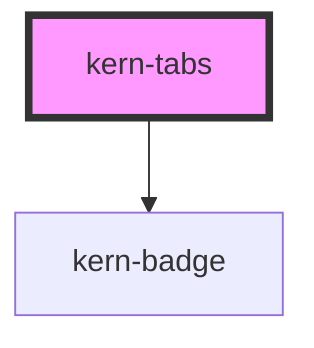

# kern-tabs

<!-- Auto Generated Below -->

## Overview

Switches between views of the same object (Config / Status / Snapshots). Tabs are built from the
kern-tab-panel children; arrow keys, Home and End move between them.

## Properties

| Property | Attribute | Description                                          | Type                  | Default     |
| -------- | --------- | ---------------------------------------------------- | --------------------- | ----------- |
| `label`  | `label`   | Accessible name of the tab list.                     | `string \| undefined` | `undefined` |
| `value`  | `value`   | `name` of the selected panel; defaults to the first. | `string \| undefined` | `undefined` |

## Events

| Event           | Description | Type                              |
| --------------- | ----------- | --------------------------------- |
| `kernTabChange` |             | `CustomEvent<{ value: string; }>` |

## Slots

| Slot | Description             |
| ---- | ----------------------- |
|      | kern-tab-panel elements |

## Shadow Parts

| Part        | Description     |
| ----------- | --------------- |
| `"tab"`     | Each tab button |
| `"tablist"` | The tab row     |

## Dependencies

### Depends on

- [kern-badge](../kern-badge)

### Graph

----------------------------------------------

