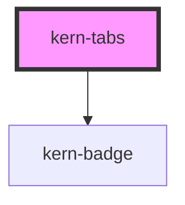

# kern-tabs


<!-- Auto Generated Below -->


## Overview

Switches between views of the same object (Config / Status / Snapshots). Tabs are built from the
kern-tab-panel children; arrow keys, Home and End move between them.

## Usage

### 01-basic

# Views of one device

Each kern-tab-panel becomes a tab: `label` is the tab text, `name` the value kern-tabs selects by, and `count` adds a number badge. `label` on kern-tabs names the tab list for screen readers.

```html
<kern-tabs label="Device data" style="max-width:520px">
  <kern-tab-panel name="config" label="Config">
    <kern-kv>
      <kern-kv-item label="Name">Bad Lüftung</kern-kv-item>
      <kern-kv-item label="IP" mono>192.168.1.21</kern-kv-item>
    </kern-kv>
  </kern-tab-panel>
  <kern-tab-panel name="status" label="Status">
    <kern-progress label="Installing firmware …"></kern-progress>
  </kern-tab-panel>
  <kern-tab-panel name="snapshots" label="Snapshots" count="12">
    <p style="margin:0;color:var(--text-muted)">12 snapshots, the latest from today 09:41.</p>
  </kern-tab-panel>
</kern-tabs>
```


### 02-value-and-event

# Selected tab and change event

`value` picks the initially selected panel by its `name` (the first one by default) and reflects the current choice. `kernTabChange` fires when the user switches tabs.

```html
<kern-tabs label="Log" value="warnings" style="max-width:520px">
  <kern-tab-panel name="all" label="All" count="128">All events of the last 24 hours.</kern-tab-panel>
  <kern-tab-panel name="warnings" label="Warnings" count="3">Rollladen Süd was not reachable 3 times.</kern-tab-panel>
  <kern-tab-panel name="errors" label="Errors" count="0">No errors.</kern-tab-panel>
</kern-tabs>
<p class="out" style="font-size:13px;color:var(--text-muted)">Switch a tab.</p>
```

```js
root.querySelector('kern-tabs').addEventListener('kernTabChange', (e) => {
  root.querySelector('.out').textContent = `kernTabChange → ${e.detail.value}`;
});
```


### 03-keyboard

# Keyboard

Only the selected tab is in the Tab order. Arrow Left and Arrow Right move to the previous or next tab (wrapping around), Home and End jump to the first and last. Tab then moves into the panel.

```html
<kern-tabs label="Rooms" style="max-width:520px">
  <kern-tab-panel name="bath" label="Bath" count="2">Bad Lüftung, Bad Licht</kern-tab-panel>
  <kern-tab-panel name="kitchen" label="Kitchen" count="1">Küche Licht</kern-tab-panel>
  <kern-tab-panel name="living" label="Living room" count="3">Rollladen Süd, Stehlampe, Heizung</kern-tab-panel>
  <kern-tab-panel name="garage" label="Garage" count="1">Garage Tor</kern-tab-panel>
</kern-tabs>
```


## Properties

| Property | Attribute | Description                                          | Type                  | Default     |
| -------- | --------- | ---------------------------------------------------- | --------------------- | ----------- |
| `label`  | `label`   | Accessible name of the tab list.                     | `string \| undefined` | `undefined` |
| `value`  | `value`   | `name` of the selected panel; defaults to the first. | `string \| undefined` | `undefined` |


## Events

| Event           | Description | Type                              |
| --------------- | ----------- | --------------------------------- |
| `kernTabChange` |             | `CustomEvent<{ value: string; }>` |


## Slots

| Slot | Description             |
| ---- | ----------------------- |
|      | kern-tab-panel elements |


## Shadow Parts

| Part        | Description     |
| ----------- | --------------- |
| `"tab"`     | Each tab button |
| `"tablist"` | The tab row     |


## Dependencies

### Depends on

- [kern-badge](../kern-badge)

### Graph


----------------------------------------------


