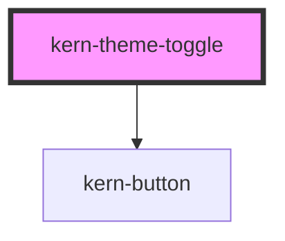

# kern-theme-toggle


<!-- Auto Generated Below -->


## Overview

Icon button switching between dark (default) and light; remembers the choice (localStorage `kern-theme`).
The icon shows the current theme (moon = dark). Set the theme before first paint with `initTheme()`
or the inline snippet from the README.

## Usage

### 01-basic

# Dark and light theme

The button switches between dark (default) and light and remembers the choice in localStorage (`kern-theme`). `small` makes it 28px for the topbar. Its accessible label describes the action (`label-light`, `label-dark`).

```html
<div style="display:flex;gap:12px;align-items:center">
  <kern-theme-toggle></kern-theme-toggle>
  <kern-theme-toggle small></kern-theme-toggle>
</div>
```


## Properties

| Property     | Attribute     | Description                   | Type                  | Default     |
| ------------ | ------------- | ----------------------------- | --------------------- | ----------- |
| `labelDark`  | `label-dark`  | Accessible label while light. | `string \| undefined` | `undefined` |
| `labelLight` | `label-light` | Accessible label while dark.  | `string \| undefined` | `undefined` |
| `small`      | `small`       | 28px instead of 34px.         | `boolean`             | `false`     |


## Dependencies

### Depends on

- [kern-button](../kern-button)

### Graph


----------------------------------------------


