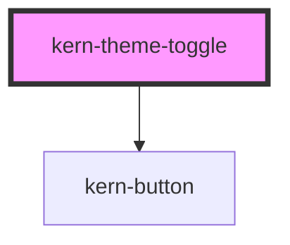

# kern-theme-toggle

<!-- Auto Generated Below -->

## Overview

Icon button switching between dark (default) and light; remembers the choice (localStorage `kern-theme`).
The icon shows the current theme (moon = dark). Set the theme before first paint with `initTheme()`
or the inline snippet from the README.

## Properties

| Property     | Attribute     | Description                   | Type      | Default                        |
| ------------ | ------------- | ----------------------------- | --------- | ------------------------------ |
| `labelDark`  | `label-dark`  | Accessible label while light. | `string`  | `'Zu dunklem Design wechseln'` |
| `labelLight` | `label-light` | Accessible label while dark.  | `string`  | `'Zu hellem Design wechseln'`  |
| `small`      | `small`       | 28px instead of 34px.         | `boolean` | `false`                        |

## Dependencies

### Depends on

- [kern-button](../kern-button)

### Graph

----------------------------------------------

