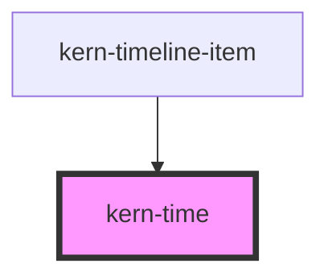

# kern-time


<!-- Auto Generated Below -->


## Overview

Time of day („06:30“) or duration („1 Std., 23 Min.“) as `<time>`. Set either `value` or `duration`.
Invalid values are shown as given.

## Usage

### 01-time-of-day

# Time of day

`value` takes `HH:mm[:ss]`, or a point in time whose time is shown. `seconds` adds seconds, `hour12` forces the 12-hour clock, and `mono` uses monospace digits.

```html
<kern-kv>
  <kern-kv-item label="Schedule">daily at <kern-time value="06:30"></kern-time></kern-kv-item>
  <kern-kv-item label="12-hour"><kern-time value="18:45" hour12></kern-time></kern-kv-item>
  <kern-kv-item label="Last ping"><kern-time value="2026-10-19T09:41:27Z" seconds mono time-zone="Europe/Zurich"></kern-time></kern-kv-item>
</kern-kv>
```


### 02-duration

# Durations

`duration` takes an ISO 8601 duration (`PT1H23M`) or a number of seconds, e.g. a device's `sys.uptime`. It takes precedence over `value`.

```html
<kern-kv>
  <kern-kv-item label="Uptime"><kern-time duration="356420"></kern-time></kern-kv-item>
  <kern-kv-item label="Auto-off"><kern-time duration="PT15M"></kern-time></kern-kv-item>
  <kern-kv-item label="Firmware update"><kern-time duration="PT1M30S"></kern-time></kern-kv-item>
  <kern-kv-item label="Maintenance window"><kern-time duration="PT2H"></kern-time></kern-kv-item>
</kern-kv>
```


## Properties

| Property   | Attribute   | Description                                                                                             | Type                                    | Default     |
| ---------- | ----------- | ------------------------------------------------------------------------------------------------------- | --------------------------------------- | ----------- |
| `duration` | `duration`  | ISO 8601 duration (`PT1H23M`) or seconds (`5025`, e.g. uptime). Takes precedence over `value`.          | `number \| string \| undefined`         | `undefined` |
| `hour12`   | `hour-1-2`  | 12-hour clock; defaults to the locale.                                                                  | `boolean \| undefined`                  | `undefined` |
| `locale`   | `locale`    | BCP 47 locale; defaults to `<html lang>`, then the browser language.                                    | `string \| undefined`                   | `undefined` |
| `mono`     | `mono`      | Monospace digits, e.g. in tables next to IDs.                                                           | `boolean`                               | `false`     |
| `seconds`  | `seconds`   | Show seconds of a time of day.                                                                          | `boolean`                               | `false`     |
| `timeZone` | `time-zone` | IANA time zone for points in time; defaults to the browser's.                                           | `string \| undefined`                   | `undefined` |
| `value`    | `value`     | Time of day `HH:mm[:ss]`, or an ISO 8601 point in time / epoch milliseconds / Date whose time is shown. | `Date \| number \| string \| undefined` | `undefined` |


## Dependencies

### Used by

 - [kern-timeline-item](../kern-timeline-item)

### Graph


----------------------------------------------


