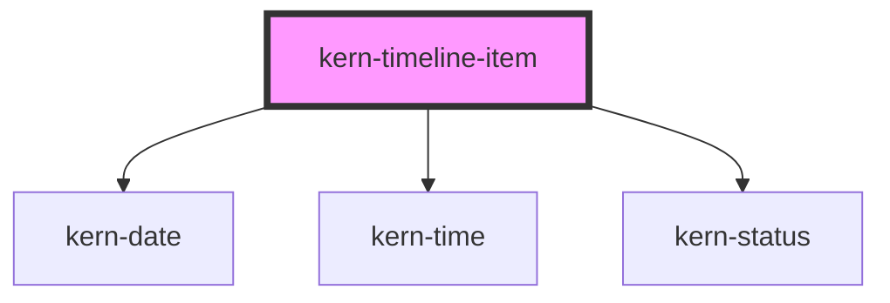

# kern-timeline-item

<!-- Auto Generated Below -->

## Overview

One event of kern-timeline: a marker on the line, heading, point in time, description and optional details and
actions. The marker has a shape per tone like kern-status (ok = circle, warn = diamond, danger = square,
busy = pulsing circle, neutral = hollow circle), with `icon` inside. Colour and shape are decoration: the heading
or the `status` word says what happened.

`collapsible` hides the `details` slot behind a «Show details» button (`aria-expanded`, Enter/Space).

## Properties

| Property      | Attribute     | Description                                                                                                    | Type                                                                                                                                                                                                                                                                                                                                                                                                                                                                 | Default     |
| ------------- | ------------- | -------------------------------------------------------------------------------------------------------------- | -------------------------------------------------------------------------------------------------------------------------------------------------------------------------------------------------------------------------------------------------------------------------------------------------------------------------------------------------------------------------------------------------------------------------------------------------------------------- | ----------- |
| `collapsible` | `collapsible` | Hides the `details` slot behind a button.                                                                      | `boolean`                                                                                                                                                                                                                                                                                                                                                                                                                                                            | `false`     |
| `datetime`    | `datetime`    | When: ISO 8601 point in time, epoch milliseconds or a Date. Shown with kern-date or, in day groups, kern-time. | `Date \| number \| string \| undefined`                                                                                                                                                                                                                                                                                                                                                                                                                              | `undefined` |
| `heading`     | `heading`     | What happened, e.g. «Firmware updated».                                                                        | `string \| undefined`                                                                                                                                                                                                                                                                                                                                                                                                                                                | `undefined` |
| `icon`        | `icon`        | Glyph in the marker (see kern-icon).                                                                           | `"bulb" \| "calendar" \| "check" \| "chevron-down" \| "chevron-left" \| "chevron-right" \| "chevron-up" \| "clock" \| "close" \| "copy" \| "download" \| "edit" \| "external" \| "eye" \| "eye-off" \| "filter" \| "home" \| "inbox" \| "info" \| "link" \| "lock" \| "menu" \| "minus" \| "moon" \| "more" \| "plus" \| "power" \| "refresh" \| "search" \| "settings" \| "star" \| "sun" \| "thermometer" \| "trash" \| "upload" \| "warn" \| "wifi" \| undefined` | `undefined` |
| `labelHide`   | `label-hide`  | Text of the button that hides the details; defaults to the Kern text.                                          | `string \| undefined`                                                                                                                                                                                                                                                                                                                                                                                                                                                | `undefined` |
| `labelShow`   | `label-show`  | Text of the button that shows the details; defaults to the Kern text.                                          | `string \| undefined`                                                                                                                                                                                                                                                                                                                                                                                                                                                | `undefined` |
| `open`        | `open`        | Whether collapsible details are shown.                                                                         | `boolean`                                                                                                                                                                                                                                                                                                                                                                                                                                                            | `false`     |
| `relative`    | `relative`    | Shows the point in time relative to now («3 hours ago»); the absolute value is the tooltip.                    | `boolean`                                                                                                                                                                                                                                                                                                                                                                                                                                                            | `false`     |
| `status`      | `status`      | State as a word beside the heading (a kern-status with `tone`), e.g. «Offline».                                | `string \| undefined`                                                                                                                                                                                                                                                                                                                                                                                                                                                | `undefined` |
| `tone`        | `tone`        | Shape and colour of the marker, as in kern-status.                                                             | `"busy" \| "danger" \| "neutral" \| "ok" \| "warn"`                                                                                                                                                                                                                                                                                                                                                                                                                  | `'neutral'` |

## Events

| Event        | Description                                  | Type                              |
| ------------ | -------------------------------------------- | --------------------------------- |
| `kernToggle` | After the user opened or closed the details. | `CustomEvent<{ open: boolean; }>` |

## Slots

| Slot        | Description                                   |
| ----------- | --------------------------------------------- |
|             | Description: one or two sentences             |
| `"actions"` | Buttons or links, e.g. «Open update log»      |
| `"details"` | Longer details, e.g. a kern-kv or a changelog |

## Shadow Parts

| Part        | Description                                                                             |
| ----------- | --------------------------------------------------------------------------------------- |
| `"day"`     | The day heading above the first event of a day (with `group-by="day"` on kern-timeline) |
| `"details"` | The details area                                                                        |
| `"heading"` | The heading                                                                             |
| `"marker"`  | The marker on the line                                                                  |

## Dependencies

### Depends on

- [kern-date](../kern-date)
- [kern-time](../kern-time)
- [kern-status](../kern-status)

### Graph

----------------------------------------------

