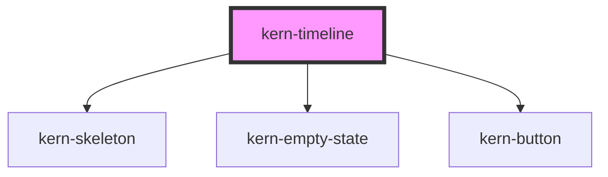

# kern-timeline


<!-- Auto Generated Below -->


## Overview

History of events, e.g. of a device: «Discovered → Firmware updated → Connection lost → Online again». A list
of kern-timeline-item children in the order the app gives them (newest or oldest first); screen readers read
them in the order they are shown. `group-by="day"` puts a day heading («Today», «Yesterday», a date) above the
first event of each day.

`loading` shows placeholders while there are no events yet, `empty` (or the `empty` slot) when there are none.
With `has-more` a «Load more» button after the last event emits `kernLoadMore`; the app appends the next events
and clears `loading`. Focus and reading position stay where they are: new events at the top do not move the
events being read, and after loading more a short status names the number of new events. If the button goes
away, focus moves to the first new event.

## Usage

### 01-device-history

# Device history

`kern-timeline` shows what happened to a device, in the order the app gives the events: here newest first. Each `kern-timeline-item` has a `heading`, a `datetime` and a `tone` whose marker has its own shape (ok = circle, warn = diamond, danger = square), so the tone does not depend on colour. The heading says what happened; `status` adds the state as a word. The default slot holds a short description, `actions` the buttons that help.

```html
<kern-timeline label="History of Bathroom fan">
  <kern-timeline-item heading="Back online" tone="ok" icon="wifi" status="Online" relative data-ago="600">
    Reconnected after 42 minutes.
  </kern-timeline-item>
  <kern-timeline-item heading="Connection lost" tone="danger" icon="wifi" status="Offline" relative data-ago="3120">
    No response from 192.168.1.21.
    <kern-button slot="actions" size="sm" variant="ghost">Show log</kern-button>
  </kern-timeline-item>
  <kern-timeline-item heading="Firmware updated" tone="ok" icon="download" relative data-ago="86400">
    Version 1.4.2 was installed.
  </kern-timeline-item>
  <kern-timeline-item heading="Signal weak" tone="warn" relative data-ago="259200">
    −78 dBm for more than an hour.
  </kern-timeline-item>
  <kern-timeline-item heading="Device discovered" icon="search" relative data-ago="1209600">
    Shelly Plus 1PM, added to Bathroom.
  </kern-timeline-item>
</kern-timeline>
```

```js
for (const el of root.querySelectorAll('[data-ago]')) el.datetime = Date.now() - el.dataset.ago * 1000;
```


### 02-day-groups

# Day groups

`group-by="day"` puts a day heading above the first event of each day: “Today”, “Yesterday”, then the full date, in the page language. Times then show without the date. Without `relative` the item shows the time of day; the heading updates at midnight.

```html
<kern-timeline group-by="day" label="Events of Shutter south">
  <kern-timeline-item heading="Moved to 40 %" data-ago="1800"></kern-timeline-item>
  <kern-timeline-item heading="Calibration finished" tone="ok" data-ago="7200"></kern-timeline-item>
  <kern-timeline-item heading="Motor overheated" tone="danger" status="Stopped" data-ago="90000">
    Stopped for 15 minutes to cool down.
  </kern-timeline-item>
  <kern-timeline-item heading="Moved to 100 %" data-ago="95000"></kern-timeline-item>
  <kern-timeline-item heading="Schedule changed" icon="calendar" data-ago="280000">
    Closes at sunset instead of 21:00.
  </kern-timeline-item>
</kern-timeline>
```

```js
for (const el of root.querySelectorAll('[data-ago]')) el.datetime = Date.now() - el.dataset.ago * 1000;
```


### 03-details

# Details

The `details` slot takes longer content, such as a kern-kv or a log excerpt. With `collapsible` it sits behind a “Show details” button (`aria-expanded`, Enter or Space), so the history stays short; `open` shows it from the start and `kernToggle` reports `{ open }`. Actions stay visible either way.

```html
<kern-timeline label="Update history">
  <kern-timeline-item heading="Firmware updated" tone="ok" icon="download" datetime="2026-10-21T06:30:00Z" collapsible>
    Version 1.4.2 was installed.
    <kern-kv slot="details">
      <kern-kv-item label="Before" mono>1.3.9</kern-kv-item>
      <kern-kv-item label="After" mono>1.4.2</kern-kv-item>
      <kern-kv-item label="Duration">2 min 14 s</kern-kv-item>
    </kern-kv>
    <kern-button slot="actions" size="sm" variant="ghost">Open update log</kern-button>
  </kern-timeline-item>
  <kern-timeline-item heading="Update failed" tone="danger" icon="download" status="Failed" datetime="2026-10-20T06:30:00Z" collapsible open>
    The download stopped at 63 %.
    <kern-code slot="details" wrap code="06:31:02 download 63 % (1.2 MB of 1.9 MB)&#10;06:31:32 timeout after 30 s, update cancelled"></kern-code>
    <kern-button slot="actions" size="sm">Try again</kern-button>
  </kern-timeline-item>
</kern-timeline>
<p class="out" style="color:var(--text-muted);font-size:13px"></p>
```

```js
const out = root.querySelector('.out');
root.querySelector('kern-timeline').addEventListener('kernToggle', (e) => (out.textContent = `kernToggle → ${JSON.stringify(e.detail)}`));
```


### 04-load-more

# Load more and live events

With `has-more` a “Load more” button follows the last event and emits `kernLoadMore`. Set `loading` while fetching (the button turns busy), append the next events, then clear `loading` and, after the last page, `has-more`. The new events appear below the ones being read, a short status tells screen readers how many arrived, and if the button goes away, focus moves to the first new event. The app owns the cursor; Kern never sorts.

New events arrive at the top with plain DOM inserts (`prepend`, or a keyed list in a framework): focus stays where it is, and once the reader has scrolled into the history the events being read stay in place. Re-creating the whole list would lose both, so update it in place.

```html
<kern-timeline label="History of Boiler" has-more>
  <kern-timeline-item heading="Heating on" tone="ok" icon="thermometer" relative data-ago="300"></kern-timeline-item>
  <kern-timeline-item heading="Target set to 55 °C" relative data-ago="3600">
    <kern-button slot="actions" size="sm" variant="ghost">Undo</kern-button>
  </kern-timeline-item>
</kern-timeline>
<kern-toolbar style="margin-top:var(--space-4)">
  <kern-button class="live" size="sm">Simulate new event</kern-button>
</kern-toolbar>
```

```js
const timeline = root.querySelector('kern-timeline');
const item = (heading, ago, tone = 'neutral') => {
  const el = document.createElement('kern-timeline-item');
  Object.assign(el, { heading, tone, relative: true, datetime: Date.now() - ago * 1000 });
  return el;
};
for (const el of root.querySelectorAll('[data-ago]')) el.datetime = Date.now() - el.dataset.ago * 1000;

let page = 0;
timeline.addEventListener('kernLoadMore', async () => {
  timeline.loading = true;
  await new Promise((r) => setTimeout(r, 800)); // the app's request with its cursor
  page++;
  for (let i = 0; i < 3; i++) timeline.append(item(`Temperature reached ${60 - page * 3 - i} °C`, 3600 * (page * 4 + i)));
  timeline.loading = false;
  timeline.hasMore = page < 2;
});

let n = 0;
root.querySelector('.live').addEventListener('click', () => timeline.prepend(item(`Heating cycle ${++n} finished`, 0, 'ok')));
```

```ts Angular
// Keep events in a signal and render them with a keyed @for, so inserts keep focus and position.
events = signal<Event[]>([]);
async loadMore() {
  this.loading.set(true);
  const page = await this.api.history(this.deviceId, this.cursor);
  this.cursor = page.next;
  this.events.update((list) => [...list, ...page.events]);
  this.loading.set(false);
}
```


### 05-states

# Loading and empty

While `loading` is set and there are no events yet, placeholders in the shape of events show (hidden from screen readers; the list is `aria-busy`). Without events the timeline shows a compact empty state with the `empty` heading. Put your own `kern-empty-state` in the `empty` slot for errors, with an action to try again.

```html
<kern-timeline class="loading" loading></kern-timeline>
<kern-timeline empty="No events in the last 30 days" style="margin-top:var(--space-5)"></kern-timeline>
<kern-timeline style="margin-top:var(--space-5)">
  <kern-empty-state slot="empty" variant="error" compact>
    The history could not be loaded.
    <kern-button slot="actions" size="sm">Try again</kern-button>
  </kern-empty-state>
</kern-timeline>
```


## Properties

| Property      | Attribute      | Description                                                                                | Type                  | Default     |
| ------------- | -------------- | ------------------------------------------------------------------------------------------ | --------------------- | ----------- |
| `empty`       | `empty`        | Heading of the empty state; empty string shows nothing. Defaults to the Kern text.         | `string \| undefined` | `undefined` |
| `groupBy`     | `group-by`     | `day` = a day heading above the first event of each day; times then show without the date. | `"day" \| "none"`     | `'none'`    |
| `hasMore`     | `has-more`     | More events can be loaded: shows the «Load more» button.                                   | `boolean`             | `false`     |
| `label`       | `label`        | Accessible name of the list, e.g. «History of Bathroom fan».                               | `string \| undefined` | `undefined` |
| `labelLoaded` | `label-loaded` | Status after loading more, `{n}` = number of new events; defaults to the Kern text.        | `string \| undefined` | `undefined` |
| `labelMore`   | `label-more`   | Text of the «Load more» button; defaults to the Kern text.                                 | `string \| undefined` | `undefined` |
| `loading`     | `loading`      | Events are being loaded: placeholders without events, a busy «Load more» button with them. | `boolean`             | `false`     |


## Events

| Event          | Description                                                                       | Type                |
| -------------- | --------------------------------------------------------------------------------- | ------------------- |
| `kernLoadMore` | «Load more» was pressed. Append the next events and set `loading` while fetching. | `CustomEvent<void>` |


## Slots

| Slot      | Description                                                                              |
| --------- | ---------------------------------------------------------------------------------------- |
|           | kern-timeline-item elements                                                              |
| `"empty"` | Replaces the empty state, e.g. a kern-empty-state with `variant="error"` and «Try again» |
| `"more"`  | Replaces the «Load more» button, e.g. a link to the full history                         |


## Shadow Parts

| Part     | Description                        |
| -------- | ---------------------------------- |
| `"list"` | The list                           |
| `"more"` | The area of the «Load more» button |


## Dependencies

### Depends on

- [kern-skeleton](../kern-skeleton)
- [kern-empty-state](../kern-empty-state)
- [kern-button](../kern-button)

### Graph


----------------------------------------------


